# StaffWare — Simple Guide to Screens and Workflows

This guide explains where to click, how the forms usually work, and how the main parts of StaffWare connect. It is written for people using the software, not just developers.

> **Safety:** Use training or test data when learning. Payroll, invoices, inventory posting, and Database Maintenance can change real business records.

> **About the screenshots:** they were captured from the running web app using fictional sample data (builder "Sample Homes Inc.", job "Oak Ridge Estates", and so on). Your screens will show your own company's records. Job Setup is used as the worked example because every module follows the same pattern.

## Quick tour: your first five minutes

| Step | What you do | What you see |
|---|---|---|
| **1** | Open the site and sign in. | Login page below. |
| **2** | Land on the Dashboard. | Reminders, totals, and module shortcuts. |
| **3** | Pick a module on the left (or press **Ctrl K**). | The module's overview with tabs. |
| **4** | Open a list, search, and click a row. | The record's form. |
| **5** | Edit, then **Save**. | A success or error message. |

### Step 1 — Sign in

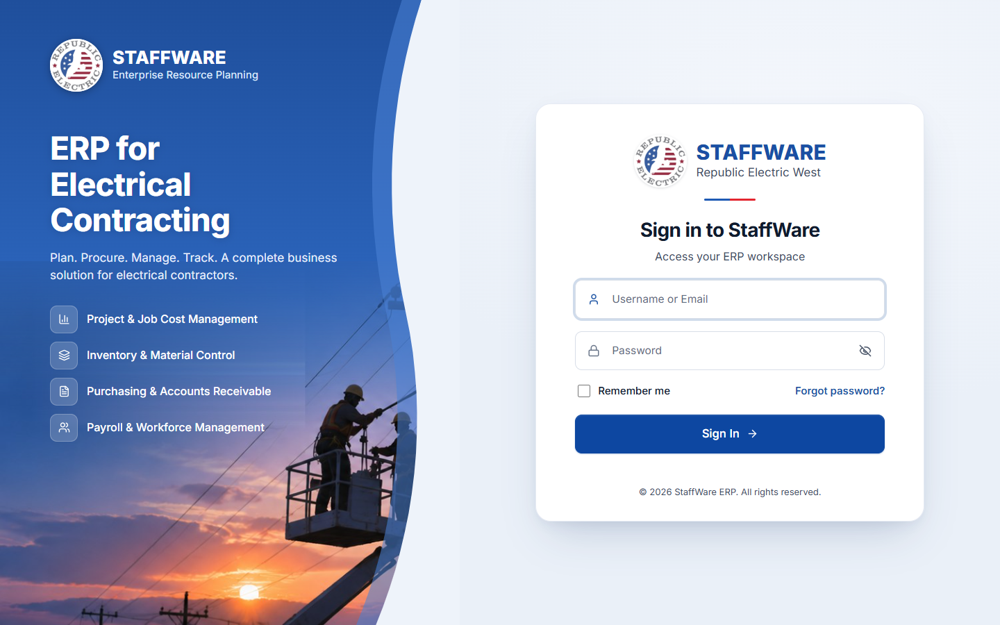

1. Type your **Username or Email** and **Password**. The eye icon shows or hides the password.
2. Tick **Remember me** to have the username filled in next time.
3. Click **Sign In** (or press Enter).

**Behind the scenes:** the page sends your login to the server, which replies with your name and the list of modules you are allowed to use. The login itself is kept in a protected browser cookie that page scripts cannot read. The menu is drawn from your module list, and the server checks permission again on every request.

### Step 2 — The Dashboard

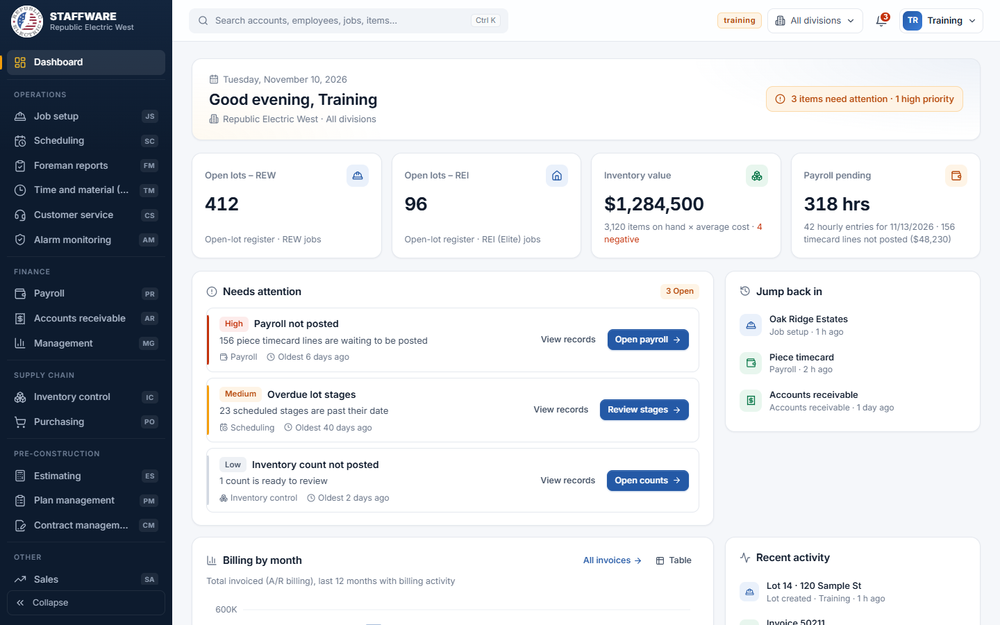

| Area | What it tells you | Click to… |
|---|---|---|
| **Left menu** | Every module you may use, grouped (Operations, Finance, Supply chain…). The two-letter code is the module's permission code. | Open that module. |
| **Top bar** | Search, an environment tag (here "training"), the **division** filter, the alerts bell, and your account menu. | Search, switch division, see alerts. |
| **Welcome banner** | Date, your name, selected division, and a count of items needing attention. | Jump to the attention list. |
| **KPI cards** | Open lots (REW and REI), inventory value, payroll pending. Only cards for modules you can use appear. | Open the matching detail report. |
| **Needs attention** | Prioritized to-dos (High / Medium / Low) such as unposted payroll or overdue stages. | **Open…** goes to the screen that fixes it; **View records** lists the underlying rows. |
| **Jump back in** | The last screens you opened on this computer. | Return to that screen. |
| **Charts and Recent activity** | Billing by month, piece-rate payroll, and a feed of latest changes. | Click a bar to see that month or pay date. |

**Behind the scenes:** the Dashboard makes four requests (summary, attention, charts, activity). Changing the **division** in the top bar re-runs the summary only. "Jump back in" is stored in your browser, so it is per computer, not per user.

### Step 3 — Search from anywhere (Ctrl K)

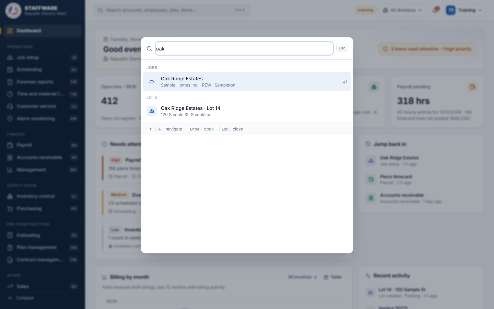

Press **Ctrl K** (or click the search box), then type at least two letters. Modules matching your text appear first, followed by matching jobs, lots, accounts, employees, items, and so on. Use ↑ / ↓ to move, **Enter** to open, **Esc** to close.

**Behind the scenes:** after a short pause in typing, the page asks the server to search. Modules are filtered locally from your permission list.

## 1. Find your way around

After signing in, use the app like this:

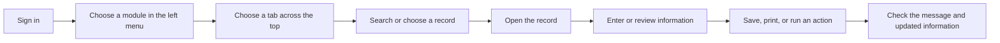

**A module's overview page** (example: Job Setup). The tabs across the top (Overview, Builders, Jobs, Lots, Reports, Lists) are the module's screens.

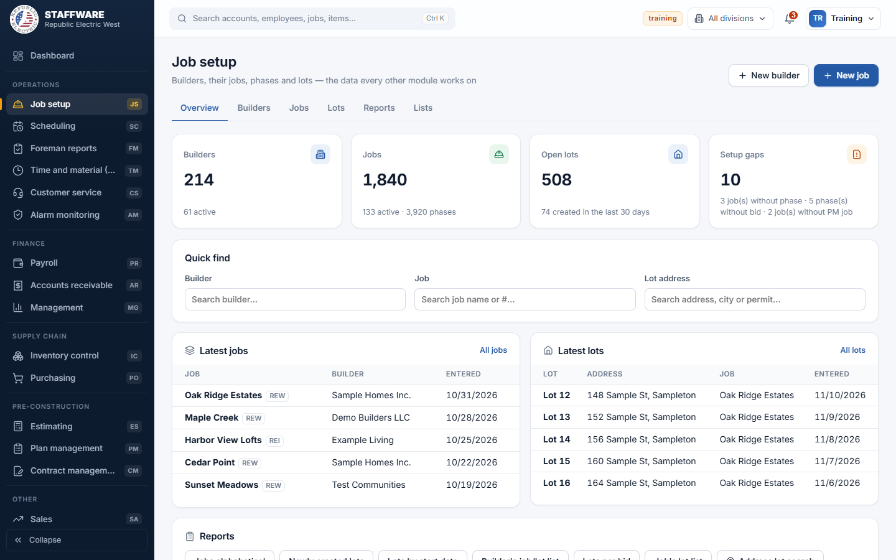

- **Overview cards** are counts that you can click to open the filtered list.
- **Quick find** looks up a builder, job, or lot address and opens it directly.
- **Latest jobs / Latest lots** open a record when you click a row.
- **Reports** buttons open a prepared report with its filters.

**A list screen** (example: Jobs):

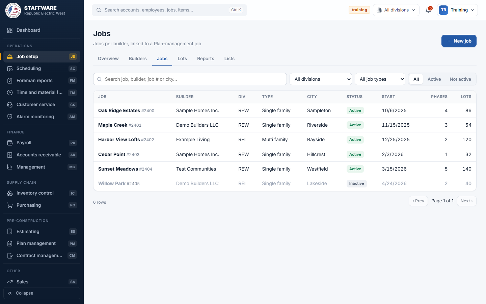

1. Type in the search box. The list updates after a short pause.
2. Narrow it with the **division**, **job type**, and **All / Active / Not active** controls. Filters are kept in the page address, so you can bookmark or share the filtered view.
3. Click a row to open its record. Greyed rows are inactive.
4. Use **Prev / Next** at the bottom (25 rows per page here).

- **Left menu:** choose an area of work, such as Job Setup, Payroll, or Purchasing.
- **Tabs across the page:** move between that area's overview, records, and reports.
- **Search and filters:** narrow a list. A row is often clickable to open its details.
- **Back / breadcrumb links:** return to the list or parent record.
- **Dashboard:** shows reminders and shortcuts. Selecting a reminder opens related records.
- **No access message:** your login may not have permission for that module. Ask an administrator.

### Common buttons

| Button or control | What it usually does |
|---|---|
| **New / Add / +** | Opens a blank form to create a record. |
| **Pencil / Edit** | Opens an existing record for changes. |
| **Save / Create** | Sends the form to be saved. Look for a success message or updated record. |
| **Delete / trash** | Removes a record. Read the confirmation carefully; some deletes cannot be undone. |
| **Search** | Finds matching records. Some lists search while you type; others need Enter or a short pause. |
| **Filters / dates** | Limit which records or report rows are shown. |
| **Print / CSV** | Prints the displayed information or downloads a spreadsheet. |
| **Post / Process / Transfer / Update** | Performs a business action that may write many records. Review its confirmation and result count. |

## 2. How to use a form

Most entry screens follow the same pattern:

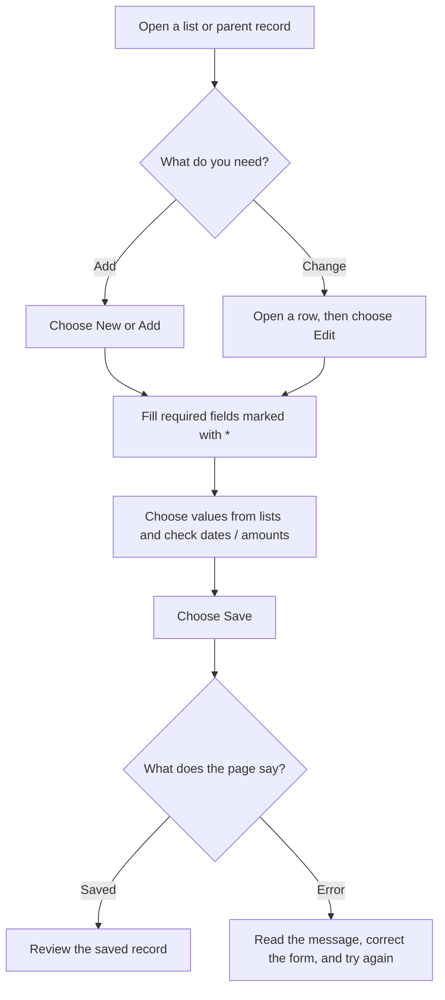

### Editing an existing record

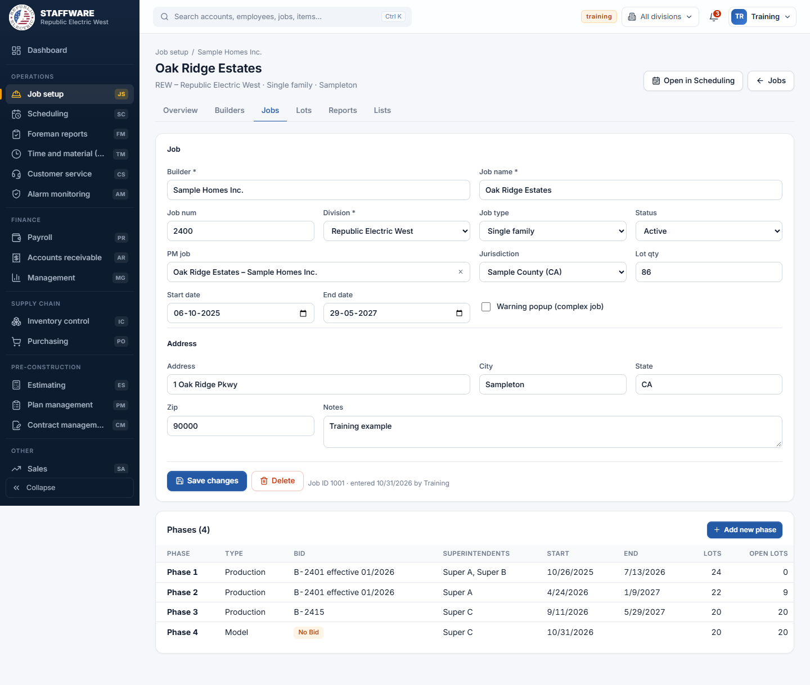

1. The **breadcrumb** (Job setup / Sample Homes Inc.) shows the parent record; click it to go up a level.
2. Fields marked `*` are required. The **Builder** is locked once the job exists.
3. Search boxes (such as **PM job**) are type-ahead pickers: type, then click a match. The **×** clears it.
4. **Save changes** sends only what you changed. If nothing changed, you see "Nothing changed".
5. **Child tables** (here **Phases**) sit under the form. Click a row to open it, or **Add new phase**.
6. The footer shows the record ID and who entered it and when.

### Creating a new record

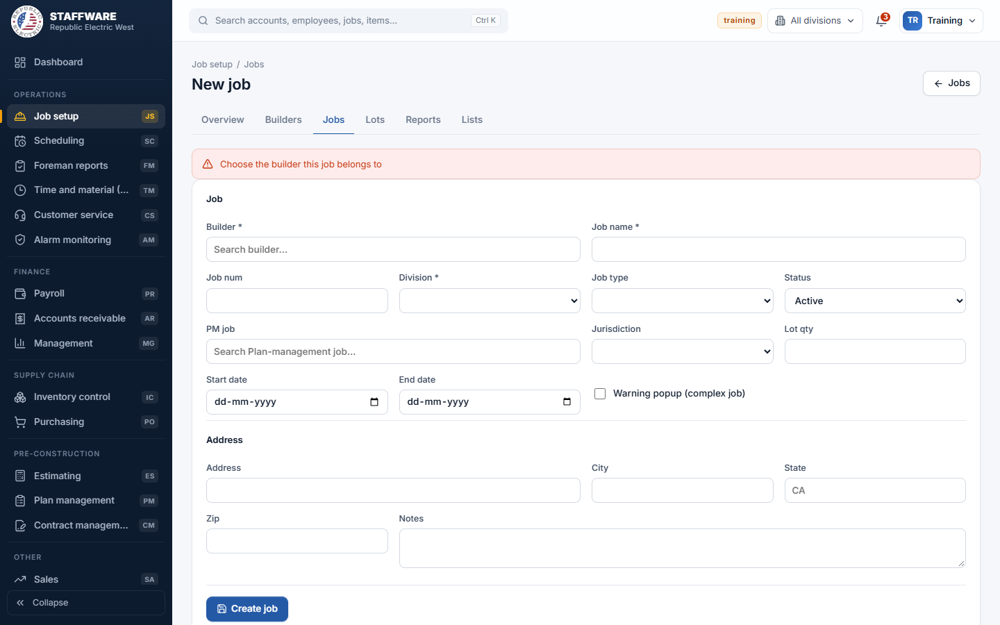

Choose **New job**. If you click **Create job** without a required value, a red message explains what is missing (here, the builder) and nothing is saved. Fix it and save again. After a successful create, the app opens the new record.

### Deleting and risky links

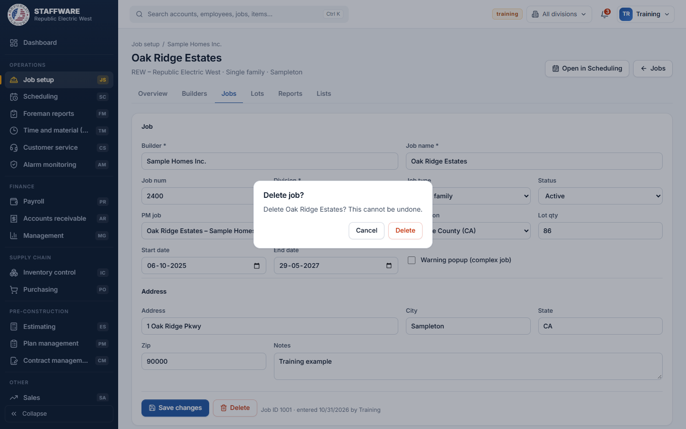

**Delete** always asks first. Some saves also ask: for example, changing the link between a Scheduling job and a Plan Management job, or selecting an inactive PM job, shows a "Are you sure?" box. Read it before confirming. If other records depend on the one you are deleting, the server refuses and shows a message.

### If you do not have access

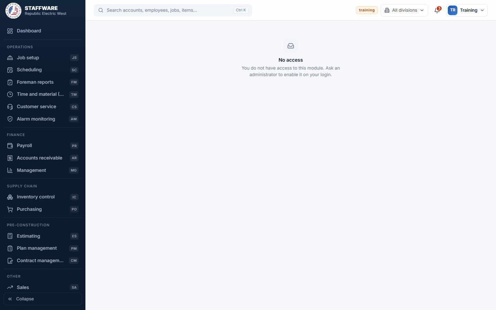

Opening a module you are not permitted to use shows this page. Ask an administrator to enable the module on your login.

### On a phone or narrow window

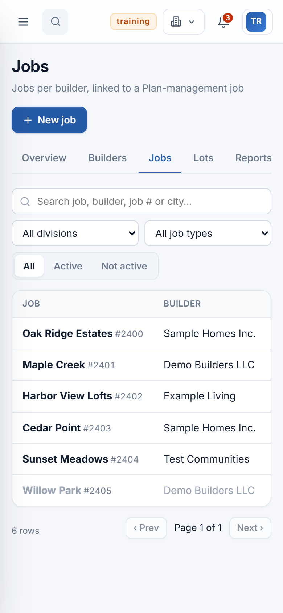

On small screens the left menu collapses behind a menu button at the top.

**Behind the scenes — what a Save really does:**

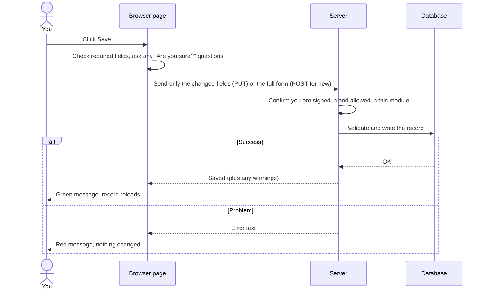

**Before you save:**

1. Check that you opened the right customer, job, lot, employee, or invoice.
2. Fill in fields marked with `*`; choose related records from the pick lists.
3. Check dates, quantities, percentages, and dollar amounts.
4. Select **Save** once. Wait for the confirmation or error message.
5. Re-open or refresh the record to make sure the values were saved.
6. For a delete, post, invoice, or bulk update, read the confirmation first. If unsure, cancel and ask your supervisor.

Some screens have extra tables under the main form, such as contacts, zones, phone numbers, or material lines. Use the controls beside those rows to add or edit the child records, then check that the list refreshes.

## 3. How the main work connects

This map shows the broad production flow. Not every company task uses every box, and the order may differ by job.

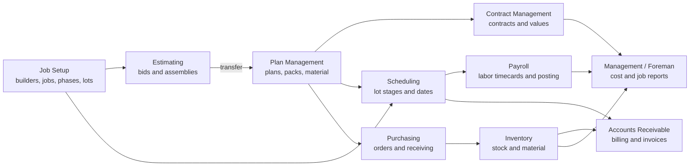

Other work connects too:

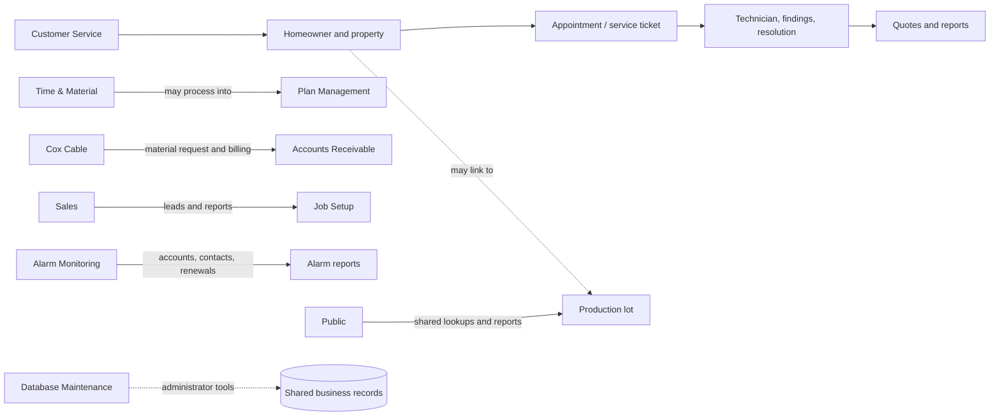

## 4. What each module is for

Use the left menu to open a module. The tabs inside it lead to the screens listed below.

| Menu name | Use it for | Common path through the screens |
|---|---|---|
| **Job Setup (JS)** | Builders, jobs, phases, and production lots. | Builder → Job → Phase → Lot |
| **Estimating (ES)** | Preparing bids, plans, assemblies, packs, and material; transferring a bid to Plan Management. | Customer → Job → Bid → Plan → Assemblies / Packs → Material → Transfer |
| **Plan Management (PM)** | Maintaining customer jobs, bids, plans, packs, and pack material. | Customer → Job → Bid → Plan → Pack → Material |
| **Contract Management (CM)** | Contracts and addenda, diary reminders, bid links, and contract values. | Job → Contract → Diary / Bid links / Values |
| **Scheduling (SC)** | Scheduling production work by job, phase, lot, pack, and stage. | Job → Phase → Lot → Schedule stages / dates |
| **Payroll (PR)** | Piece and hourly timecards, employees, pay periods, and payroll reports. | Payroll date → Enter time → Review timecards → Append hourly if needed → Post |
| **Purchasing (PO)** | Purchase orders, order lines, receiving, and purchasing reports. | Vendor → Purchase order → Items → Receipt / billing |
| **Inventory Control (IC)** | Items, vendors, stock, counts, material, and inventory posting. | Item / Vendor → Transactions or Count → Review → Post |
| **Accounts Receivable (AR)** | Billing lots, reviewing pre-bills, invoices, credits, and AR reports. | Billing work → Lot / stage → Pre-bill → Invoice |
| **Management (MG)** | Job cost, profit, labor, and lot reports. | Choose report → Set filters → Review totals / details |
| **Foreman Reports (FM)** | Start packets, sequence sheets, work-in-progress, labor, and material reports. | Choose report → Select job / lot / date → Review or print |
| **Customer Service (CS)** | Homeowners, properties, appointments, service tickets, technicians, and quotes. | Homeowner ↔ Property → Appointment / Ticket → Technician / Resolution |
| **Time & Material (TM)** | Creating and tracking T&M orders or quotes, including processing and payment. | New T&M → Add details → Process / Print → Track payment |
| **Cox Cable (CX)** | Cox setup, material requests, billing information, and Cox invoices. | Setup → Check date / eligibility → Request material or preview billing → Process |
| **Sales (SA)** | Sales leads and sales reports. | Lead → Contact details / status → Reports |
| **Alarm Monitoring (AM)** | Alarm accounts, contacts, zones, renewals, audit, and printouts. | Account list → Account → Contacts / Zones → Renewals or Reports |
| **Public (PU)** | Shared address/lot searches and job, lot, and plan lookups. | Search address or choose report → Open result |
| **Database Maintenance (DM)** | Login permissions, lookup lists, repair tools, and bulk actions. | Administrator only: choose tool → review affected records → confirm action |

### Example: follow a job from setup to billing

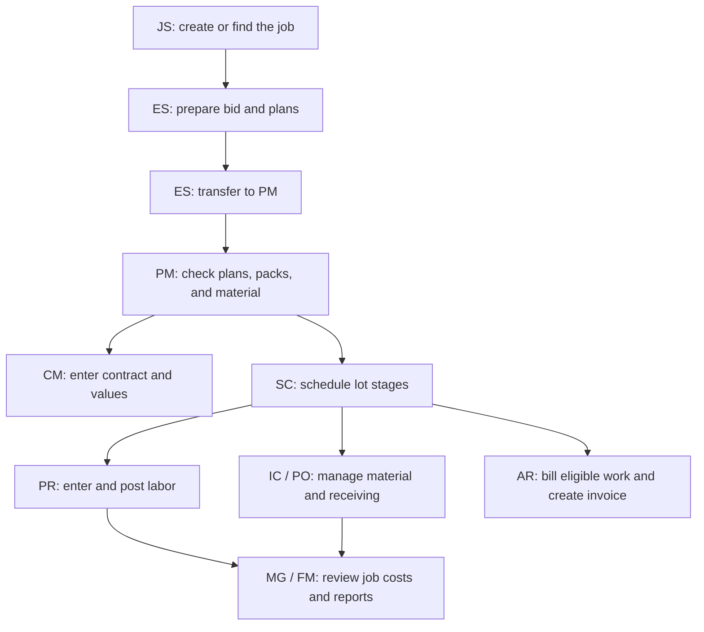

## 5. Safe checks for common work

| When checking… | Confirm these things |
|---|---|
| **A new or edited record** | Correct parent record; required fields; valid lookup selections; saved values remain after refresh. |
| **A list or report** | Search/filter values are right; totals and dates match the requested period; opening a result leads to the correct record. |
| **A child table** | Add, edit, and delete affect only the selected parent's rows; changes appear after reload. |
| **Payroll** | Correct payroll date, employee, job, lot, and pack; review pre-post problems. Only post on an approved test date or with authorization. |
| **Purchasing / inventory** | Vendor, item, division, quantities, and remaining amounts are correct; understand whether a receipt or adjustment is still waiting to be posted. |
| **Billing** | Correct lot/stage, amount, and invoice date; preview before processing; confirm invoice totals and status afterward. |
| **Bulk or destructive action** | Read the entire confirmation; check the affected-record count; use a test database first. Cancel if the scope is unclear. |

## 6. If something does not work

- **You cannot open a module:** ask the administrator to check your module permissions.
- **A dropdown is empty:** confirm that the parent record is selected, then reload. The list may depend on the selected customer, job, phase, or division.
- **Save shows an error:** read it carefully; it may explain a required field, invalid date, duplicate, or related record that blocks the change.
- **The page looks out of date:** use its refresh/retry control or reload the page. Check whether a posting action is still required.
- **A record cannot be deleted:** other records may depend on it. Do not remove related data just to bypass the warning; ask an administrator.
- **A result count is unexpected:** stop before confirming a posting or bulk change and ask the module owner to review it.

## 7. Notes for administrators and developers

This section is optional for everyday users. It explains where to look in the code when investigating a form.

- Frontend screens and access gates: [App.jsx](../client/src/App.jsx); navigation names and paths: [modules.js](../client/src/modules.js).
- Shared API wrapper: [api.js](../client/src/api.js). Server module routes are in [server/src/modules](../server/src/modules).
- Authentication and module permissions: [auth.js](../server/src/auth.js) and [server startup](../server/src/index.js).
- SQL connection, transactions, and ID creation: [db.js](../server/src/db.js); shared CRUD helpers: [crud.js](../server/src/crud.js).
- To trace a screen: find its route → find the page's `api()` call → find the matching endpoint in the server module → check validation, SQL tables, and side effects.

### Code checks run

- Client lint: **0 errors, 147 warnings**. Many warnings are Fast Refresh notices; hook-dependency warnings should be reviewed when changing affected screens.
- Client production build: **passed**. The build reported a large JavaScript chunk (about 2.77 MB); code splitting may improve initial load time.
- Server tests: the `npm test` command is a placeholder, so the project currently has no configured automated server test suite.
- No live SQL Server testing was performed for this overview. Verify posting and billing workflows in an approved test database before relying on them.

### Important security and operational note

The existing login system checks passwords stored as plain text in the legacy database. The repository README identifies this as a go-live issue. Do not change passwords or authentication storage without a migration plan that considers the existing Access application. For deployment steps and database migration cautions, see [README.md](../README.md) and the [db migrations](../db).
