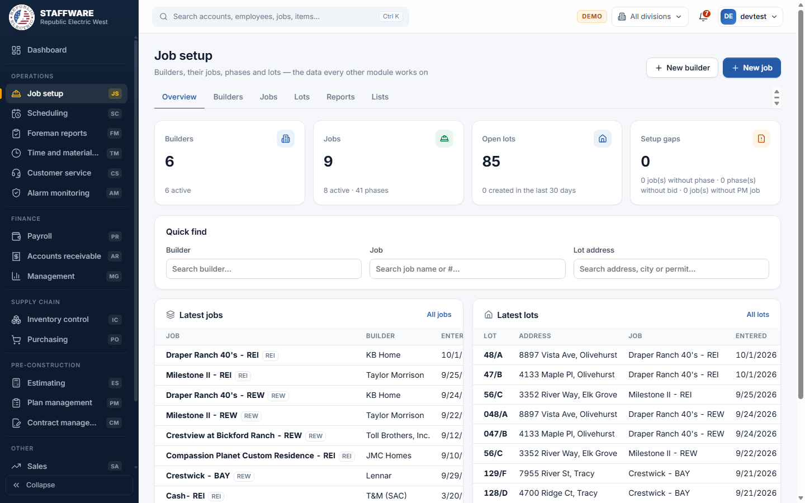
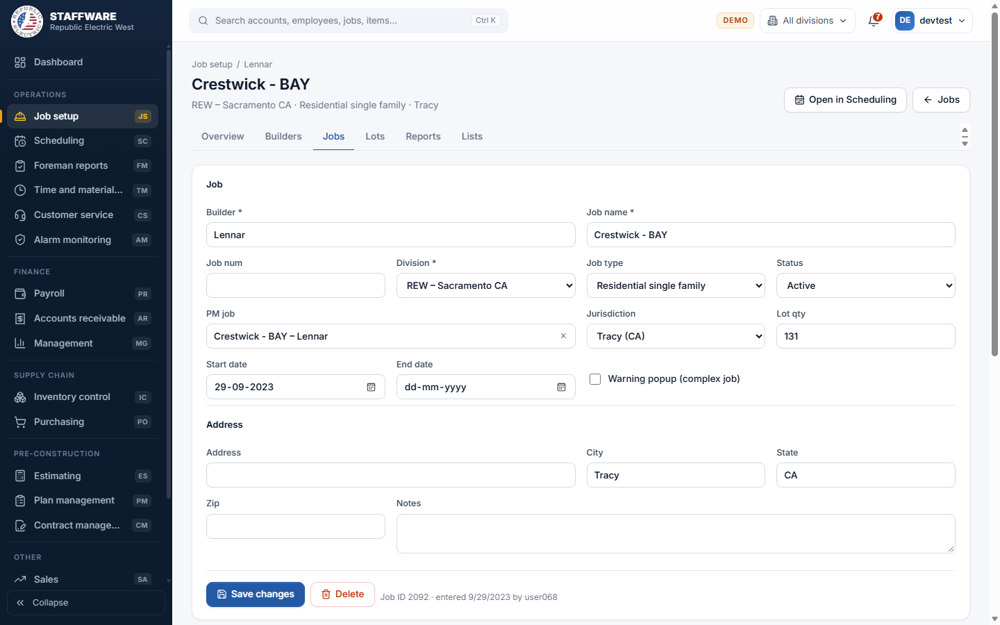
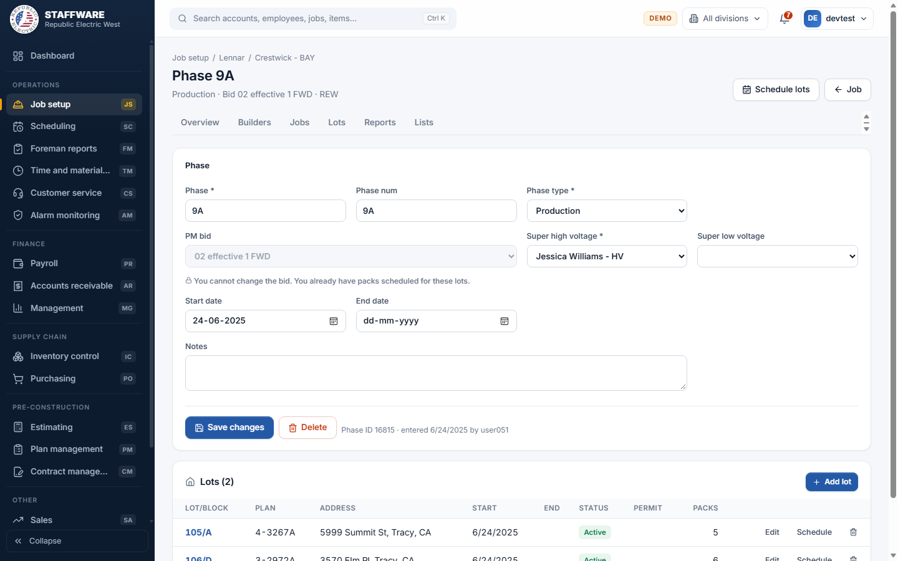

# Job Setup (JS)
*Builders, their jobs, phases and lots: the master data every other module works on.*

## 1. What this module is for
Job Setup is where the company records who it builds for and what it builds. You enter a builder (the customer), the builder's jobs (subdivisions or projects), the phases of each job, and the lots (houses) inside each phase. Office staff and project coordinators use it, mostly when a new builder, job or phase starts. Access is controlled per login: a user only sees this module if their login has the JS permission flag.

## 2. How it connects to other modules
### Needs data from
| Module | What it uses | Why |
|---|---|---|
| Plan management | The plan-management job, the bids (contracts) of that job, and the plans of a bid | A job is linked to a plan-management job; each phase picks one of that job's bids; each lot picks a plan from that bid |
| Database maintenance | Status, division, credit rating, job type, phase type, jurisdiction, city and superintendent lists | These fill the pick-lists in the forms. Six of the lists can be edited from the Lists tab |

### Feeds data to
| Module | What it gives | When |
|---|---|---|
| Scheduling | Jobs, phases and lots to schedule | As soon as a lot is saved; Scheduling works on exactly these records |
| Foreman reports | The builder, job, phase and lot pick-lists and the lot heading on every sheet | Whenever a foreman report is opened |
| Receivables, Payroll, Inventory, Purchasing, Customer service, Time and material, Cox cable, Sales, Management, Contract management, Public | Builder, job, phase and lot records used for billing, pay, material, service calls and reports | Whenever those modules look up a job or lot |

### Where it sits in the work flow
1. Plan management holds the bid and the plans for the work.
2. In Job Setup you create the builder, the job (linked to the plan-management job), the phase (with its bid and superintendents) and its lots (with a plan each).
3. Scheduling then books packs and stage dates on those lots.
4. Posted stages feed Inventory (material) and Payroll (labor); Receivables bills the lots.

## 3. Screens (tabs) in this module
| Screen / tab | What it is for | What you can do there |
|---|---|---|
| Overview | Snapshot and shortcuts | See counts (Builders, Jobs, Open lots, Setup gaps), Quick find a builder, job or lot address, open the latest jobs and lots, open any report; buttons New builder and New job |
| Builders | List of builders | Search by builder, QB number or city; filter All / Active / Not active; open or add a builder |
| Builder form | One builder | Edit builder and corporate address; manage billing addresses per division; see and add the builder's jobs |
| Jobs | List of jobs | Search by job, builder, job number or city; filter by division, job type and status; open or add a job |
| Job form | One job | Edit the job; see its phases; Add new phase; Open in Scheduling |
| Phase form | One phase and its lots | Edit the phase; add, edit or delete lots; Schedule lots |
| Lots | Search across all lots | Search by address, permit, lot, job or builder; filter by job, division and All / Open / Closed; export CSV (first 200) |
| Lot sheet | Read-only sheet for one lot | See job, phase, bid, plan, address and the packs on the lot; Edit in phase, Schedule, Print |
| Reports | Six prepared reports | See section 5 |
| Lists | Maintain the pick-lists | Job types, Phase types, Superintendents, Jurisdictions, Cities, Credit ratings |

## 4. How the data entry forms work
Common behaviour: required fields are marked with an asterisk. Saving checks the data first and shows a message in plain words if something is wrong. Nothing is saved until you press the save button. When you change an existing record only the changed fields are saved; if nothing changed you get "Nothing changed". Deleting always asks for confirmation, and the record is refused if other records depend on it.

### Builder
- When you use it: a new customer starts work with the company, or an address or credit rating changes.
- Fields: required: Name. Optional: Cust num (QuickBooks), Status (pick-list of statuses, default Active), Credit (pick-list of credit ratings), Corporate address (Address, City with suggestions from the city list, State as a 2-letter code, Zip).
- Step by step: open Job Setup, Builders, then New builder (or click a builder in the list). Fill in the fields and press Create builder (or Save changes). The builder opens with "Builder saved". To remove it press Delete and confirm.
- What gets saved: the builder. It then shows in the Builders list, in the Job form's builder field, and in every module that picks a builder.
- Safeguards: a builder name that already exists is refused. A builder cannot be deleted while it still has jobs, billing addresses, or related records in Receivables, Cox cable or Inventory; the message names what is in the way.

### Billing address per division (inside the Builder form)
- When you use it: a builder is billed from different divisions at different addresses.
- Fields: Division (pick-list, required), Contact, Address, City, State, Zip.
- Step by step: in the "Billing addresses per division" table, fill the last row and press Add. Use Edit on a row to change it (Save or Cancel), or the bin icon to remove it after a confirmation.
- What gets saved: one billing address for that builder and division. Receivables reads it when it bills the builder.
- Safeguards: only one billing address per builder and division; a second one is refused.

### Job
- When you use it: a new subdivision or project starts, or job dates, type or status change.
- Fields: required: Builder (pick one when creating; fixed afterward), Job name, Division. Optional: Job num, Job type, Status (default Active), PM job (search of plan-management jobs), Jurisdiction, Lot qty, Start date, End date, Warning popup (complex job), Address, City, State, Zip, Notes.
- Step by step: open the builder and press New job (or Jobs, New job). Fill in the form and press Create job. The job opens and a Phases section appears below it. Press Save changes to update it, or Delete to remove it.
- What gets saved: the job. It shows in Jobs, under its builder, in Scheduling, and in all other modules.
- Safeguards: the same builder cannot have two jobs with the same name in the same division. End date cannot be before start date. Changing an existing link to a plan-management job asks "You are about to change the link between SC and PM for this job. Are you sure?"; choosing an inactive plan-management job asks "This job is INACTIVE. Are you sure you want to select it?". After saving, warnings may list phases still tied to the old plan-management job's bids, or phases whose type no longer fits the job type. A job cannot be moved to another builder. A job with phases, lots, billing, paid labor or other related records cannot be deleted. If "Warning popup (complex job)" is ticked, the job and phase screens show a banner: "This is a complex job, make sure you select the appropriate bid for each lot."

### Phase
- When you use it: a job is built in stages (for example a production phase) and each needs its bid and superintendents.
- Fields: required: Phase, Phase type, Super high voltage. Optional: Phase num (copies the phase name if left blank), PM bid, Super low voltage, Start date, End date, Notes. Phase type is a pick-list that only offers the types of the job's job type. PM bid is a pick-list of the bids of the job's plan-management job. The superintendent lists come from the Superintendents list.
- Step by step: open the job, press Add new phase, fill in the form, press Create phase. Or click a phase row on the Job form. Save changes or Delete as usual.
- What gets saved: the phase. It then shows in the Job form, in Scheduling and in Foreman reports.
- Safeguards: the job must have a job type first (otherwise a banner says so). A bid can only be chosen when the job is linked to a plan-management job. Once packs are scheduled on the phase's lots the bid is locked: "You cannot change the bid. You already have packs scheduled for these lots." Two phases of a job cannot have the same name. A phase with lots cannot be deleted.

### Lot (inside the Phase form)
- When you use it: houses are added to a phase, or an address or permit changes.
- Fields: required: Lot, Plan. Optional: Block, Start date, Status (Active / Inactive), Address, City, State, Zip, Permit, Notes. Plan is a pick-list of the plans of the phase's bid.
- Step by step: in the phase's Lots section press Add lot (it is disabled until the phase has a bid), fill the form and press Add lot. Use Edit on a row, then Save lot or Cancel. Schedule opens the lot in Scheduling; the bin icon deletes it.
- What gets saved: the lot. It shows in Lots, the Lot sheet, Scheduling and Foreman reports.
- Safeguards: the same lot and block cannot be repeated in a phase. The plan must belong to the phase's bid. The plan cannot be changed once packs are scheduled on the lot. A closed lot (it has an end date) cannot be edited here: "This lot is closed. You need to open the lot before you can modify it." Zip must be digits only. Closing and moving lots is done in Scheduling or Database maintenance, not here. A lot with scheduled packs or stages, paid labor, job cost, billing and similar records cannot be deleted.

### Lists
- When you use it: a new job type, phase type, superintendent, jurisdiction, city or credit rating is needed.
- Fields: Job types (Job type); Phase types (Phase type, Job type); Superintendents (Superintendent, Super type HV / LV / UGS, Active); Jurisdictions (Jurisdiction, State); Cities (City, State, Cox service); Credit ratings (Rating).
- Step by step: Lists tab, choose a list, type in the "new" row and press Add. Edit changes a row (Save or Cancel). The In use column shows how many records use an entry.
- What gets saved: the pick-list entry, available at once in all Job Setup forms.
- Safeguards: duplicates are refused; entries in use cannot be deleted (the bin is disabled), and the job type of a phase type in use cannot be changed.

## 5. Reports
| Report | What it shows | Filters you choose first | Print / export |
|---|---|---|---|
| Jobs alphabetical | Every job with builder, job number, division, status and the high-voltage superintendent of its latest phase. Builders named "Test..." are left out | Division (optional); tick "Include jobs without a phase / superintendent" to show all | CSV, Print |
| Newly created lots | Lots created between two dates, both days included | From and To dates | CSV, Print |
| Lots by start date | Lots whose phase starts between two dates | From and To dates | CSV, Print |
| Builder's job/lot list | All lots of every job of one builder | Builder | CSV, Print |
| Lots per bid | Lots of one job grouped by the plan-management bid of their phase | Builder, then Job | CSV, Print |
| Job's lot list | All lots of one job with the last trim delivery date | Job | CSV, Print |

The Lots tab and the Lot sheet also work as an "address lot search". The Lots tab exports CSV and the Lot sheet can be printed.

## 6. Action buttons
Job Setup has no bulk "process" buttons. These are the only buttons that jump to other modules or remove records:
| Button | Where | What it does | What changes | Safeguards |
|---|---|---|---|---|
| Open in Scheduling | Job form | Opens the job in Scheduling | Nothing | None needed |
| Schedule lots / Schedule | Phase form | Opens the phase or lot in Scheduling | Nothing | None needed |
| Delete | Builder, Job, Phase, Lot forms | Removes the record | The record is deleted | Confirmation; refused when other records use it |

## 7. A typical day-to-day workflow
1. Make sure the bid and plans exist in Plan management.
2. Open Job Setup, Builders and check whether the builder exists; if not, press New builder and save it.
3. Add a billing address for each division the builder is billed from.
4. Press New job on the builder, choose the division and job type, link the PM job and save.
5. On the job press Add new phase, choose the phase type, bid and superintendents, and save.
6. In the phase press Add lot for each house: lot, block, plan, address and permit.
7. Check the Overview "Setup gaps" card for jobs without a phase, phases without a bid or jobs without a PM job.
8. Press Schedule lots to hand over to Scheduling.
9. Run Jobs alphabetical or Builder's job/lot list to confirm the setup.

## 8. Screenshots

## 9. Good to know
- The Overview "Setup gaps" card counts jobs without a phase, phases without a bid and jobs without a plan-management job.
- The bid and plan lists come from Plan management, so a bid must exist there before lots can be added in Job Setup.
- Lots can be added in two places: one at a time here, or many at once (for example lot 101 to 120) in Scheduling.
- Rules carried over from Access: the PM job link confirmations, the complex-job warning, the lock on bid and plan after packs are scheduled, and the closed-lot rule.
- Differences from Access: the web version also refuses duplicate builders, jobs, phases and lots and tells you what blocks a delete.
- Closing or reopening a lot and moving a lot to another phase are not done in Job Setup.
