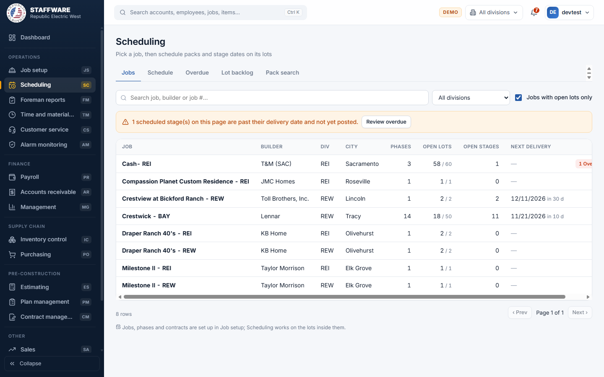
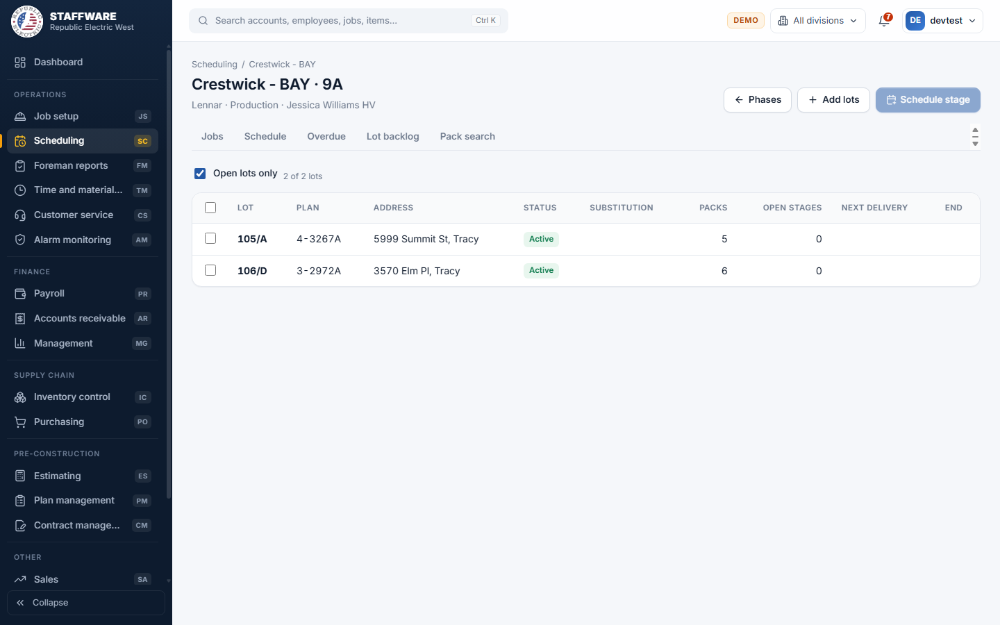
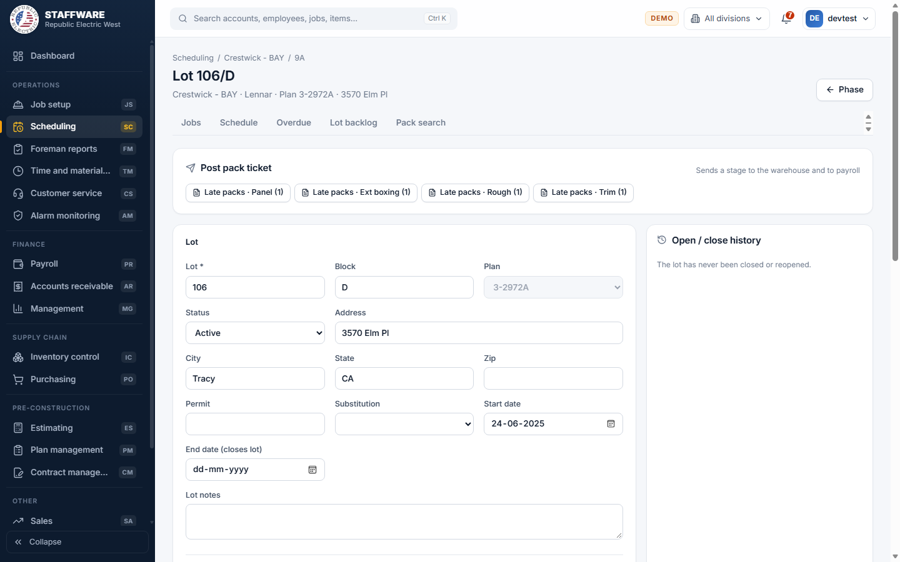

# Scheduling (SC)
*Schedule packs and stage delivery dates on each lot, and post pack tickets that send work to the warehouse and to payroll.*

## 1. What this module is for
Scheduling decides what work is done on each house and when. For every lot you choose the packs (bundles of material and labor, such as "Standard rough") and book stage dates (for example Rough, Trim) with a delivery date. When a stage is ready you post the pack ticket, which sends the material list to the warehouse and the labor lines to payroll. Schedulers, coordinators and superintendents use it. Access is controlled per login: a user only sees this module if their login has the SC permission flag.

## 2. How it connects to other modules
### Needs data from
| Module | What it uses | Why |
|---|---|---|
| Job setup | Jobs, builders, phases and lots | Scheduling works on lots that were set up there |
| Plan management | Plans, packs and their material, labor and values | The packs you can add to a lot come from the lot's plan and the "universal" plan of the bid |
| Database maintenance | Work types, stages, substitution types, divisions, superintendents, pack types | These fill the pick-lists |
| Inventory | Item descriptions | Shown on the pack ticket |
| Payroll and Receivables | Labor paid and billing on a lot | Used to refuse deleting a lot that was paid or billed |

### Feeds data to
| Module | What it gives | When |
|---|---|---|
| Inventory | The material list of a posted stage (the warehouse list) | When you post a pack ticket |
| Payroll | The labor lines ready to be paid | When you post a pack ticket |
| Job setup, Foreman reports, Receivables and others | Scheduled packs, stage dates, contract values on lots and packs, lot open/close history | As soon as it is saved; those modules read the same lots and packs |

### Where it sits in the work flow
1. Job Setup creates the job, phase and lots; Plan management supplies the bid, plans and packs.
2. Scheduling books packs and stage dates on the lots.
3. The Schedule, Overdue and Lot backlog screens show what is coming and what is late.
4. Posting a stage sends material to Inventory and labor to Payroll.
5. Foreman reports show the paid and posted amounts; Receivables bills the lots.

## 3. Screens (tabs) in this module
| Screen / tab | What it is for | What you can do there |
|---|---|---|
| Jobs | Starting point: jobs with open lots | Search by job, builder or job number; filter by division; "Jobs with open lots only"; see open lots, open stages, next delivery and overdue count; Review overdue |
| Phases of a job | Phases of the chosen job | See lots, open lots and open stages per phase; open a phase |
| Phase (schedule packs) | Lots of one phase | Add lots (one or a range); tick lots and Schedule stage on all of them; open a lot |
| Lot | Everything about one lot | Edit the lot; add, change or remove stages and packs; open the pack ticket; see open/close history |
| Pack ticket | Printable ticket for one lot and stage | Review materials and labor; Print; Post stage or Post late packs |
| Schedule | Stages by delivery date | Report with filters, CSV and Print |
| Overdue | Stages past their date and not posted | Same report preset to overdue |
| Lot backlog | Lots still without a date for a stage | Pick a job and a stage |
| Pack search | Find packs by words | See how many open lots have a pack scheduled |

## 4. How the data entry forms work
Common behaviour: required fields are marked with an asterisk. Checks run when you save and show a message in plain words. Removing a stage, a pack or a lot asks for confirmation first.

### Add lots (Phase screen)
- When you use it: new houses are released in a phase and you want to create many lots quickly.
- Fields: required: Lot number (from), Plan. Optional: To (for a range), Block, Address (single lot only), City (defaults to the job's city), Substitution, Start date. Plan is a pick-list of the plans of the phase's bid. Substitution is a pick-list of substitution types.
- Step by step: open the job, open the phase, press Add lots, enter for example 101 to 120, choose the plan and press Add lots. You get "n lot(s) added." Leading zeros are kept (so 001 to 010 works).
- What gets saved: the lots, with status Active and the start date you gave (today if blank). They show in this screen, the Lot screen and in Job Setup.
- Safeguards: all lots are added in one go or none are; up to 200 lots at a time; a range must be whole numbers; a lot and block that already exist in the phase are refused; the plan must belong to the phase's bid.

### Schedule stage on selected lots (Phase screen)
- When you use it: the same stage (for example Rough) is booked on several lots with staggered dates.
- Fields: required: Work type, Stage, Delivery date (first lot). Optional: Days between lots (0 to 30), and a tick box "Also add the stage's default pack".
- Step by step: tick the lots, press Schedule stage, fill in the form and press Schedule. The first lot gets the date; each next lot gets the date plus the "days between lots", in the order shown. A message tells how many lots were scheduled and how many were skipped and why.
- What gets saved: one stage per lot, and (if ticked and the stage has a default pack) the default pack with quantity 1 on lots that lack it. Shows in the Lot screen, Schedule and Overdue.
- Safeguards: lots that already have this work type and stage are skipped, not duplicated; lots that do not belong to the phase are skipped; if a lot's plan has no such default pack the message says how many lots lack it; everything is saved together or not at all.

### Lot
- When you use it: to correct a lot, or to adjust one lot's stages and packs.
- Fields: required: Lot. Optional: Block, Plan, Status (Active / Inactive or closed), Address, City, State, Zip, Permit, Substitution, Start date, End date (closes the lot), Lot notes.
- Step by step: open a lot from any list, change fields and press Save lot ("Lot saved"). Delete lot removes it after confirmation.
- What gets saved: the lot. Setting an End date closes the lot and writes an entry (Close or Open) to the Open / close history box with the date and user. Clearing the date reopens it.
- Safeguards: the plan cannot be changed after a stage was posted, and must belong to the phase's bid. A lot with posted stages cannot be deleted ("Set it to Closed or Inactive instead"); a lot with paid labor or billing cannot be deleted. Deleting an unposted lot also removes its scheduled stages and packs.

### Scheduled stages (Lot screen)
- When you use it: to book, move or remove one stage on one lot.
- Fields: required: Stage, Work type, Delivery date. Optional: Notes. Stage and Work type are pick-lists.
- Step by step: fill the last row of the Scheduled stages table and press Add. Use the pencil to change the delivery date or notes, and the bin to remove a stage.
- What gets saved: the stage. Status shows Scheduled, Overdue or Posted with date and user.
- Safeguards: the same work type and stage cannot be booked twice on a lot. A posted stage cannot change its work type or stage and cannot be removed.

### Scheduled packs (Lot screen)
- When you use it: to add the packs (standard and optional) for the house's plan.
- Fields: required: Pack (pick-list grouped Standard and Optional, from the lot's plan and the universal plan), Qty (whole number 1 to 9999).
- Step by step: choose "Add a pack...", set the quantity and press Add. Use the pencil to change the quantity or the bin to remove a pack.
- What gets saved: the pack on the lot. It shows in the Packs table, on the pack ticket and in Job Setup's Lot sheet.
- Safeguards: a pack can only be on a lot once (change its quantity instead). A posted pack cannot be removed; set its quantity to 0. The table shows posted quantity and a badge for inactive packs.

### Pack ticket and posting
- When you use it: a stage is due and the lot's packs must go to the warehouse and payroll.
- Fields: none to type; you choose the lot and the stage from the "Post pack ticket" box on the Lot screen.
- Step by step: on the Lot screen press "Pack ticket - [stage]". Review the header, materials and labor lines (with totals), optionally Print, then press Post stage and confirm. A green message shows how many material lines and labor lines were created. "Late packs" works the same way for packs added after the stage was posted.
- What gets saved: the material list for the warehouse and the labor lines for payroll, the stage marked posted with today's date and your name, the packs marked posted, and contract values copied from Plan management onto the lot and packs.
- Safeguards: a confirmation explains what will be created. Posting is refused when no packs are scheduled, when the stage is not scheduled on the lot, or when the stage was already posted. All steps are saved together or not at all.

## 5. Reports
| Report | What it shows | Filters you choose first | Print / export |
|---|---|---|---|
| Schedule (Schedule by date) | Stages by delivery date with a count and a summary by stage and work type | From, To, Show (Not yet posted, Overdue only, Posted, Everything), Division, Stage, Work type, Search | CSV, Print |
| Overdue (Overdue stages) | Stages past their delivery date and not posted | Division, Stage, Work type, Search | CSV, Print |
| Lot backlog (Lot scheduling backlog) | Every lot of a job with its date for one stage, and how many are not scheduled | Job, Stage, Include closed lots | On screen |
| Pack search | Packs whose name contains all your words, with open lots, total quantity and not yet posted | Key words (at least 2 letters), Division | On screen |
| Pack ticket | Materials and labor of one lot and stage | Lot and stage | Print |

## 6. Action buttons
| Button | Where | What it does | What changes | Safeguards |
|---|---|---|---|---|
| Add lots | Phase screen | Creates one lot or a range of lots | New lots in the phase | All or nothing; duplicates and wrong plans refused; max 200 |
| Schedule stage (n) | Phase screen | Books a stage on all ticked lots | One stage per lot, optional default packs | Duplicates skipped; all or nothing |
| Post stage | Pack ticket | Sends material and labor out | Material list, labor lines, stage and packs marked posted, contract values set | Confirmation; refused if nothing to post or already posted; all or nothing |
| Post late packs | Pack ticket | Sends only packs added after the stage was posted | Material and labor lines for those packs; packs marked posted | Confirmation; refused if no late packs |
| Review overdue | Jobs tab banner | Opens the Overdue list | Nothing | None needed |
| Delete lot | Lot screen | Removes the lot with its unposted stages and packs | Lot deleted | Confirmation; refused if posted, paid or billed |

## 7. A typical day-to-day workflow
1. Open Scheduling, Jobs and find the job (the banner shows overdue stages).
2. Open the job and choose the phase.
3. Press Add lots if new houses are needed; enter the lot range and the plan.
4. Open each lot and add its standard and optional packs.
5. Tick lots and press Schedule stage to book Rough, Trim and so on with delivery dates.
6. Check the Schedule tab for the next two weeks and Lot backlog for lots still without a date.
7. When a stage is due, open the lot, press the Pack ticket button and review it.
8. Press Post stage to send material to the warehouse and labor to payroll.
9. Use Overdue each day to chase stages that were not posted.
10. If packs are added after posting, use "Late packs".

## 8. Screenshots

## 9. Good to know
- Rules carried over from Access: stages and packs per lot, the ticket and the posting, "Late packs", and the lock on plan changes after posting.
- The web version adds the multi-lot "Schedule stage" with staggered dates and the stage's default pack.
- Moving a lot to another phase or job is not done here; it belongs to Database maintenance.
- Posted stages and posted packs are protected; a posted pack can only be set to quantity 0.
- The pack ticket prints from the browser; there is no separate print layout setting.
