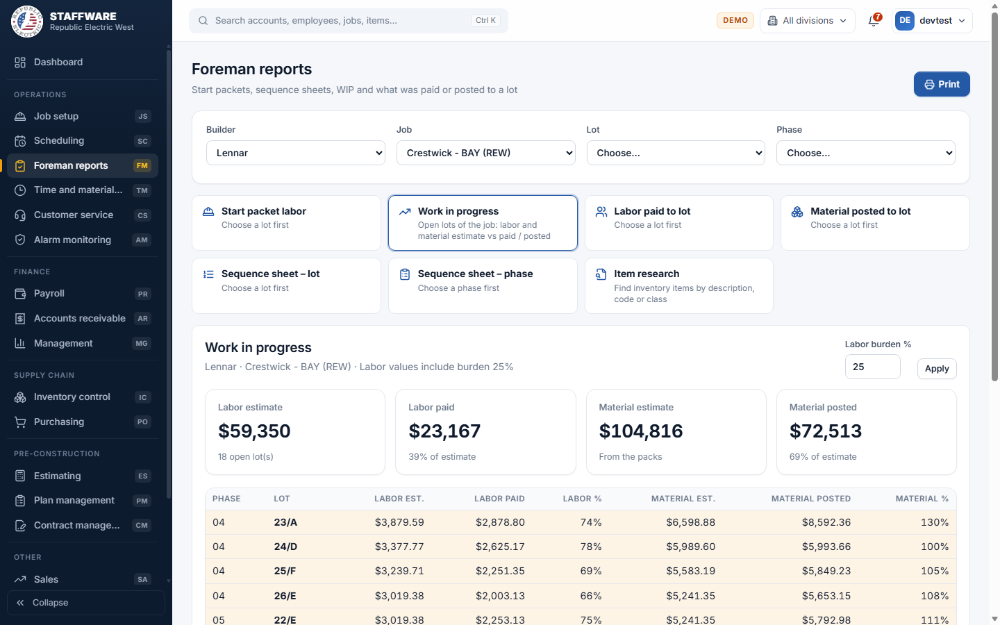
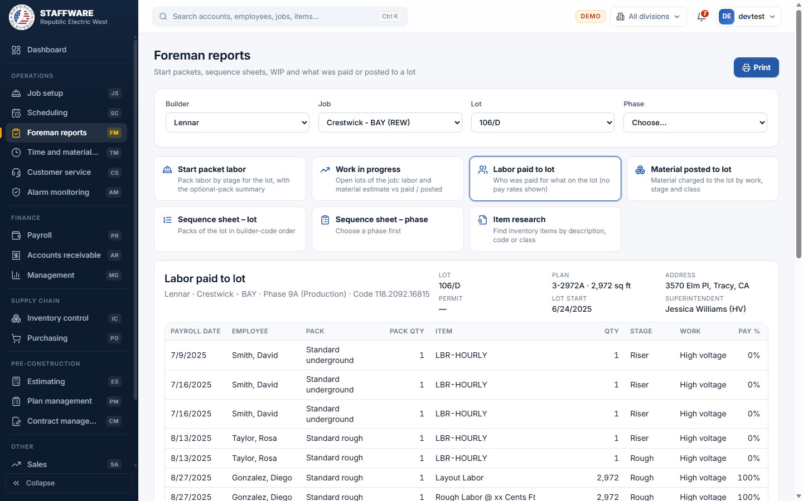

# Foreman Reports (FM)
*Field sheets for foremen: start packets, sequence sheets, work in progress, labor paid, material posted and item research.*

## 1. What this module is for
Foreman Reports gives superintendents and foremen the printed sheets they need on site: what labor a house includes, which packs go in which order, how a job is doing against its estimate, and what has already been paid or charged to a lot. It only shows information; nothing is entered or changed here. Access is controlled per login: a user only sees this module if their login has the FM permission flag.

## 2. How it connects to other modules
### Needs data from
| Module | What it uses | Why |
|---|---|---|
| Job setup | Builders, jobs, phases, lots, superintendents | The Builder, Job, Lot and Phase pick-lists and the heading of every sheet |
| Scheduling | The packs scheduled on each lot | Start packet, sequence sheets and the estimates in Work in progress are built from them |
| Plan management | Packs, their labor and material lines, plans, bids | Quantities, values, builder codes and bid details |
| Payroll | Labor paid to lots | Labor paid to lot and the "paid" side of Work in progress |
| Inventory | Item list and classes | Item research and item descriptions |
| Job cost (material and labor posted to lots) | Material posted to lots | Material posted to lot and the "posted" side of Work in progress |
| Database maintenance | Stages, work types, pack types, classes | Labels on the sheets |

### Feeds data to
This module does not give data to any other module. It is read-only.

### Where it sits in the work flow
1. Job Setup and Scheduling prepare the lots and their packs.
2. Before work starts the foreman prints the Start packet labor and the Sequence sheet.
3. While work runs, Labor paid to lot, Material posted to lot and Work in progress show the cost so far.
4. Item research is used any time a foreman needs to find an item or code.

## 3. Screens (tabs) in this module
| Screen / tab | What it is for | What you can do there |
|---|---|---|
| Foreman reports | The single screen of the module: four pick-lists (Builder, Job, Lot, Phase) and seven report buttons | Choose the builder, job, lot or phase; click a report; Print |

The report buttons are Start packet labor, Work in progress, Labor paid to lot, Material posted to lot, Sequence sheet - lot, Sequence sheet - phase and Item research. Each button says "Choose a lot first", "Choose a job first" or "Choose a phase first" until the right pick is made.

## 4. How the data entry forms work
There are no data entry forms in this module. The only inputs are the pick-lists and filters below, which work like this:
### Builder, Job, Lot and Phase pick-lists
- When you use it: at the start of every report (Item research needs none).
- Fields: Builder (all builders); Job (only the chosen builder's jobs, shown with the division); Lot (the chosen job's lots, finished lots are marked "finished"); Phase (the chosen job's phases with the phase number). Each pick-list stays empty until the one before it is chosen.
- Step by step: choose a builder, then a job, then a lot or a phase, then click a report button. Changing the builder clears the job, lot and phase; changing the job clears the lot and phase.
- What gets saved: nothing. The choices are kept in the web address, so a report can be bookmarked or reopened.
- Safeguards: a report that needs a lot, job or phase will not run until it is chosen.
### Labor burden % (Work in progress only)
- When you use it: to include payroll costs on top of the wages.
- Fields: a percentage from 0 to 200, default 25.
- Step by step: type the percentage and press Apply. The labor figures are recalculated.
- What gets saved: nothing.
- Safeguards: a value outside 0 to 200 is refused with a message.
### Item research search
- When you use it: to find an inventory item by words.
- Fields: search words (description, item or code) and a Class pick-list.
- Step by step: type words; the list updates after a short pause. Choose a class to narrow it.
- What gets saved: nothing.
- Safeguards: only active items are listed and at most 500 are shown; the list says so and asks you to narrow the search. No prices or costs are shown.

## 5. Reports
| Report | What it shows | Filters you choose first | Print / export |
|---|---|---|---|
| Start packet labor | Pack labor of the lot by pack type, pack, stage and work with quantity and value, total labor, and a summary of the optional packs (rough and trim) | Builder, Job, Lot | Print |
| Work in progress | Open lots of the job with labor estimate, labor paid, labor %, material estimate, material posted, material %; totals as four cards; lots over 100% are highlighted | Builder, Job (and Labor burden %) | Print |
| Labor paid to lot | Who was paid for what on the lot: payroll date, employee, pack, item, quantity, stage, work, pay %, hours, notes. Pay rates are not shown and the item code digits are masked | Builder, Job, Lot | Print |
| Material posted to lot | Material charged to the lot by work, stage and class, with delivery (Production pack or Counter material), quantity, value and total | Builder, Job, Lot | Print |
| Sequence sheet - lot | Packs of the lot in builder-code order, with quantity, date and whether the pack is verified | Builder, Job, Lot | Print |
| Sequence sheet - phase | The same for every lot of the phase | Builder, Job, Phase | Print |
| Item research | Active inventory items: class, item, description, alternate code | Search words, Class (no builder or job needed) | Print |

Every sheet has a heading with the builder, job, phase, lot, plan, address, permit, start date and superintendents (sequence sheets also show the bid). There is no CSV export; use Print (the controls on screen are hidden when printing).

## 6. Action buttons
This module has no buttons that change records. The buttons are:
| Button | Where | What it does | What changes | Safeguards |
|---|---|---|---|---|
| Report buttons (seven) | Under the pick-lists | Open that report on screen | Nothing | Disabled hints until the needed pick is made |
| Apply | Work in progress | Recalculates labor with the burden % | Nothing saved | Percentage must be 0 to 200 |
| Print | Top right | Prints the open sheet | Nothing | Shown only when a report is ready |

## 7. A typical day-to-day workflow
1. Open Foreman reports and choose the Builder and the Job.
2. Choose the Lot and click Start packet labor; Print it for the crew.
3. Click Sequence sheet - lot (or choose a Phase and click Sequence sheet - phase) and Print the install order.
4. During the job click Labor paid to lot to see what has been paid so far.
5. Click Material posted to lot to see what material was charged.
6. Click Work in progress for the job to compare estimate with paid and posted; adjust the Labor burden % if needed.
7. Use Item research to look up an item or code when a pack line is unclear.

## 8. Screenshots

## 9. Good to know
- Read-only by design: no record can be created, changed or deleted here.
- Pay rates are hidden: Labor paid to lot shows quantities and percentages only, as in Access, and masks digits in the pay item.
- Work in progress covers open lots with labor only; finished lots are left out. Labor values include the burden % (default 25).
- The reports come from the Access switchboard; the web version adds the dependent pick-lists and keeps your choices in the page address.
- Sheets can be printed but not exported to a file.
- Because the reports read Scheduling, Payroll and posted material, a lot with nothing scheduled, paid or posted shows an empty sheet with a message.
