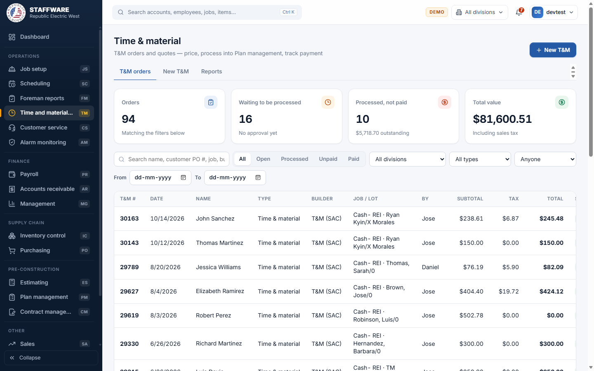
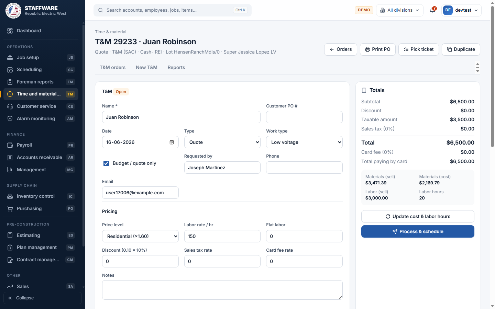
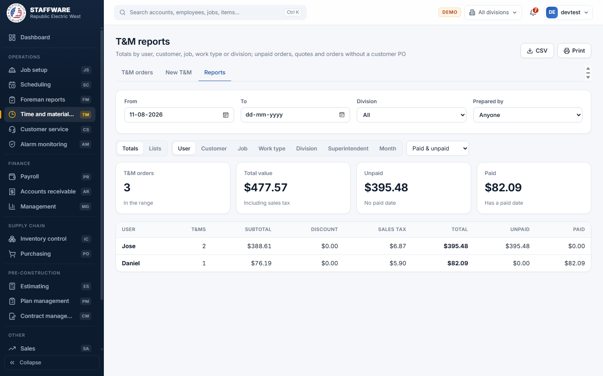

# Time and material (TM)
*Price extra and service work as T&M orders or quotes, send them to Plan management so the lot can bill them, and track payment.*

## 1. What this module is for
Time and material is used for work outside the original contract: extras, change orders, quotes, service work and credits. The office builds an order for a lot, lists the work as packs with materials and labor, prices it with a markup level, sales tax and optional discount, prints the order, and "processes" it. Processing adds the work to the lot as a pack so it can be scheduled and billed. The module then tracks whether each order has been paid. Access is controlled per login: only users with the TM permission flag see this module.

## 2. How it connects to other modules
### Needs data from
| Module | What it uses | Why |
|---|---|---|
| Job setup | Jobs, builders, lots, phases and superintendents; the division's sales tax | You choose the job and lot, and the tax rate defaults from the division |
| Inventory control | The item catalogue with costs, prices and labor codes | Material and labor lines are picked from the catalogue and priced from it |
| Plan management | The contract of the lot's phase | Needed so a processed order can be added to the lot |
| Database maintenance (lists) | T&M types, price levels, work types, divisions, cost codes, company details | Fill pick-lists and printed headings |

### Feeds data to
| Module | What it gives | When |
|---|---|---|
| Plan management | A new "PO" pack (with a "PO" plan if the contract has none) holding the order's materials | When you press "Process & schedule" |
| Job setup / Scheduling | The pack is placed on the lot's list of packs | At the same moment, so the lot shows a pack named "PO - Lot ... - (order name)" |
| Accounts receivable | The processed pack becomes something that can be billed, and AR reports show the T&M number | After processing, whenever AR bills the lot |

### Where it sits in the work flow
A builder or the office asks for extra work on a lot. The order is entered here (or a quote is prepared first), priced and printed. When it is approved it is processed, which puts it on the lot. The crew is scheduled and paid, and Accounts receivable bills the pack. Back in Time and material, the order is marked paid when the money arrives.

## 3. Screens (tabs) in this module
| Screen / tab | What it is for | What you can do there |
|---|---|---|
| T&M orders | List of all orders and quotes | Search, filter by status, division, type, prepared by and dates; click an order to open it; "New T&M" button. Four cards show orders, waiting to be processed, processed but not paid, and total value |
| New T&M | Start a new order | Pick the job and lot, name the work and create the order |
| Reports | Totals and lists | Totals by user, customer, job, work type, division, superintendent or month; lists of unpaid, quotes, no customer PO and all orders |
| T&M order (opened from the list) | The order itself | Edit the header and pricing, add packs, materials and labor, see live totals, process, mark paid, duplicate, print |
| Print PO and Pick ticket (buttons on the order) | Paper copies | Print the order, or a materials-only pick list with a "Picked" column |

## 4. How the data entry forms work
### New T&M
- When you use it: to start a new order or quote on a lot.
- Fields, required first: Job and Lot (job is searched by job or builder name; lots of that job appear next), Name * (up to 60 characters). Then Customer PO #, Type (pick-list: Change order, Quote, Time & material, Credit; Time & material by default), Work type (pick-list), Price level (pick-list: Estimating, VIP, Residential, Retail; Residential by default), Requested by, Requestor phone, Requestor email, Notes.
- Step by step: choose the job and lot, type the name, press "Create T&M". The new order opens so you can add packs and lines.
- What is checked: a lot must be chosen; the name is required; closed lots are refused with the message to open the lot in Scheduling first; the name must be short enough to be imported into Plan management.
- What gets saved: the order header with today's date, your login as "prepared by", labor rate 150 per hour, card fee 5%, and the sales tax rate of the lot's division. It then appears in T&M orders.

### The T&M order (header and pricing)
- When you use it: to describe and price the order.
- Fields, required first: Name *. Then Customer PO #, Date, Type, Work type, a "Budget / quote only" tick, Requested by, Phone, Email. Pricing: Price level, Labor rate / hr, Flat labor, Discount (0.10 means 10%), Sales tax rate, Card fee rate, Notes.
- Step by step: open an order from the list, change fields and press Save ("T&M saved"). The Totals panel on the right shows Subtotal, Discount, Taxable amount, Sales tax, Total, card fee, total paying by card, and materials and labor in sell and cost with labor hours.
- Checks: discount must be between 0 and 1, tax rate between 0 and 0.25, card fee between 0 and 0.20, labor rates cannot be negative, price level must be one of the four.
- Safeguards: if the lot is closed everything is locked with a banner. After processing, prices, labor rate, discount and tax are locked and a banner explains that later changes stay in T&M and do not go to Plan management. A processed order cannot be deleted. Delete (for unprocessed orders) asks for confirmation.
- How totals work: the subtotal is the sum of the pack prices plus flat labor (when flat labor is above zero it replaces the hourly labor lines). Sales tax is worked out on the subtotal without the labor part, after the discount; on a Credit type it is worked out on the materials only, after the discount.

### Packs, materials and labor lines
- When you use it: to list the work in the order.
- Fields: a pack has a name * and a price; a line is an item or labor code picked from the catalogue (search box "Add an item or labor code...") with a quantity. Each line shows Cost ea, Price ea and Ext price.
- Step by step: type a new pack name and price and press "Add pack". In the pack, search for an item, enter the quantity (default 1) and press Add. The cost and price come from the catalogue according to the order's price level (labor lines use the order's labor rate). Use the pencil to change quantity, notes, cost or price. A line changed by hand shows a "manual" badge and a reset button returns it to the catalogue price. If the lines add up to a different amount than the pack price, a button "Lines total ... use" sets the pack price to the lines.
- Checks: pack name required; quantity must be a number other than zero; cost and price cannot be negative.
- Safeguards: removing a pack or a line asks for confirmation; after processing, packs and lines can no longer be removed and prices are locked.

### Process & schedule
- When you use it: when the order is approved and should go on the lot.
- Step by step: press "Process & schedule" and confirm. The page says "Processed" and shows the new pack name and amount.
- What is checked first: the lot must be open; the order must not already be processed; it needs at least one pack with a material or labor line; the lot's phase must have a contract in Plan management.
- What gets saved: a pack named "PO - Lot (number) - (order name)" is added to Plan management with the order total as its value, with one material line per catalogue item (quantities added up across packs); the pack is placed on the lot; the order is stamped approved with the date and your name. It then shows as "Processed" in the list.
- Safeguards: confirmation, and all steps succeed together or none are saved.

### Update cost & labor hours
- When you use it: on an unprocessed order after catalogue prices have changed.
- What it does: refreshes cost and price on lines that were not changed by hand, and sets the labor hours from the labor lines. It refuses once the order is processed.

### Duplicate
- When you use it: to copy an order to another lot.
- Fields: Job and Lot to receive the copy; a tick "Process & schedule the copy immediately".
- Step by step: press Duplicate, choose the job and lot, press "Create copy". The copy opens.
- Checks: the receiving lot must be open and different from the original.
- What gets saved: a new order with the same header, packs and lines, dated today and prepared by you. If the tick is on, it is processed in the same step, all together.

### Mark paid
- When you use it: after a processed order has been paid.
- Step by step: on a processed order press "Mark paid today"; to undo, press "Clear payment". The status becomes Paid.

## 5. Reports
Reports tab: choose From, To, Division and Prepared by, then Totals or Lists. Test and template jobs are left out.

| Report | What it shows | Filters you choose first | Print / export |
|---|---|---|---|
| Totals by User, Customer, Job, Work type, Division, Superintendent or Month | Number of orders, subtotal, discount, sales tax, total, unpaid and paid; four summary cards | From, To, Division, Prepared by; choose the grouping; payment filter (Paid & unpaid, Unpaid only, Paid only, Quotes only) | CSV, Print |
| Unpaid | Contracted orders with no paid date | From, To, Division, Prepared by | CSV, Print |
| Quotes | Quote-type orders not paid | Same | CSV, Print |
| No customer PO | Contracted unpaid orders without a customer PO number | Same | CSV, Print |
| All T&M | Every order in the range | Same | CSV, Print |
| T&M PO (Print PO button) | The printable order with company heading, lines and totals | Open the order | Print |
| Pick ticket (button) | Materials only, with a "Picked" column | Open the order | Print |

Click any row in the lists to open the order. The CSV for lists exports up to 200 rows.

## 6. Action buttons
| Button | Where | What it does | What changes | Safeguards |
|---|---|---|---|---|
| Process & schedule | Order screen | Sends the order to Plan management and the lot | New pack, plan if needed, material lines, lot pack; order approved | Confirmation, lot open, at least one line, all-or-nothing |
| Update cost & labor hours | Order screen | Re-prices unprocessed lines from the catalogue | Cost and price of lines; labor hours | Refused after processing; hand-priced lines kept |
| Duplicate / Create copy | Order screen | Copies the order to another lot | A new order with packs and lines (optionally processed) | Different, open lot; all-or-nothing |
| Mark paid today / Clear payment | Order screen | Sets or clears the paid date | Paid date on the order | Only after processing |
| Delete | Order screen | Deletes an unprocessed order | Order, packs and lines removed | Confirmation; not allowed once processed |

## 7. A typical day-to-day workflow
1. Open T&M orders and use the status buttons (Open, Processed, Unpaid, Paid) to see what needs attention.
2. Press "New T&M", choose the job and lot, name the work, pick the type (for example Quote or Time & material) and the price level, and create it.
3. On the order, add a pack for the job description and search the catalogue to add materials and labor lines.
4. Check the Totals panel; use "Update cost & labor hours" if prices may be old.
5. Press "Print PO" to send the order to the builder, or "Pick ticket" for the warehouse.
6. When it is approved press "Process & schedule" so the pack appears on the lot.
7. Accounts receivable bills the pack with the lot's other billing.
8. When payment arrives, open the order and press "Mark paid today".
9. Use Reports (Unpaid, No customer PO) to chase payments and missing PO numbers.

## 8. Screenshots

## 9. Good to know
- A closed lot blocks every change to its orders; open the lot in Scheduling first.
- After processing, edits to packs or lines stay in T&M and do not transfer to Plan management, so price changes should be made before processing.
- The value of the pack sent to Plan management is the order total shown on the printed PO. The notes in the app say this differs from the Access formula; check this with your finance contact if it matters.
- The status shown in the list is Open (not processed), Processed (approved, not paid) or Paid.
- The "Budget / quote only" tick and the Quote type mark an order as a quote; quotes are not counted in the Unpaid list.
- Printing uses the browser print dialog; there is no separate PDF export.
