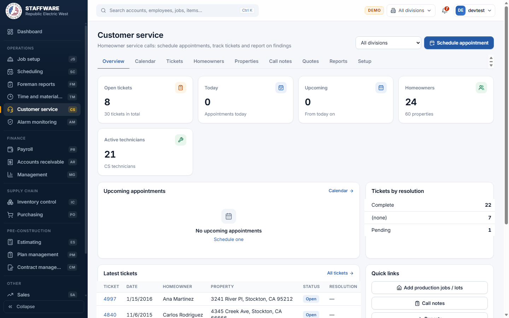
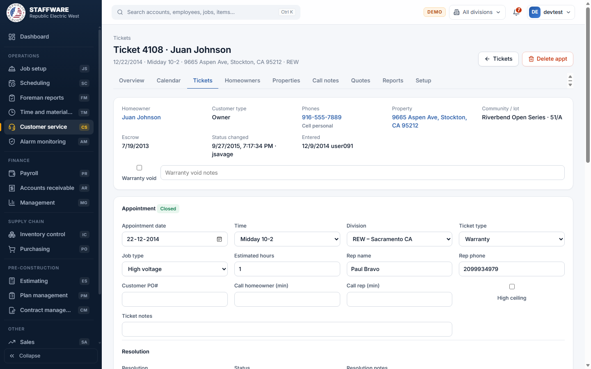
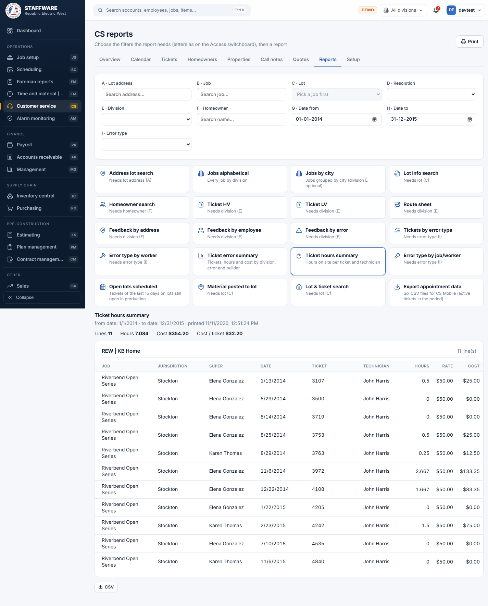

# Customer Service (CS)
*Homeowner service calls: schedule appointments, track tickets, record what was found and report on it.*

## 1. What this module is for
Customer Service is where the office handles service calls from homeowners on homes the company has wired. A coordinator books an appointment (a "ticket"), assigns technicians, records the time on site, notes what was wrong and what material was used, and closes the ticket with a resolution. The module also keeps the list of homeowners and properties, call notes, price quotes for extra work, and a set of reports on tickets, findings and cost. Access is controlled per login: only users with the CS permission flag see the module.

## 2. How it connects to other modules
### Needs data from
| Module | What it uses | Why |
|---|---|---|
| Job Setup (JS) | Jobs, lots, packs, phases and stages of production lots | Lets a service property be tied to the production lot it was built on, and shows what packs were installed |
| Plan Management (PM) | Plans and packs | Shows the plan and pack names on lot reports |
| Inventory Control (IC) | Items, vendors and item prices | Material used on a finding and the lines of a quote are picked from the item list |
| Payroll (PR) | Employees and labor paid | Technicians are chosen from the employee list; "Feedback by employee" shows who was paid on the lot |
| Database Maintenance (DM) | Divisions, statuses, phone types, states, stages and other shared lists | These pick-lists are shared with the rest of the system |

### Feeds data to
| Module | What it gives | When |
|---|---|---|
| Sales (SA) | Properties, homeowners, phones, call notes, tickets and quotes | Sales leads are built on the same property and homeowner records, so anything entered here is visible there and the other way round |

Customer Service also keeps its own pick-lists (appointment times, ticket types, job types, resolutions, errors and so on) on its Setup tab. Job costing for material used on tickets is read only: ticket material is not posted to the lot's costs.

### Where it sits in the work flow
Homes are built in Job Setup and Scheduling. After the home is finished and sold, the homeowner calls with a problem, and Customer Service books and tracks the visit. "Add production jobs / lots" brings the builder, job and lot data from Job Setup into Customer Service. The ticket findings and hours are then used for reports back to management on error causes and cost of service work.

## 3. Screens (tabs) in this module
| Screen / tab | What it is for | What you can do there |
|---|---|---|
| Overview | Daily summary | See open tickets, today's and upcoming appointments, homeowners, active technicians, latest tickets and tickets by resolution. Filter by division. Click any figure to open the matching list. Button: Schedule appointment |
| Calendar | Appointments by day or week | Switch Day or Week, move back and forward, jump to Today, type a calendar note for a day and division, see "Upcoming by city and time" and "Upcoming by technician" |
| Tickets | All appointments | Filter by Division, Show (all or open), Resolution, From and To dates; search; export CSV; open a ticket; Schedule |
| Homeowners | Homeowner list | Search by name, email, phone or address; open a homeowner; New homeowner |
| Properties | Two sub-tabs: CS properties, and Add production jobs / lots | Search and open properties; create a new property; copy production lots into Customer Service |
| Call notes | Notes of phone calls per property | Add, edit and delete notes; filter by property or "With follow-up" |
| Quotes | Price quotes for service work | Search, open or create a quote, print it |
| Reports | 20 reports | Pick the filters, then a report; print or export |
| Setup | Four sub-tabs: Technicians, Assemblies, Master lists, Inventory items | Maintain technicians, assemblies (groups of material), the CS pick-lists, and look up inventory items (read only) |

## 4. How the data entry forms work
All forms follow the common behaviour of the system: required fields are marked with a star, a green message confirms a save, a red message explains a refusal, and anything that deletes asks "are you sure" first.

### Schedule appointment
- When you use it: a homeowner calls and needs a visit. This one form can create the homeowner, the property, the link between them and the ticket in one go.
- Fields:
  - Required: Division, Appointment date, Appointment time, Ticket type, Job type, Customer type, homeowner Last name and First name, property Street address, City, State, Zip. Status starts as Active.
  - Pick-lists: Division, Appointment time, Ticket type, Job type, Status, Customer type and Phone type come from the lists kept in Setup and Database Maintenance.
  - Finders: "Find homeowner" and "Find property" search existing records; Community searches the CS communities of the chosen division; the technician drop-down adds technicians to the ticket.
  - Optional: Middle name, Email, phone numbers (several allowed), Unit / apt, Escrow date, CS lot / block, Builder representative and Representative phone, Customer PO#, Estimated hours, Call homeowner and Call rep (minutes before), High ceiling, Ticket notes.
- Step by step: open Schedule appointment (from Overview, Calendar, Tickets, or the Schedule button on a homeowner or property). Either find an existing homeowner or property, or type new ones. Choosing a homeowner fills email, phones and notes, and fills the property if the homeowner has only one; if there are several, buttons let you pick one. Choosing a property fills the address and does the same for the homeowner. Fill the appointment details, add technicians, and click Schedule. Clear data empties the form.
- What gets saved: the ticket (with the next ticket number), plus a new homeowner, property and link only if they did not already exist. If a property with exactly the same address exists it is reused; if a homeowner with the same first and last name exists, that one is reused. The phone list on the form replaces the homeowner's saved phone list. The property's zip and escrow date and the homeowner's email are updated to what you typed. You land on the new ticket, which also appears on Tickets, the Calendar and the homeowner and property pages.
- Safeguards: if two properties share the address, or two homeowners share the name, you are told to pick from the list. A date more than 10 days in the past shows a warning. Warnings appear if the property is still open in production, or has the Warranty void flag. Notes on the homeowner are shown on screen. The "Already on this date" panel under the form shows who else is booked that day. Everything is saved together or not at all.

### Ticket (edit appointment, resolution, technicians, findings, material)
- When you use it: to follow a visit from booking to close.
- Fields:
  - Appointment block: Appointment date, Time, Division, Ticket type, Job type, Estimated hours, Rep name and Rep phone, Customer PO#, call reminders, High ceiling, Ticket notes.
  - Resolution block: Resolution, Status, Resolution notes, Payment date, Payment value, Labor cost / hour, Material tax, Labor tax, Material mark up, Other mark up.
  - Technicians: add from the Add technician list; per technician enter Time in and Time out (hours are worked out).
  - Findings: Error, Category and Detail (each list narrows to the one before), Schedule stage, Lead technician. Material on a finding: Item, Qty, Cost ea.
- Step by step: click a ticket number anywhere. Change fields and click Save ticket. Choosing a Resolution automatically sets the Status that goes with it. Add technicians and type their times; each change saves as you leave the field. To record a finding, pick Error, then Category, then Detail, and click Submit finding. Click a finding in the list to select it, then add material on the right. The cost defaults to the item's job cost and can be changed. Warranty void and its notes are on the top panel and save on their own.
- What gets saved: the ticket and its technicians, findings and material. Status changes record who and when. If you move the date, the technicians move with it. Results appear in the Tickets list, Calendar, Overview, homeowner and property pages and in the feedback and hours reports.
- Safeguards: error, category and detail must belong together; a technician cannot be added twice; time out cannot be before time in; quantity must be above zero. Delete appt asks for confirmation and is refused while findings are entered or a quote is linked. Removing a technician, a finding (and its material) or a material line each asks first.

### Homeowner
- When you use it: to add or correct a homeowner.
- Fields: First name and Last name (required), Middle name, Email, Notes; phone list (number and type); linked properties (property and customer type).
- Step by step: Homeowners, New homeowner. Enter the details and phones and click Create homeowner. On an existing homeowner, change the fields and click Save; add phones with Add phone, link properties with Link, change a customer type in the list, or unlink with the X. The Schedule button starts an appointment for this homeowner. Ticket history is listed at the bottom.
- What gets saved: the homeowner, phones and links; they show on Properties, Tickets and in Sales.
- Safeguards: if a homeowner with the same name exists you are asked whether to save anyway. Unlinking a property keeps the property. Delete is refused if the homeowner has tickets or quotes; otherwise it removes the phones and links after confirmation.

### Property
- When you use it: to add or correct a house that gets service.
- Fields: Street address, City and State (required), Unit / apt, Zip, Escrow date, CS job / community, CS lot / block, Notes, Warranty void and notes; linked homeowners (homeowner and type); production job and lot (read only, with packs).
- Step by step: Properties, New property (or open one). Fill in and click Create property or Save. Link a homeowner with Link. The Schedule button starts an appointment. Tickets and call notes of the property are listed.
- What gets saved: the property, which then shows in Tickets, Call notes, Quotes and Sales leads.
- Safeguards: if the address already exists you are asked whether to save a second one. A banner shows if the lot is still open in production or the warranty is void. Delete is refused if the property has tickets, call notes or quotes; otherwise it asks first.

### Add production jobs / lots
- When you use it: to bring finished or active production lots into Customer Service so they can be serviced later.
- Fields: Filter address, Filter city, Division.
- Step by step: on Properties choose "Add production jobs / lots". Find a lot and click Add for one lot, or choose a division and click "Add all jobs / lots of the division".
- What gets saved: builders, communities, properties and lot links that are not yet in Customer Service. Existing ones are not touched.
- Safeguards: the bulk button asks for confirmation. It reports how many were added and lists any lots linked twice. A lot already in Customer Service, or without an address, is refused.

### Call notes
- When you use it: to log a phone call about a property and when to call back.
- Fields: Call date, Property address (finder) and Call notes are required; Customer name and Follow up date are optional.
- Step by step: type the note and click Save notes. Use the pencil in the list to edit and the check mark to save; the bin deletes after confirmation. Filter by property, search, or tick "With follow-up".
- What gets saved: the note, shown also on the property page.

### Quote
- When you use it: to price extra work for a homeowner.
- Fields: Quote name and Quote date (required); Homeowner, Property, Ticket type, Customer ref #, Lead status; pricing (Price level, Mark up %, Labor hourly rate, Flat labor, Discount %, Sales tax %, Credit card fee); follow up (Approved date and by, Paid date, Scheduled ticket #); Notes.
- Step by step: Quotes, New quote, fill in the header, Create quote. Then add categories, and inside each category add assemblies or single items with a quantity. Percentages are typed as percent (7.75 means 7.75 %). The Price level list fills in the mark up. Totals show at the bottom. Print produces a clean copy.
- What gets saved: the quote, its categories and lines. An assembly line brings in all of its material; changing its quantity re-adds its material.
- Safeguards: deleting a quote, category, assembly or line asks first. Sales tax is worked out on material only.

### Technicians, Assemblies, Master lists (Setup)
- Technicians: choose an Employee and a Technician type, click Add technician; untick Active to retire one. A warning shows if the employee has been terminated. A technician who is on tickets cannot be deleted; make them inactive instead.
- Assemblies: New assembly (name and sale price), then add items with quantity and cost. "Update assembly price" refreshes every item's cost to the current inventory price and records the date. The screen shows estimated cost, profit and profit percent.
- Master lists: pick a list (Appointment times, Customer types, Errors, Error categories, Error details, Job types, Resolutions, Technician types, Ticket types), then add, edit or delete entries. Duplicates are refused. An entry already in use cannot be deleted. Error categories and details are entered under their parent error or category.

## 5. Reports
Choose the filters at the top (Lot address, Job, Lot, Resolution, Division, Homeowner, Date from, Date to, Error type), then click a report. Each report button shows which filters it still needs. The report lines are grouped as shown.

| Report | What it shows | Filters you choose first | Print / export |
|---|---|---|---|
| Address lot search | Production lot, plan and packs for a lot address | Lot address | Print, CSV |
| Jobs alphabetical | Every job by division | none | Print, CSV |
| Jobs by city | Jobs grouped by city | Division (optional) | Print, CSV |
| Lot info search | Production lot, plan and packs of one lot | Job, Lot | Print, CSV |
| Homeowner search | Properties, plan and packs of a homeowner | Homeowner | Print, CSV |
| Ticket HV | High voltage ticket sheets for the from date | Division, Date from | Print |
| Ticket LV | Low voltage ticket sheets for the from date | Division, Date from | Print |
| Route sheet | One page per technician for the day | Division, Date from | Print, CSV |
| Feedback by address | Ticket findings by job and lot | Division, Date from, Date to | Print, CSV |
| Feedback by employee | Findings by lot with the installers paid on the lot | Division, Date from, Date to | Print, CSV |
| Feedback by error | Findings by error with the most frequent first | Division, Date from, Date to | Print, CSV |
| Tickets by error type | Tickets due to an error, hours on site and cost | Date from, Date to, Error type | Print, CSV |
| Error type by worker | Installers paid for the stage of the error | Date from, Date to, Error type | Print, CSV |
| Ticket error summary | Tickets, hours and cost by division, error and builder | Date from, Date to | Print, CSV |
| Ticket hours summary | Hours on site per ticket and technician | Date from, Date to | Print, CSV |
| Error type by job/worker | Findings by job, lot and ticket with the installers | Date from, Date to, Error type | Print, CSV |
| Open lots scheduled | Tickets of the last 15 days on lots still open in production | none | Print, CSV |
| Material posted to lot | Material (not labor) posted to a lot | Job, Lot | Print, CSV |
| Lot & ticket search | The lot and every ticket on it | Job, Lot | Print, CSV |
| Export appointment data | Six CSV files for the CS Mobile app | Date from, Date to | Download each file or all six; Email opens a blank message (attach the files by hand) |

The Resolution filter is used to jump to the ticket list of open tickets with that resolution.

## 6. Action buttons
| Button | Where | What it does | What changes | Safeguards |
|---|---|---|---|---|
| Schedule | Schedule appointment | Creates the ticket and any missing homeowner, property and link | New ticket, possibly new homeowner and property; phone list replaced | Checks required fields; all-or-nothing |
| Save ticket | Ticket | Saves the appointment and resolution | Ticket; status stamped when it changes | Warnings for past dates |
| Delete appt | Ticket | Deletes the ticket and its technicians | Ticket removed | Confirmation; refused if findings or a linked quote exist |
| Add all jobs / lots of the division | Properties, Add production jobs / lots | Copies all missing builders, jobs, properties and lot links of a division | Many new records | Confirmation; summary and duplicate list afterwards |
| Update assembly price | Setup, Assembly | Resets each item's cost to the current inventory price | All items of the assembly; update date | Reports how many items changed |
| Download all six | Reports, Export appointment data | Saves six CSV files | Nothing in the database | None needed |

## 7. A typical day-to-day workflow
1. Open Overview to see open tickets and today's appointments.
2. A homeowner calls: check Homeowners or Properties to see if they already exist, and look at their call notes and ticket history.
3. Click Schedule appointment, choose the homeowner and property (or type new ones), set the date, time, types and technicians, and click Schedule.
4. Use the Calendar to check the day's load, and type a calendar note for the day if needed.
5. Before the day, print the Route sheet and the Ticket HV or Ticket LV sheets for the technicians.
6. After the visit, open the ticket, enter each technician's Time in and Time out, submit the findings and add the material used.
7. Choose the Resolution, which sets the matching Status (for example Closed), add payment details if any, and Save ticket.
8. For extra work, create a Quote and later put its ticket number on it.
9. Log follow-up calls under Call notes.
10. At month end run the feedback and hours reports to review errors and cost.

## 8. Screenshots

## 9. Good to know
- The forms follow the Access screens: choosing a resolution sets the status, the technician times drive the hours, and the quote pricing rules were carried over.
- In Access the "Delete appointment" refusal and the duplicate-address questions existed as message boxes; here they are on-screen messages or confirmation questions.
- Material entered on a ticket finding is recorded for reports only; it is not posted to lot job costs or inventory.
- Sales leads share the property and homeowner records with this module, so a change in one place changes both.
- Report filters are shown with the Access letters in the app; this guide uses the filter names.
- Reports show only the data present in the database; the figures in the screenshots are test data.
