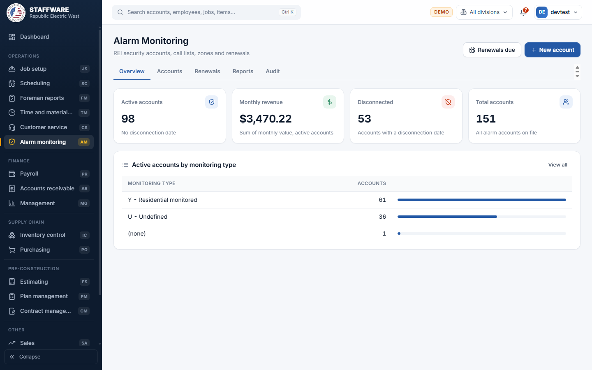
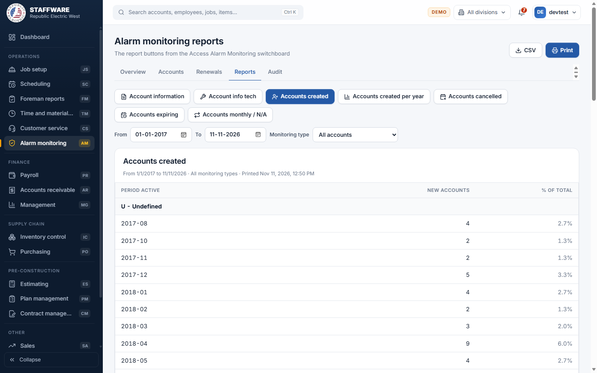
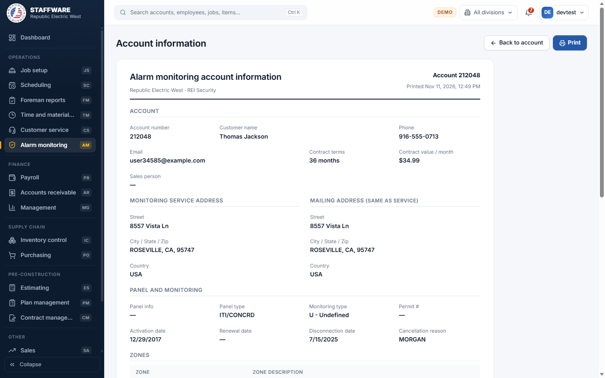

# Alarm Monitoring (AM)
*REI security accounts: contract details, call lists, zones, renewals and account reports.*

## 1. What this module is for
Alarm Monitoring keeps the company's alarm monitoring customers (REI Security). Each account holds the customer, the service and mailing addresses, the monitoring type and contract terms, the monthly value, key dates (activation, renewal, disconnection), the alarm panel, the call list of people to contact, and the alarm zones. The office uses it to look up accounts, watch contract renewals, print account sheets for the office and the technician, and report on new, cancelled and expiring accounts. Access is controlled per login: only users with the AM permission flag see the module.

## 2. How it connects to other modules
### Needs data from
| Module | What it uses | Why |
|---|---|---|
| Database Maintenance (DM) | The pick-lists Alarm monitoring types, Alarm contract terms and Phone types | These choose the monitoring type, contract terms and phone type on an account |

### Feeds data to
| Module | What it gives | When |
|---|---|---|
| none | Alarm Monitoring is self-contained | Its accounts, contacts and zones are used only inside this module |

### Where it sits in the work flow
Alarm Monitoring is separate from the building work flow. A security sale is entered as a new account, activated, then monitored for the length of the contract. Before the contract ends, the Renewals and Reports screens show which accounts are due. When a customer leaves, a disconnection date and cancellation reason are entered, and the account moves out of the active list but stays on file for the reports.

## 3. Screens (tabs) in this module
| Screen / tab | What it is for | What you can do there |
|---|---|---|
| Overview | Quick figures | See Active accounts, Monthly revenue, Disconnected and Total accounts, and active accounts by monitoring type. Buttons: Renewals due, New account |
| Accounts | List of all accounts | Search by name, account number, address, phone, email or panel; filter Active, Disconnected or All, and by monitoring type; sort by clicking headings; page through; New account; click a row to open it |
| Account (opened from the list) | The account form | Change account data, manage the call list and zones, print the sheets, delete the account |
| Renewals | Contracts renewing soon | Choose the next 30, 60, 90, 180 or 365 days; Print |
| Reports | Seven reports | Pick a report and its filters; Print or CSV |
| Audit | Check accounts | Filter by contract value, terms, type, reason and status; Print or CSV |

## 4. How the data entry forms work
### Account
- When you use it: to add a new alarm customer or change an existing one.
- Fields:
  - Required: Customer name.
  - Account: Account # (suggested automatically as the next free number), Phone, Email, Sales person.
  - Contract: Monitoring type and Contract terms (pick-lists), Monthly value, Activation date, Renewal date, Disconnection date, Cancellation reason.
  - Service address: Street, City, State, Zip, Country. Mailing address: same fields, hidden when "Mailing address same as service" is ticked.
  - Panel: Panel type, Panel info, Permit #. Notes.
- Step by step: Accounts, New account (or Overview, New account). Fill in the fields and click Create account. To change an account, click its row, edit, and click Save changes; "Saved" appears. The Calc button next to Renewal date fills in the activation date plus the length of the chosen contract terms. If the account is disconnected a banner shows the date and reason at the top.
- What gets saved: the account. It then shows in the Accounts list, Overview figures, Renewals, Audit and the reports, and on the printable sheets. If "Mailing address same as service" is ticked, the service address is copied into the mailing address when you save. The contract terms text is stored along with the chosen term.
- Safeguards: Customer name is required. An account number that already exists is refused ("Account number ... already exists"). Delete account opens an on-screen question that states how many contacts and zones will also be deleted and that it cannot be undone; the account, its call list and its zones are removed together.

### Call list (contacts) on an account
- When you use it: to record who to call when the alarm goes off, in order.
- Fields: Order, Name, Phone, Phone type (pick-list from Phone types), Passcode.
- Step by step: on the account page, use the "Call list (contacts)" grid. Type a new row at the bottom and click Add. Click Edit on a row to change it, then Save or Cancel. Delete asks "Delete this row?".
- What gets saved: the contact row, saved immediately (it does not wait for Save changes). It shows on the Account information sheet; contacts with the phone type "Premises" give the premises phone on the tech sheet.

### Zones on an account
- When you use it: to list the alarm zones and what each one covers.
- Fields: Zone, Description.
- Step by step: same as the call list grid: Add, Edit, Save, Cancel, Delete (with confirmation).
- What gets saved: the zone row, saved immediately. It shows on both printable sheets.

## 5. Reports
Open Reports and click one of the seven report buttons. Date reports start with From as 1 January of this year and To as today.

| Report | What it shows | Filters you choose first | Print / export |
|---|---|---|---|
| Account information | Full sheet of one account: account, service and mailing addresses, panel and monitoring, notes, zones and call list | Search for the account and click Open sheet | Print on the sheet |
| Account info tech | Technician sheet: customer, panel type, service address, premises phone and zones | Search for the account and click Open sheet | Print or Email on the sheet |
| Accounts created | New accounts by monitoring type and month, with percent of total | From, To, Monitoring type | Print, CSV |
| Accounts created per year | New accounts per year | From, To, Monitoring type | Print, CSV |
| Accounts cancelled | Cancelled accounts by monitoring type, month and cancellation reason | From, To, Monitoring type | Print, CSV |
| Accounts expiring | Active contracts longer than one month whose term ends in the period, with the expiry date | From, To | Print, CSV |
| Accounts monthly / N/A | Active monthly and N/A contracts | none | Print, CSV |

How the two single-account sheets work: choose Account information or Account info tech, then type part of the account number, name, street, city or phone in the search box. Up to 12 matches are listed with their status (Active, or Disconnected with a date). Click Open sheet beside the account you want. The printable sheet opens; use Print (or Email on the tech sheet, which opens a new message with the subject "Alarm monitoring info for homeowner" and the customer name; save the sheet as a PDF and attach it yourself). Back to account returns to the account form. The same two sheets can also be opened from the Print account and Tech sheet buttons on the account page.

The Audit tab works like a report: Contract value from and to, Contract terms, Monitoring type, Cancellation reason, and the status buttons All accounts, Active and Cancelled. It lists the matching accounts with their monthly value and shows the number of accounts and the total monthly value. The small X clears a filter. From value must not be above To value. Print and CSV are available.

## 6. Action buttons
| Button | Where | What it does | What changes | Safeguards |
|---|---|---|---|---|
| Delete account | Account page | Deletes the account with its call list and zones | The account, contacts and zones are removed | On-screen confirmation showing how many contacts and zones go too |
| Calc | Account page, next to Renewal date | Works out the renewal date from activation date and contract length | Only the field on screen until you save | None needed |
| Print account / Tech sheet | Account page | Opens the printable sheet | Nothing | None needed |

## 7. A typical day-to-day workflow
1. Open Overview to see active accounts, monthly revenue and the split by monitoring type.
2. Add a new customer with New account; enter the contract, addresses and panel and click Create account.
3. Add the call list contacts in order, each with a phone type and passcode.
4. Add the zones.
5. Print the Account information sheet for the file and the Account info tech sheet for the technician.
6. Each month open Renewals (for example the next 60 days) and print it to call customers.
7. Use Reports, Accounts expiring and Accounts monthly / N/A to plan renewals.
8. When a customer cancels, open the account, enter the Disconnection date and the Cancellation reason, and Save changes.
9. Use Audit to check data, for example all active accounts with a monthly value of zero.
10. At period end run Accounts created, Accounts created per year and Accounts cancelled.

## 8. Screenshots

## 9. Good to know
- All data entry is on one account form with two small grids; there are no wizards or batch processes.
- An account counts as active when it has no disconnection date. There is no separate status field.
- Monthly value is stored as text (for example $34.99). Reports and the Audit tab convert it to a number; a blank or unreadable value cannot be matched by the value filters.
- Contact and zone changes save immediately; the other fields wait for Save changes.
- The delete confirmation is shown on screen rather than as a browser pop-up, because pop-ups can be blocked.
- Email on the tech sheet cannot attach the sheet automatically; the user saves it as a PDF and attaches it.
- The data in the screenshots is test data and includes one account without a number or address.
