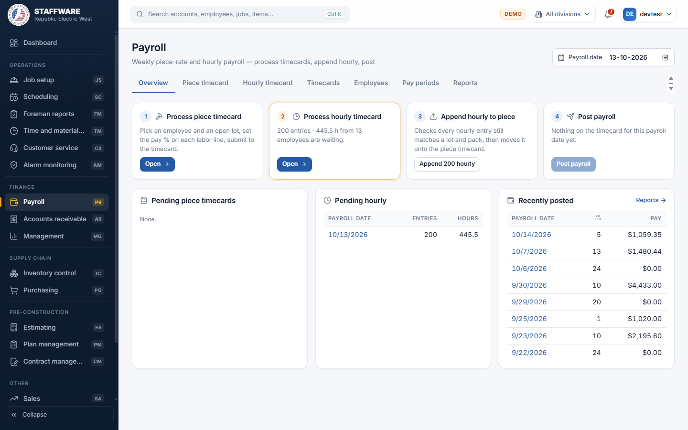
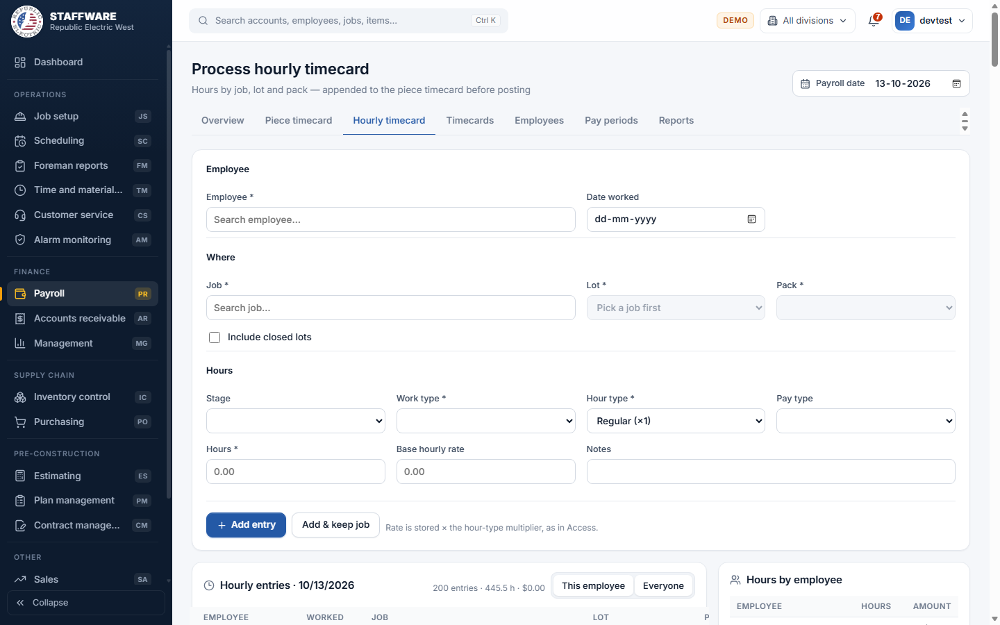
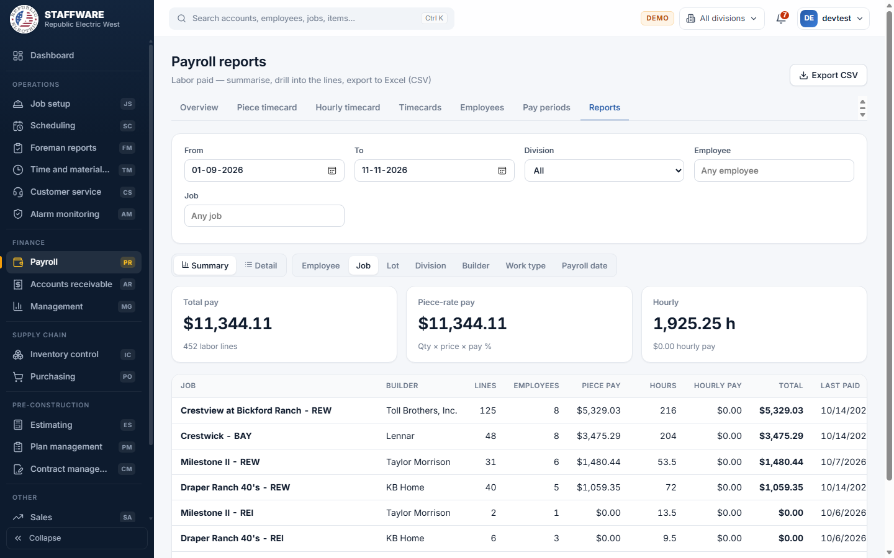

# Payroll (PR)
*Weekly piece-rate and hourly payroll: build timecards, check them, post them to labor paid and job cost.*

## 1. What this module is for
Payroll turns the work done on each lot into pay for each employee. Most pay is piece rate: the office pays an employee a percentage of the labor price on a lot. Hourly time is also supported. Payroll staff enter the timecards for a payroll date, review them, and post them. Posting records what was paid and charges the labor to the job. Access is controlled per login (permission flag PR).

## 2. How it connects to other modules
### Needs data from
| Module | What it uses | Why |
|---|---|---|
| Scheduling and Job setup | Open lots, the packs on each lot and their labor lines (item, quantity, labor price, stage, work type) | Piece pay is calculated from these labor lines. Labor lines appear on a lot when a stage is posted in Scheduling. |
| Job setup | Jobs, customers (builders), lots, phases | To pick the job and lot, and to show builder and division in reports |
| Plan management | Plan numbers and pack names | Shown on each timecard line |
| Inventory control | The item record behind each labor line, including the hourly labor item | Each timecard line is tied to a labor item |
| Database maintenance (lists) | Titles, pay types, hour types (Regular, overtime, double time), work types, stages, divisions | Pick-lists on the employee and hourly forms |

### Feeds data to
| Module | What it gives | When |
|---|---|---|
| Job cost (kept with each lot) | One labor cost line per posted timecard line | When you press Post payroll |
| Management, Receivables work-in-progress reports, Foreman reports and the Dashboard | The labor-paid history (what each employee was paid, by job, lot and date) | Whenever those reports are run, after posting |

### Where it sits in the work flow
Before payroll: a job and its lots are set up, and Scheduling posts stages so that labor lines exist on each lot. Foremen or the office decide what percentage of each lot's labor is earned. During payroll: piece timecards and hourly timecards are entered for a payroll date, hourly time is moved onto the piece timecard, and the whole timecard is posted. After payroll: labor paid shows in the payroll reports and in job cost, where it is compared with billing and budgets.

## 3. Screens (tabs) in this module
| Screen / tab | What it is for | What you can do there |
|---|---|---|
| Overview | The four payroll steps in order, with counts for the chosen payroll date | Open each step, append hourly entries, post payroll, see pending and recently posted payroll dates |
| Piece timecard | Process piece timecard: pay an employee a percentage of the labor on a lot | Pick employee, job, lot and work type; set pay %; submit to the timecard |
| Hourly timecard | Process hourly timecard: hours by job, lot and pack | Add and delete hourly entries, see hours by employee |
| Timecards | Everything waiting to be posted for the payroll date, grouped by employee | Review, change or remove lines, filter by employee, job or item |
| Employees | Employee list and employee record | Search, filter, add and change employees, see pay history |
| Pay periods | Payroll dates and the work period each one covers | Add and delete pay periods |
| Reports | Labor paid, summarised or in detail | Group, filter, drill down, export to CSV |

The **Payroll date** box at the top right of the payroll screens sets the date you are working on. The program remembers the last date you used.

## 4. How the data entry forms work
### Process piece timecard
- When you use it: to pay an employee for work done on a lot.
- Fields:
  - Required: Employee (type to search), Job (type to search; only jobs with open lots are offered), Lot (pick-list of that job's open lots, filled after you pick the job), pay % on at least one line.
  - Optional: Work type (pick-list limited to the work types found on the lot; "All work types" is the default), hours and hourly rate per line (for extra hourly pay on top of the piece pay), notes per line.
- Step by step:
  1. Check the payroll date at the top right.
  2. Pick the employee, the job and the lot. The labor lines of the lot are listed with item, quantity, price, labor dollars, and how much has already been paid or is waiting.
  3. Type a pay % on each line, or use **Set 100%**, **Set X%** (type the percent first), **Set remaining** (fills 100 minus what is paid or waiting) or **Set 0%** to clear.
  4. The pay amount for each line and a running total show as you type.
  5. Press **Submit** (the button shows how many lines). The lines are added to that employee's timecard for the payroll date.
  6. The employee's timecard for the date is shown below the form. Use the trash can on a line to remove it (you are asked to confirm).
- What gets saved or changed: lines are added to the waiting timecard for the payroll date. Nothing is paid yet. The lines show on the Timecards tab and on the Overview counts.
- Safeguards: a pay % must be between 0 and 100. If a line would go over 100% in total, counting what was already paid and what is waiting, you are asked to confirm. At least one line must have a percentage or hours. If a labor line was changed by someone else meanwhile, nothing is saved and you are asked to reload. All lines are saved together or not at all.

### Process hourly timecard
- When you use it: to record hours worked by job, lot and pack.
- Fields:
  - Required (marked with a star): Employee, Job, Lot, Pack, Work type, Hour type, Hours.
  - Optional: Date worked, Stage, Pay type, Base hourly rate, Notes.
  - Pick-lists: Lot depends on Job; Pack depends on Lot (the packs scheduled on that lot). Work type, Stage, Hour type and Pay type come from the maintained lists. **Include closed lots** adds closed lots to the Lot list.
- Step by step: pick the employee (their hourly rate, pay type and default stage are filled in for you), pick job, lot and pack, enter hours, then press **Add entry**. The form clears. Press **Add & keep job** to keep job, lot and pack for the next entry. A pay preview shows hours times rate times the hour-type multiplier. Entries for the payroll date are listed below; the trash can deletes one after confirmation. "This employee" or "Everyone" switches the list.
- What gets saved: an hourly entry waiting for the payroll date. The rate is saved already multiplied by the hour type (for example overtime is 1.5 times).
- Safeguards: hours must be above 0 and a reasonable number; the employee, lot, pack and hour type combination must exist; the hourly rate cannot be negative.

### Timecards (review and correct)
- When you use it: to check and fix lines before posting.
- Step by step: pick the payroll date, optionally type in the filter box, press the pencil on a line, change Pay %, Hours or Rate, then save (check mark) or cancel. The trash can removes a line after confirmation.
- What changes: only the waiting timecard line. Lines whose pack was removed from the lot are marked "pack removed" and a banner warns you; remove them or re-enter them before posting.

### Employee form
- When you use it: to add a new employee or change an employee.
- Fields:
  - Required: First name, Last name.
  - Optional: Employee #, Middle initial, Division (pick-list), Title (pick-list), Hire date, Termination date, Pay type (pick-list), Amount per hour, Wages rate, Salary, Default stage (pick-list), Notes.
- Step by step: on the Employees tab press **Add employee**, or click a name to open it. Fill in the fields and press **Add employee** or **Save changes**. The record also shows total paid, first and last paid dates, and recent payrolls with a link to all labor paid.
- What gets saved: the employee record. It then appears in the employee search on the timecard forms. Hourly rate, pay type and default stage are used to pre-fill the hourly timecard.
- Safeguards: first and last name are required; the termination date cannot be before the hire date; an Employee # already used by someone else is refused. There is no delete button; set a termination date instead, and use the Active / Terminated / All switch on the list.

### Pay period form
- When you use it: to set up the weekly payroll dates.
- Fields: Payroll date, Period from, Period to (all required). The next week after the latest period is suggested.
- Step by step: check or change the dates and press **Add**. The trash can deletes a period after confirmation.
- Safeguards: the period end cannot be before its start; only one pay period per payroll date.

## 5. Reports
| Report | What it shows | Filters you choose first | Print / export |
|---|---|---|---|
| Labor paid, Summary | Total pay, piece-rate pay, hours and hourly pay, with a line for each employee, job, lot, division, builder, work type or payroll date (your choice of grouping). Click a row to open its detail. | From, To, Division, Employee, Job | Export CSV button; browser print |
| Labor paid, Detail | Every paid labor line: payroll date, employee, job, lot, pack, item, work type, quantity, price, pay %, hours, rate, pay | Same filters, plus any row you clicked in the summary | Export CSV; paged list |
| Posted payroll for a date | Opened from the "View posted payroll" link or the Recently posted list on the Overview | The payroll date you click | Viewed on screen in the Insights area |

The CSV export is the replacement for the Access "Export payroll" and "Exp labor paid" Excel outputs.

## 6. Action buttons
| Button | Where | What it does | What changes | Safeguards |
|---|---|---|---|---|
| Append hourly | Overview, step 3 | Checks that every hourly entry still matches a lot and pack, then moves all hourly entries for the payroll date onto the piece timecard | Hourly entries become timecard lines and are cleared from the hourly list | If any entry does not match, nothing moves and the problem entries are listed (employee, job, lot, pack, what is wrong). Confirmation asked first. All or nothing. |
| Post payroll | Overview, step 4 | Posts the whole timecard for the payroll date | Writes labor paid and job cost for every line, then clears the timecard | Checks every line still matches a pack on its lot; a confirmation shows the number of lines and the pay total and says it cannot be undone from here; a warning shows if labor is already posted for that date. All or nothing. |
| Submit | Piece timecard | Adds the selected lines to the employee's timecard | Waiting timecard lines | See the piece form above |

## 7. A typical day-to-day workflow
1. Open **Payroll > Overview** and choose the payroll date.
2. Open **Piece timecard**, pick an employee, a job and a lot, set the pay % on the labor lines and press **Submit**. Repeat for each employee and lot.
3. Open **Hourly timecard** and add hourly entries for employees paid by the hour.
4. On the Overview press **Append hourly** to move the hourly entries onto the timecard. Fix any listed problems.
5. Open **Timecards** and review each employee. Correct or remove lines. Fix any "pack removed" lines.
6. Return to the Overview and check the totals shown for step 4.
7. Press **Post payroll** and confirm.
8. Open the **Reports** tab, or use the "View posted payroll" link, to check what was posted. Export to CSV if the payroll service needs it.
9. Add next week's date on **Pay periods**.

## 8. Screenshots

## 9. Good to know
- The four-step flow follows the Access payroll switchboard that is in use today. A newer Access process that was switched off is not reproduced.
- Pay for a line is quantity x price x pay % plus hours x hourly rate, the same as Access.
- Hourly entries have to be appended to the timecard before they can be posted. Posting does not pick up unappended hourly entries.
- Posting cannot be undone in the web program. If the same payroll date is posted twice, the second posting adds to the first, and a warning is shown.
- The timecard and hourly lists are shared by all users on the same payroll date.
- The Timecards, Employees and Pay periods tabs have no separate print layout. Use the browser print or the CSV export.
- The Employee form has no delete button.
