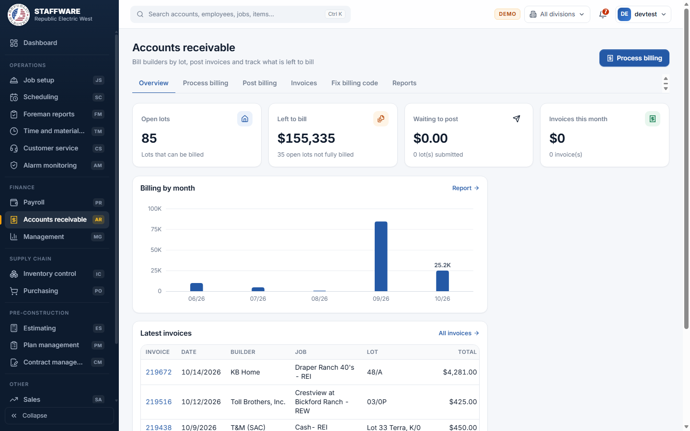
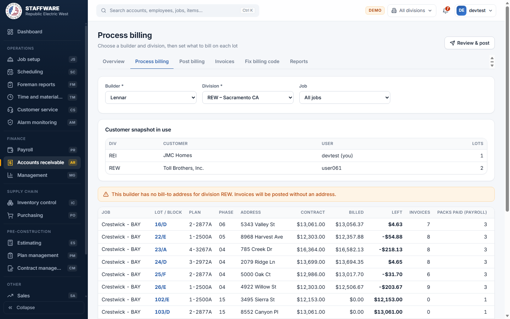
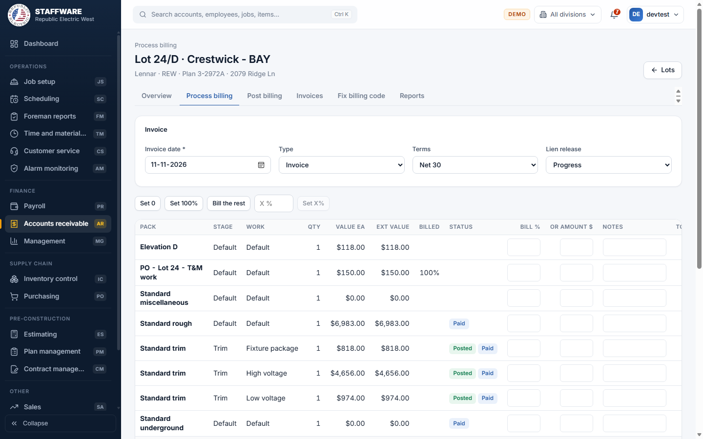
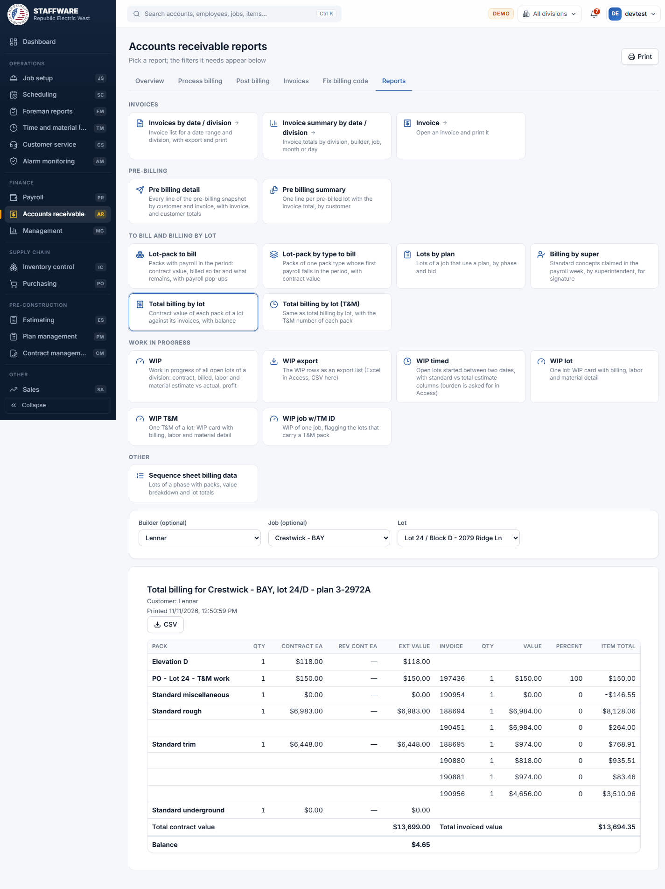

# Accounts receivable (AR)
*Bill builders by lot and stage, post the invoices, fix billing codes and report on what is billed and what is left to bill.*

## 1. What this module is for
Accounts receivable is where the office turns finished work into invoices. For each builder and division you pick the open lots, say how much of each pack to bill (as a percent or a dollar amount), review the result, and post it as one invoice per lot. You can also enter manual invoices (backcharges, credits, extras), correct billing lines that lost their stage and work, and run the billing and work-in-progress reports. Access is controlled per login: only users with the AR permission flag see this module.

## 2. How it connects to other modules
### Needs data from
| Module | What it uses | Why |
|---|---|---|
| Job setup | Builders, jobs, lots, phases, packs on each lot, contract values, and the builder's bill-to address for each division | These are the lots and amounts you bill, and the address printed on the invoice |
| Plan management | Plans and contract/pack information behind each lot | Shows the plan on each lot and supports the "Lots by plan" report |
| Payroll | Labor already paid per pack | Shows "Packs paid (payroll)" on Process billing and drives the "Lot-pack to bill" and "Billing by super" reports |
| Inventory control and job cost | Material and labor posted to each lot | Used by the work-in-progress reports to compare estimate with actual |
| Time and material | The T&M number on each T&M pack | Used by "Total billing by lot (T&M)", "WIP T&M" and "WIP job w/TM ID" |
| Database maintenance (lists) | Divisions, invoice types, terms, schedule stages, work types, pack types, superintendents | Fill the pick-lists and labels |

### Feeds data to
| Module | What it gives | When |
|---|---|---|
| Management | The posted invoices and invoice lines | Management's job cost report shows "Billed" and gross profit from these invoices, every time it is run |
| Reports inside AR | Billed amounts per lot | Every report here reads the invoices straight away; there is no separate month-end step |

AR does not change records in any other module; it only saves to its own invoice and pre-billing tables.

### Where it sits in the work flow
Job setup creates the lots and packs, Plan management and Scheduling set up the work, and Payroll pays the crews as stages are done. A Time and material order that has been processed adds a "PO" pack to the lot, and that pack then appears in AR as something to bill. AR bills the lot and the invoice amounts flow into Management's job cost and profit reports.

## 3. Screens (tabs) in this module
| Screen / tab | What it is for | What you can do there |
|---|---|---|
| Overview | Quick picture of billing | See open lots, the amount left to bill, the amount waiting to post, invoices this month, a "Billing by month" chart and the latest invoices. Click a card, a bar or an invoice to drill in. "Process billing" button at the top right |
| Process billing | Choose what to bill | Pick a builder and division (and optionally a job), see the open lots with contract, billed, left, invoice count and payroll-paid packs. Click a lot to enter its billing. "Review & post" jumps to Post billing |
| Post billing | Review and post | See the lots that were submitted, remove a lot or a line, clear the snapshot, or post everything as invoices |
| Invoices | All posted invoices, backcharges and credits | Search and filter, open an invoice, create a manual invoice, export to CSV |
| Fix billing code | Repair billing lines that lost their stage and work | Preview the automatic fix, run it, or fix lines one by one in the Manual fix |
| Reports | Page of report cards | Pick a card; only the filters that report needs appear below it |

## 4. How the data entry forms work
### Process billing (choose lots)
- When you use it: at billing time, to decide which lots to bill for a builder.
- Fields: Builder * and Division * (pick-lists; Division lists the company divisions), Job (optional pick-list that fills once builder and division are chosen; "All jobs" by default).
- Step by step: choose Builder and Division. The page lists the builder's open lots (not finished, active) with Plan, Phase, Address, Contract, Billed, Left, Invoices and "Packs paid (payroll)". A violet amount in "Submitted" means the lot is already waiting to post. Click a lot to open its billing form.
- Safeguards: a yellow notice appears if the builder has no bill-to address for that division (invoices will be posted without an address). If another user already has a snapshot for the same builder and division, a warning asks whether you really want to bill the same customer; you must press "Yes, continue" before the lots are shown.

### Customer snapshot in use (box on Process billing and Post billing)
- When you use it: it is always shown on both billing screens, as a warning against two people billing the same builder at once.
- What it shows: one row per division, customer and user who has lots waiting to post, with the number of lots. Your own entries are marked "(you)". The chosen builder and division row is highlighted.
- Good to know: the warning only appears when someone else holds the snapshot.

### Lot billing form (opened by clicking a lot)
- When you use it: to set what to bill on one lot.
- Fields, required first: Invoice date *. Then Type (Invoice, Backcharge or Credit), Terms (pick-list of payment terms, Net 30 by default) and Lien release (Progress or Final). Each pack line (Pack, Stage, Work, Qty, Value ea, Ext value, Billed, Status) has Bill % or "or amount $", plus Notes. "To bill" is calculated for you.
- Step by step: enter a percent or a dollar amount on each line to bill. Shortcut buttons set the whole lot: "Set 0", "Set 100%", "Bill the rest", and "Set X%" with the number you type. Then press "Submit invoice".
- What is checked: at least one line must have a percent or amount; percent must be between 0 and 100; the lines must still belong to the lot. If a line would go above 100% billed in total, a warning lists those lines and you can choose "Bill anyway" or Cancel.
- What gets saved: the lines are saved as a "snapshot" (pre-billing) for that lot. Submitting again replaces the earlier submission for the lot. A "Remove" button takes the lot out of the waiting billing after a confirmation. Nothing becomes an invoice yet.
- Safeguards: all lines of the lot are saved together or not at all. Status badges "Posted" and "Paid" show which stages are posted or paid in payroll. A banner tells you if the lot was finished. The "Billed on this lot" table lists earlier invoices with links.

### Post billing
- When you use it: when all the lots of a builder and division have been submitted.
- Fields: Builder * and Division * (pick-lists, "All submitted" shows the waiting list first), Invoice date *.
- Step by step: choose builder and division; each submitted lot is shown as a block with its lines. Use Edit to go back to the lot form, the trash icon to remove a lot or a line (each asks for confirmation). Press "Post billing" and confirm.
- What gets saved: one invoice per lot is created with the builder's bill-to address, invoice numbers are assigned automatically, and the waiting snapshot for that builder and division is cleared. A message lists the new invoice numbers with links, and warns if no bill-to address exists.
- Safeguards: confirmation before posting; everything posts together or not at all; posting refuses if nothing is waiting.

### Invoice (open from Invoices)
- When you use it: to correct or print a posted invoice.
- Fields: Date, Type, Terms, Lien release, Builder invoice #, Contact, Bill-to address, City, State, ZIP, Notes. Lines: description, Qty, Value ea, Bill %, Notes.
- Step by step: open an invoice from the list, change the header and press Save ("Invoice saved"). Use the pencil on a line to change quantity, value, percent or notes; the invoice total is recalculated each time. Add a line at the bottom (Description and Value required). Delete removes the whole invoice.
- Checks: the date must be valid, type must be Invoice, Backcharge or Credit, quantity, value and percent must be numbers, percent between 0 and 100.
- Safeguards: deleting an invoice asks "Delete invoice ... and all its lines? The lot can then be billed again." and removes the invoice and its lines together. Removing a line also asks first.
- Print: the "Print" button opens a printable invoice sheet with company name, bill-to, job, lines, total due and lien release.

### Manual invoice (Invoices tab, "Manual invoice" button)
- When you use it: for backcharges, credits and extras that are not billed from packs.
- Fields: Job and Lot (required; pick the job first, then a lot of that job), Date, Type, Terms, Lien release, Notes.
- Step by step: choose job and lot, set the options and press "Create invoice". The invoice opens with a $0.00 total; add its lines on the invoice screen.
- What gets saved: an invoice header for that lot, taking the builder, division and bill-to address from the lot's job and builder.

### Fix billing code
- When you use it: when billing lines were saved without a schedule stage and work (so reports cannot place them).
- Fields: Division * (pick-list).
- Step by step: choose a division. A preview table shows four steps (standard packs, and option packs matched by total, by value each, or by total per unit), how many lines each would fix and how many are ambiguous. "Show lines" lists them. Nothing is saved by the preview. Press "Fix billing code" and confirm to run all four steps.
- Manual fix (same tab, below): choose an Invoice that still has unfixed option lines; for each line pick a stage / work from that pack's contract values (or "Other (enter ids)"), then "Save n fix(es)".
- What gets saved: stage, work and code are filled in on the invoice lines. Only lines with exactly one match are fixed automatically; ambiguous lines are left for the manual fix.
- Safeguards: preview first, confirmation, and all four steps run together or not at all. The manual fix checks that the invoice belongs to the chosen division.

## 5. Reports
All reports are on the Reports tab: click a card and only the filters it needs appear. Filters marked optional can be left blank. Choosing a report that needs From/To fills them with the start of this year and today. Print uses the browser print on the report shown; most reports also have a CSV button.

| Report | What it shows | Filters you choose first | Print / export |
|---|---|---|---|
| Invoices by date / division | Invoice list for a date range and division (opens the Invoices tab) | From, To, Division, Builder, Type | CSV, search |
| Invoice summary by date / division | Invoice totals by division, builder, job, month or day (opens "Receivables reports") | From, To, Division, Builder; choose grouping | CSV, Print |
| Invoice | One invoice to print (opens Invoices) | Pick the invoice, then Print | Print |
| Pre billing detail | Every line of the waiting billing by customer and invoice, with totals | Division * (Builder optional) | Print, CSV |
| Pre billing summary | One line per waiting lot with invoice total | Division * (Builder optional) | Print, CSV |
| Lot-pack to bill | Packs with payroll in the period: contract, billed so far, what remains; payroll details open under each row | Division *, From *, To * (Builder optional) | Print, CSV |
| Lot-pack by type to bill | Packs of one pack type whose first payroll falls in the period | Division *, From *, To *, Pack type * | Print, CSV |
| Lots by plan | Lots of a job that use a plan, by phase and bid | Builder, Job *, Plan * | Print, CSV |
| Billing by super | Standard concepts claimed in the payroll week, by superintendent, for signature | Date *, Division * | Print, CSV |
| Total billing by lot | Contract value of each pack of a lot against its invoices, with balance | Builder, Job, Lot * | Print, CSV |
| Total billing by lot (T&M) | Same, with the T&M number of each pack | Builder, Job, Lot * | Print, CSV |
| WIP | Work in progress of all open lots of a division: contract, billed, labor and material estimate vs actual, profit | Division *, Burden %, Builder | Print, CSV |
| WIP export | The WIP rows as an export list | Division *, Burden %, Builder | CSV |
| WIP timed | Open lots started between two dates | Division *, From *, To *, Burden % | Print, CSV |
| WIP lot | One lot's WIP card with billing, labor and material detail | Builder, Job, Lot *, Burden % | Print, CSV |
| WIP T&M | One T&M of a lot as a WIP card | Builder, Job, T&M order *, Burden % | Print, CSV |
| WIP job w/TM ID | WIP of one job, flagging lots that carry a T&M pack | Division *, Job *, Burden % | Print, CSV |
| Sequence sheet billing data | Lots of a phase with packs and value breakdown | Builder, Job, Phase * | Print, CSV |

The "Receivables reports" page (opened from the invoice summary card and from the Overview) also offers "Invoice totals", "Lots left to bill" and "Work in progress" views with a Division and Builder filter, plus CSV and Print.

## 6. Action buttons
| Button | Where | What it does | What changes | Safeguards |
|---|---|---|---|---|
| Submit invoice | Lot billing form | Saves the lot's lines as waiting billing | Waiting-billing records for that lot (replaces any earlier submission) | At least one line, percent 0-100, warning above 100% total, all-or-nothing |
| Post billing | Post billing tab | Turns the waiting lots of a builder and division into invoices | New invoices and invoice lines; waiting records cleared | Confirmation, all-or-nothing, refuses if nothing is waiting |
| Clear billing snapshot | Post billing tab | Discards everything submitted for the builder and division | Waiting records deleted; no invoices created | Confirmation |
| Fix billing code | Fix billing code tab | Fills in stage, work and code on billing lines | Existing invoice lines in the chosen division | Preview first, confirmation, all four steps together |
| Save n fix(es) | Fix billing code, Manual fix | Applies the stage/work you chose to selected invoice lines | Lines of one invoice | Invoice must belong to the chosen division |
| Delete (invoice) | Invoice screen | Removes an invoice and its lines | Invoice and lines deleted; lot can be billed again | Confirmation |

## 7. A typical day-to-day workflow
1. Open Overview to see open lots, the amount left to bill and anything waiting to post.
2. Go to Process billing and choose the Builder and Division. Check the "Customer snapshot in use" box; if someone else is billing the same builder, talk to them first.
3. Click the first lot, set the invoice date, type and terms, and enter Bill % or an amount on the packs that are ready (use "Bill the rest" or "Set 100%" for speed).
4. Press "Submit invoice" and repeat for each lot of the builder.
5. Open Post billing ("Review & post"), check the lots and totals, and remove any line that should not go out.
6. Enter the invoice date and press "Post billing"; note the invoice numbers shown.
7. Open Invoices to print invoices or add backcharges and credits with "Manual invoice".
8. If reports show billing lines without a stage, open Fix billing code, check the preview and run the fix.
9. Use Reports (Lot-pack to bill, Total billing by lot, WIP) to see what is left to bill and how jobs are performing.

## 8. Screenshots

## 9. Good to know
- Money is handled as dollars and cents; invoice totals are recalculated whenever a line changes.
- "Burden" on the WIP reports is entered as a percent (15 means 15%).
- Where a ratio would divide by zero, the web app shows a blank instead of an error.
- In "Fix billing code", Access picked one match at random for ambiguous lines; the web app leaves them for the Manual fix.
- The "Customer snapshot in use" warning appears only when another user holds the snapshot, not for your own.
- The payroll pop-ups under "Lot-pack to bill" open inline under the row instead of in a second window.
- Lots without a plan still appear in the lot reports (Access hid them).
- The sample database has little data for some reports (for example pre-billing and Fix billing code); these show little or nothing until real data is loaded. The Access letter-coded switchboard buttons are replaced by the report cards.
- Invoices can be edited and deleted after posting; the app does not lock posted invoices.
