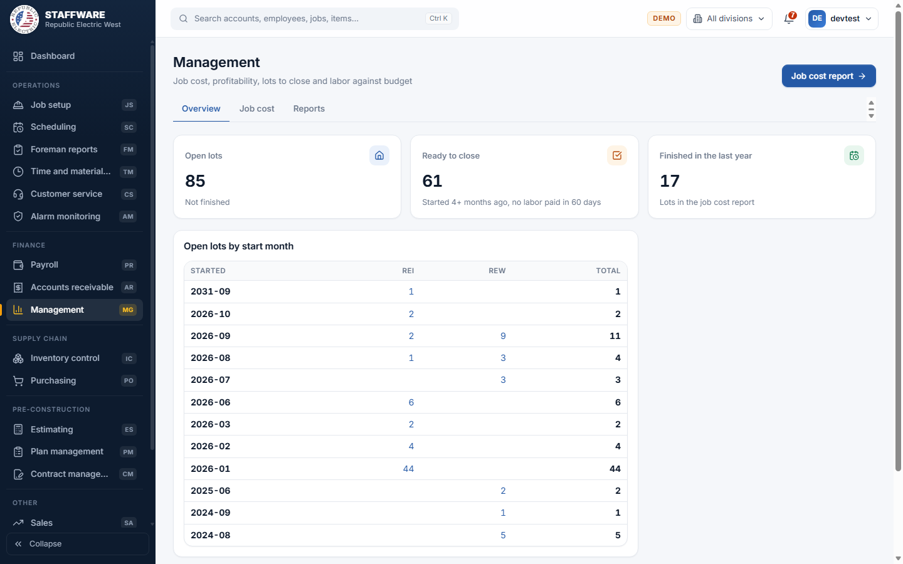
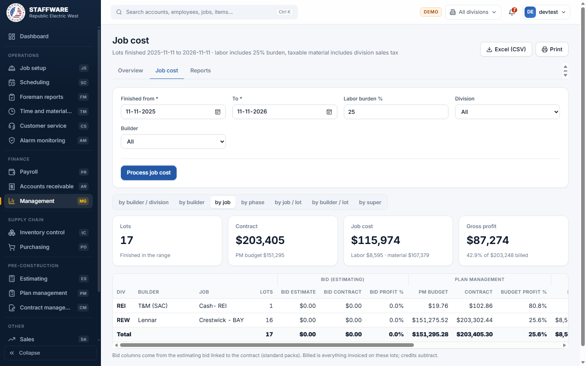
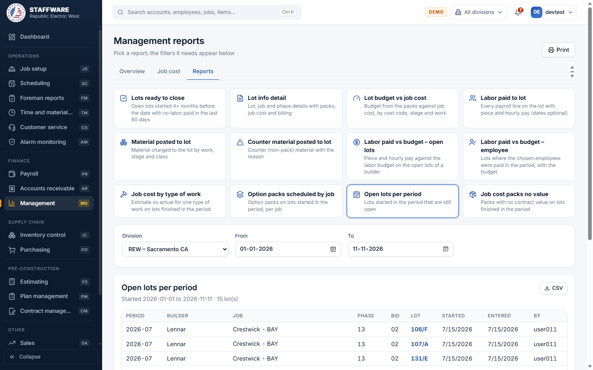

# Management (MG)
*Job cost, profit, lots to close and labor against budget, for the people who run the company.*

## 1. What this module is for
Management is a read-only reporting module for owners and managers. It answers questions such as: which lots are open, which lots are ready to close, how much did each job, builder, phase or superintendent cost against the bid and the budget, how much was billed, and what profit was made. Nothing is entered or changed here. Access is controlled per login: only users with the MG permission flag see this module.

## 2. How it connects to other modules
### Needs data from
| Module | What it uses | Why |
|---|---|---|
| Job setup | Builders, jobs, phases, lots and packs on each lot | The basis of every report |
| Plan management | Plans, contracts, pack budgets and materials | The "PM budget" and contract columns, and lot budgets |
| Estimating | The bid linked to a contract (plans, packs, materials) | The "Bid" columns in the job cost report |
| Payroll | Labor paid per lot and employee | Labor cost, "Labor paid to lot", "Labor paid vs budget" and the "no labor in 60 days" rule |
| Inventory control and job cost | Material posted to lots | Material cost, "Material posted to lot" and counter material |
| Accounts receivable | Posted invoices and invoice lines | The "Billed" amount and gross profit |
| Database maintenance (lists) | Divisions, stages, types of work, superintendents, statuses and similar lists | Pick-lists and labels |

### Feeds data to
| Module | What it gives | When |
|---|---|---|
| None | Management only reads; it does not save anything to any module | - |

### Where it sits in the work flow
Management sits at the end of the chain. Estimating prepares the bid, Plan management sets the budget, Payroll and material posting record the real cost, and Accounts receivable records what was billed. Management compares all four so the office can decide which lots to close and how jobs are performing.

## 3. Screens (tabs) in this module
| Screen / tab | What it is for | What you can do there |
|---|---|---|
| Overview | Snapshot of open work | See three cards (Open lots, Ready to close, Finished in the last year), a table "Open lots by start month" by division where each number opens the list, and a "Lot info detail" box to open a lot by its lot id. "Job cost report" button at top right |
| Job cost | Estimate vs budget vs actual vs billing | Choose the finished-date range, burden and filters, press "Process job cost", switch the grouping, export to Excel (CSV) or print |
| Reports | Page of report cards | Pick a card; only the filters that report needs appear below it; the report opens underneath |

## 4. How the data entry forms work
Management has no screens where records are added or changed. It has two screens with filters that run reports.

### Job cost filters
- When you use it: to see cost and profit for lots finished in a period.
- Fields, required first: Finished from *, To *, Labor burden % (25 by default). Optional: Division and Builder pick-lists (All by default).
- Step by step: set the dates and burden, press "Process job cost". The grouping buttons switch the same numbers between by builder / division, by builder, by job, by phase, by job / lot, by builder / lot and by super. At the lot level, clicking a row opens "Lot info detail".
- What is checked: From and To must both be given and From must not be after To; burden must be between 0 and 200.
- What gets saved: nothing. The figures are worked out live each time you press the button, so there is no stored job cost to refresh.

### Report filters (Reports tab)
- When you use it: to run any of the twelve report cards.
- Fields: only those the chosen report needs. Builder, Job and Lot are linked pick-lists: choose the builder first, then its jobs appear, then the lots of that job. Division and Type of work are pick-lists. From, To and "As of" are dates; Burden % is a number; Employees is a searchable check-list with a Clear button.
- Step by step: click a card; dates and burden are pre-filled where needed (From one year ago, To today, burden 25). Until all the required filters are chosen the page tells you what is missing (for example "Choose a builder, a division").
- Safeguards: nothing is saved; filters are kept in the page address so you can bookmark or share a report.

## 5. Reports
Every report page has a Print button. A CSV button is on the reports marked below.

| Report | What it shows | Filters you choose first | Print / export |
|---|---|---|---|
| Job cost (Job cost tab) | For lots finished in the range: bid estimate and contract, PM budget and contract, actual labor, material, job cost, billed, gross profit and GP %, with four summary cards | Finished from, To, Burden %, optional Division and Builder; grouping buttons | Excel (CSV), Print |
| Lots ready to close | Open lots started 4+ months before the date with no labor paid in the last 60 days | As of date; tick "Group by superintendent" if wanted | Print, CSV |
| Lot info detail | Lot, job and phase details with Packs, Job cost and Billing sections | Builder, Job, Lot | Print |
| Lot budget vs job cost | Budget from the packs against job cost by cost code, stage and work | Builder, Job, Lot, Burden % | Print |
| Labor paid to lot | Every payroll line on the lot with piece and hourly pay | Builder, Job, Lot; From and To optional | Print, CSV |
| Material posted to lot | Material charged to the lot by work, stage and class | Builder, Job, Lot | Print |
| Counter material posted to lot | Counter (non-pack) material with the reason | Builder, Job, Lot | Print |
| Labor paid vs budget - open lots | Piece and hourly pay against the labor budget on a builder's open lots | Builder, Division | Print, CSV |
| Labor paid vs budget - employee | Lots where the chosen employees were paid in the period, with the budget | Division, From, To, Employees | Print, CSV |
| Job cost by type of work | Estimate vs actual for one type of work on lots finished in the period | Builder, Type of work, From, To | Print, CSV |
| Option packs scheduled by job | Option packs on lots started in the period, per job | Builder, Division, From, To | Print, CSV |
| Open lots per period | Lots started in the period that are still open | Division, From, To | Print, CSV |
| Job cost packs no value | Packs with no contract value on lots finished in the period | From, To | Print |

## 6. Action buttons
| Button | Where | What it does | What changes | Safeguards |
|---|---|---|---|---|
| Process job cost | Job cost tab | Runs the job cost figures for the chosen dates and filters | Nothing is saved; the screen is refreshed | Dates required, burden 0 to 200 |

There are no other buttons that change records.

## 7. A typical day-to-day workflow
1. Open Overview and look at Open lots, Ready to close and the start-month table.
2. Click the "Ready to close" card (or choose "Lots ready to close" on Reports) to see lots with no labor in 60 days; tick "Group by superintendent" to hand each super a list.
3. Open a lot from that list to see "Lot info detail": packs, job cost and billing.
4. At month end open the Job cost tab, set the dates, keep burden at your standard, and press "Process job cost".
5. Switch the grouping (by builder, by job, by phase, by super) to see where profit is made or lost; click a lot row to look closer.
6. Use "Labor paid vs budget - open lots" for one builder to find lots where labor is running over budget.
7. Use "Job cost packs no value" to find packs that were scheduled without a contract value.
8. Export to Excel (CSV) or Print the pages you need for the meeting.

## 8. Screenshots

## 9. Good to know
- Everything is read-only; Management cannot damage data.
- In Access, "Process job cost info" built temporary tables first. The web app works the figures out live, so results always reflect current data and the button simply refreshes them.
- Job cost covers lots with an end date between From and To. Labor includes the burden percent you choose; taxable material includes the division's sales tax.
- The bid columns come from the estimating bid linked to the contract (standard packs); lots without a bid show zeros there.
- "Billed" is everything invoiced on the lots; credits subtract.
- A lot is "ready to close" when it started four or more months before the date and no labor was paid in the last 60 days.
- Access offered separate switchboard buttons for each job cost grouping; the web app puts them behind the grouping buttons on the Job cost tab.
