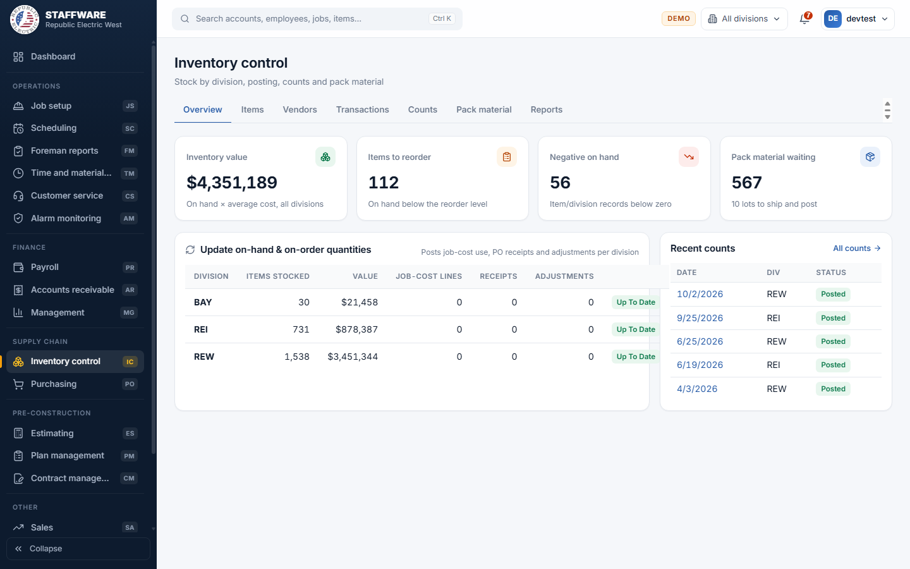
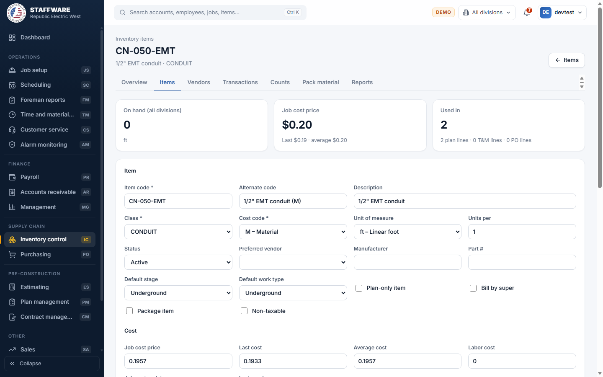
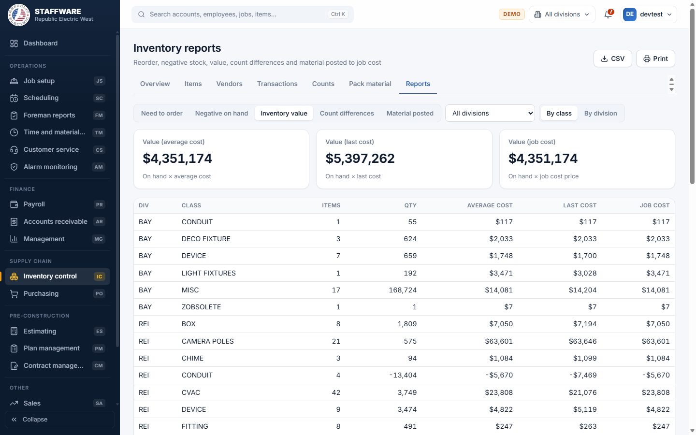

# Inventory control (IC)
*The item catalogue, vendors, stock by division, adjustments, counts and pack material posted to job cost.*

## 1. What this module is for
Inventory control keeps the master list of materials the company buys and uses, the vendors who supply them, and how many of each item are on hand in each division. It also posts material used on lots to job cost and runs periodic stock counts. Warehouse and purchasing staff use it daily. Access is controlled per login (permission flag IC).

## 2. How it connects to other modules
### Needs data from
| Module | What it uses | Why |
|---|---|---|
| Purchasing | Purchase orders and the quantities received against them | Received material is added to stock, and "on order" quantities are worked out from open orders |
| Scheduling and Job setup | Lots, jobs, phases and the pack material lists created when a stage is posted | Pack material is shipped and posted to job cost from these lists |
| Job cost (kept with each lot) | Material charged to lots | Material used on lots reduces stock |
| Plan management and Time and material | Where each item is used (plan material, T&M material) | Shown as "Used in" on the item, and used to warn before an item is made inactive or deleted |
| Database maintenance (lists) | Classes, units of measure, cost codes, divisions, stages, work types, vendor categories, transaction types, update types | Pick-lists on the item, vendor and adjustment forms |

### Feeds data to
| Module | What it gives | When |
|---|---|---|
| Purchasing | Items, vendors, vendor prices, last cost and average cost | Whenever a purchase order is written |
| Estimating, Plan management, Time and material | The item catalogue with prices, used to build bids, plans and T&M material | Whenever those modules pick an item |
| Job setup / Job cost | Material cost lines on lots | When you press **Post to job cost** on Pack material |
| Payroll | The item record behind each labor line | Whenever payroll builds a timecard line |

### Where it sits in the work flow
Before: items and vendors are set up here. Plans and bids pick those items. Purchasing orders material, and receiving records what arrived. Scheduling posts stages, which creates a pack material list for each lot. During: stock is updated from receipts, job cost and adjustments with **Update now**; pack material is shipped to lots and posted to job cost. After: counts correct stock to the real shelf count, and the reports show reorder needs, negative stock, stock value and material posted.

## 3. Screens (tabs) in this module
| Screen / tab | What it is for | What you can do there |
|---|---|---|
| Overview | Totals and the posting centre | See inventory value, items to reorder, negative on hand, pack material waiting; press **Update now** per division; open recent counts |
| Items | Inventory items (the "Inventory item" form) | Search and filter, add, change, delete or deactivate an item, set reorder levels, keep vendor prices |
| Vendors | Suppliers | Search, add, change, delete a vendor and its contacts |
| Transactions | Stock adjustments and posting history | Enter an adjustment, filter history, delete unposted ones, post |
| Counts | Inventory counts | Start a count, enter counted quantities, post or delete a count |
| Pack material | Material lists by lot | Ship all, zero or none, change shipped quantity, post to job cost |
| Reports | Five stock reports | Choose a report tab, filter, print, export CSV |

## 4. How the data entry forms work
### Inventory item
- When you use it: to add a new material, change prices, or retire an item.
- Fields:
  - Required: Item code (at least 5 characters, must be unique), Class (pick-list), Cost code (pick-list).
  - Optional: Alternate code, Description, Unit of measure (pick-list), Units per, Status (Active or inactive), Preferred vendor (pick-list of vendors), Manufacturer, Part #, Default stage and Default work type (pick-lists), check boxes Plan-only item, Bill by super, Package item, Non-taxable, Notes.
  - Cost group: Job cost price, Last cost, Average cost, Labor cost, Job cost update (how the job cost price is kept up to date), Last purchase.
  - Selling prices: mark-up % for Estimating, VIP, Residential PO and Retail, plus Estimating price update.
- Step by step: on Items press **New item**, or click an item to open it. Fill in the fields and press **Create item** or **Save changes**. The selling prices are job cost price times (1 + mark-up %); the screen shows a live preview as you type. Under the form, **Stock by division** shows on hand, on order and a "Reorder at" box (change it and press the save icon). **Vendor prices** lists each vendor's price and part number; add a vendor and price with **Add**, remove with the trash can after confirmation. **Recent transactions** lists the last stock movements.
- What gets saved: the item record, its reorder levels per division and its vendor prices. The item then shows in Purchasing, Estimating and Plan management pick-lists. On hand changes only through adjustments, receiving, job cost and counts, never on this form.
- Safeguards: item code length and uniqueness are checked; class and cost code are required; prices cannot be negative. Making an item inactive that was used in Plan management in the last 12 months asks "Are you sure you want to disable it?". **Delete** is refused if the item was ever used (stock, orders, transactions, plans, job cost or T&M); the message tells you to set it to Inactive instead. Delete asks for confirmation.

### Vendor
- When you use it: to add a supplier or keep its contacts and terms up to date.
- Fields: Name (required, unique), Category (pick-list), Status, Payment terms, Free shipping over ($), Address, City, State, Zip, Phone, Fax; a "Pay to" group with its own name, address and phone; Notes. Contacts (Name required, Title, Main contact, Office, Cell, Email) are added and edited in a table under the form.
- Step by step: on Vendors press **New vendor** or click a vendor. Press **Create vendor** or **Save changes**. Add a contact with **Add**, change with **Edit**, remove with the trash can after confirmation. The page also lists the vendor's quoted items and recent purchase orders.
- What gets saved: the vendor and contacts. The vendor then appears when a purchase order is created and in Purchasing reports.
- Safeguards: duplicate names refused. **Delete** is refused if the vendor has orders, item prices or is an item's preferred vendor; set it to Inactive instead.

### New adjustment (Transactions)
- When you use it: to correct stock for reasons other than receiving or job use (for example damage or a transfer type your company has set up).
- Fields (all required): Division, Item (type to search), Type (pick-list showing the effect, plus, minus or zero), Quantity (a whole number above 0); Notes optional.
- Step by step: fill in the form and press **Add adjustment**. It is listed as "Waiting". It changes stock only when you post.
- What gets saved: an unposted adjustment priced at the item's last cost (or average cost if none). Types for purchases and pack material are not offered because those post automatically.
- Safeguards: a waiting adjustment can be deleted after confirmation; a posted one cannot, so enter an offsetting adjustment instead.

### Start a new count (Counts)
- When you use it: for a physical inventory.
- Fields: Count date and Division (required), Activity from, Activity to, Notes.
- Step by step: press **Process count**. The program first posts everything waiting for that division so the starting quantities are current, then lists every active stocked item with its system quantity. Open the count, type the counted quantity in the "Counted" box on each line (saved when you leave the box), use "Changed only" or the class and search filters to work through the list, and press **Print** for count sheets. Press **Post count** when done.
- What changes on posting: on hand for each item in that division becomes the counted quantity. Blank lines count as 0.
- Safeguards: only one count per division per date. Posting asks for confirmation and says it cannot be undone. A posted count cannot be changed or deleted. An open count can be deleted after confirmation.

### Ship pack material (Pack material)
- When you use it: when material for a lot's stage has gone out to the job.
- Step by step: the Pack material tab lists lots with material waiting, with a division filter. Click a lot. Choose a stage if you want, then press **Ship ALL** (shipped quantity equals scheduled), **Ship ZERO** (nothing shipped, but cleared) or **Ship NONE (clear)** (decide later), or type a shipped quantity on a line. "Short" shows scheduled minus shipped.
- Safeguards: closed lots cannot be changed. Shipping does not charge anything until the division is posted.

## 5. Reports
| Report | What it shows | Filters you choose first | Print / export |
|---|---|---|---|
| Need to order | Items whose on hand is below the reorder level, with the amount needed and the vendor | Division | CSV and Print buttons |
| Negative on hand | Items below zero stock, with value | Division | CSV and Print |
| Inventory value | Stock value by class or by division, at average cost, last cost and job cost price | Division; By class or By division | CSV and Print |
| Count differences | The 20 biggest differences between system and counted quantity | Count; By value or By quantity | CSV and Print |
| Material posted | Material posted to job cost, with totals by class | Division, From, To, Class | CSV and Print |

## 6. Action buttons
| Button | Where | What it does | What changes | Safeguards |
|---|---|---|---|---|
| Update now (Update on-hand & on-order) | Overview, per division; also Transactions | Turns material used on lots (job cost) into stock reductions, purchase receipts into stock additions, adds waiting adjustments, then recalculates "on order" | Updates on hand and on order for the division and marks the receipts, job cost lines and adjustments as posted | Confirmation shows how many job cost lines, receipts and adjustments will be posted. Runs as one all-or-nothing step. Labor lines are ignored. |
| Process count / Post count | Counts | See the count form above | Stock set to counted quantities | Confirmation; cannot be undone |
| Ship ALL / ZERO / NONE | Pack material, on a lot | Sets shipped quantity for the lot (or the chosen stage) | Shipped quantities on the pack material lines | Not allowed on closed lots |
| Post [division] to job cost | Pack material | Turns every shipped line (not zero) of that division into material cost on the lot, then clears all shipped lines including zeros from the list | Adds job cost lines noted "Production pack" | Confirmation shows the shipped line count. All or nothing. |

## 7. A typical day-to-day workflow
1. Open **Inventory control > Overview** and read the four totals.
2. Add any new materials on **Items** and their suppliers on **Vendors**; enter vendor prices on the item.
3. As Purchasing receives material (see Purchasing), and as lots use material, press **Update now** for each division so stock is current.
4. Enter damaged or lost stock on **Transactions** as an adjustment, then post with **Update now**.
5. Open **Pack material**, click a lot, press **Ship ALL** (or type quantities) when the material goes out.
6. Press **Post to job cost** for the division to charge shipped pack material to the lots.
7. Check **Reports > Need to order** and **Negative on hand** and pass needs to Purchasing.
8. Periodically start a count on **Counts**, enter the counted quantities, check **Count differences**, then **Post count**.

## 8. Screenshots

## 9. Good to know
- Posting and counting follow the Access "Update on hand/order qty" and inventory count processes.
- Stock changes only through posting, receiving, job cost and counts, never by typing on the item form.
- Whole-number quantities only for adjustments, counts and pack material.
- Not built in this module (found in the Access switchboard): Item research, the item list exports and the "counter material" reports by job, plan, super and lot. Check with the project owner before promising these.
- Stock value reports use average cost on the Overview, and show all three costs on the Inventory value report.
- The count sheet uses the browser's Print button; there is no separate print layout.
