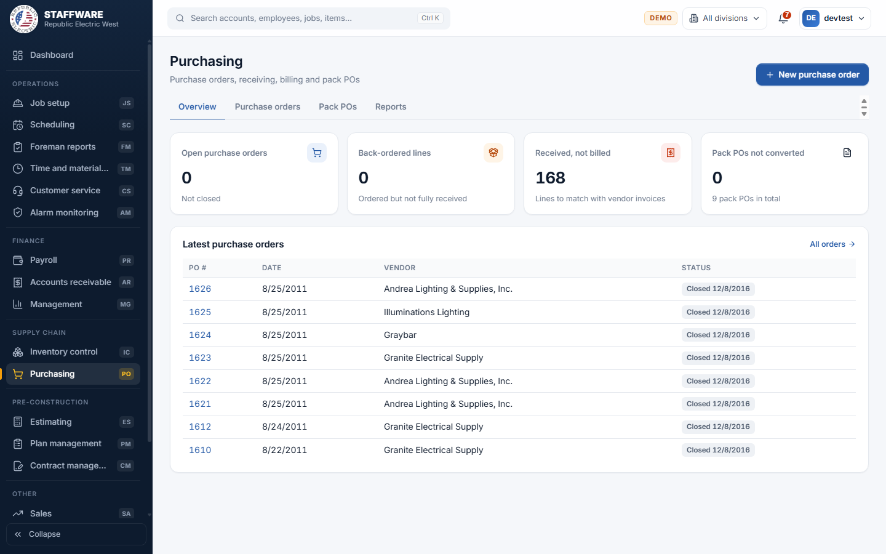
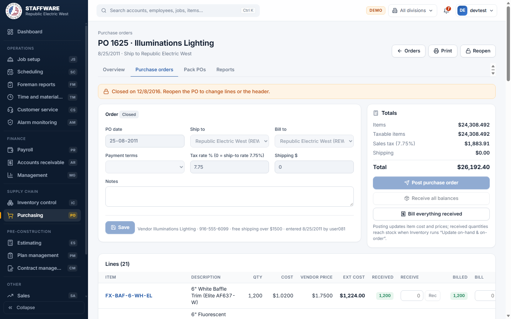
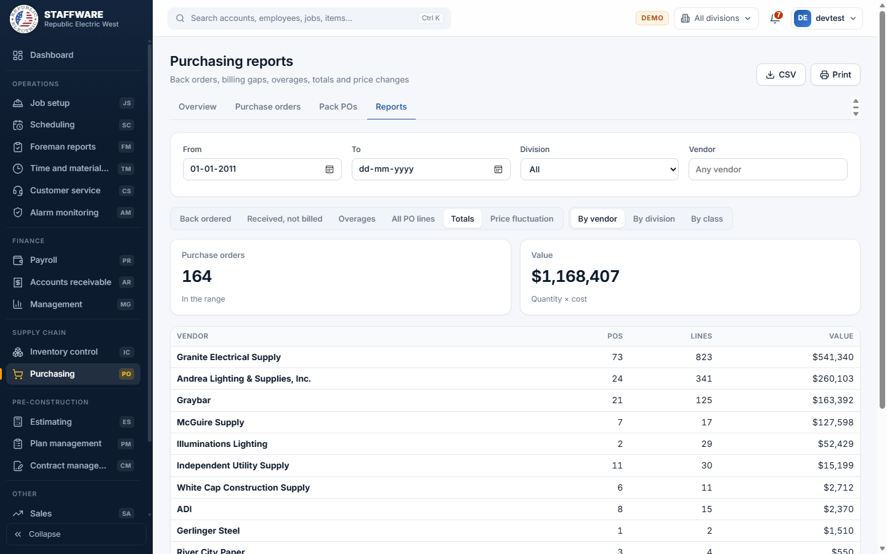

# Purchasing (PO)
*Purchase orders to vendors, receiving, billing, pack POs and purchasing reports.*

## 1. What this module is for
Purchasing is where the company orders material from its vendors and tracks each order until it is received and billed. Buyers write a purchase order, post it so costs and prices are brought up to date, record what arrives, and record what the vendor has invoiced. A pack PO lets the office order the package items of scheduled packs and convert them into one purchase order. Access is controlled per login (permission flag PO).

## 2. How it connects to other modules
### Needs data from
| Module | What it uses | Why |
|---|---|---|
| Inventory control | Items (with last and average cost), vendors and vendor prices | Every order line is an inventory item bought from an inventory vendor |
| Database maintenance (lists) | Companies (ship-to and bill-to, with their sales tax rate), payment terms, divisions, inventory classes | Pick-lists and tax on the order |
| Job setup and Plan management | Jobs, lots, scheduled packs and the package items in each pack | Used only by pack POs |

### Feeds data to
| Module | What it gives | When |
|---|---|---|
| Inventory control | Received quantities, which are added to stock; open order quantities, shown as "on order"; updated last cost, average cost, job cost price and VIP, Residential PO and Retail selling prices on the items | Receipts reach stock when Inventory control runs **Update now**. Costs and prices change when you **Post purchase order**. |

### Where it sits in the work flow
Before: items and vendors exist in Inventory control; reorder needs show on the Inventory reports; scheduled packs exist on lots. During: the buyer creates a PO, adds items, posts it, sends the printed PO to the vendor, then records receipts and billing as the material and invoices arrive. After: Inventory control posts the receipts into stock, and the PO is closed when everything is received and billed.

## 3. Screens (tabs) in this module
| Screen / tab | What it is for | What you can do there |
|---|---|---|
| Overview | Counts and latest orders | See open orders, back-ordered lines, lines received but not billed, pack POs not converted; open a recent PO; start a new PO |
| Purchase orders | List of all POs | Search and filter by status, division, vendor and date; open a PO; start a new PO |
| Purchase order (form) | One PO: header, lines, totals, receiving, billing | Edit the order, post, receive, bill, close, reopen, delete, print |
| Pack POs | List of pack POs | Filter All, Not converted, Converted; open or start a pack PO |
| Pack PO (form) | One pack PO | Add scheduled packs, post (convert) to a purchase order |
| Reports | Purchasing reports | Choose a report tab, filter, export CSV, print |

## 4. How the data entry forms work
### New purchase order
- When you use it: to start an order.
- Fields: Vendor (required, type to search); PO date, Ship to, Bill to (pick-lists of companies; the main company is the default), Payment terms (pick-list; "Vendor default" uses the vendor's terms), Notes.
- Step by step: press **New purchase order**, choose the vendor and press **Create purchase order**. The order opens so you can add items.
- What gets saved: the order header, with a new PO number. It appears at once in the list and the Overview.

### Purchase order (header, lines and totals)
- When you use it: to build, change, receive and bill an order.
- Fields:
  - Header: PO date, Ship to, Bill to, Payment terms, Tax rate % (0 means use the ship-to company's rate, shown in the label), Shipping $, Notes.
  - Lines: Item (type to search), Qty, Cost. Cost left empty fills automatically from the vendor's price, then last cost, then average cost.
- Step by step:
  1. Change the header and press **Save**.
  2. In the last row of the Lines table pick an item, type a quantity (and a cost if you want to override) and press **Add**. The pencil edits quantity and cost; the trash can removes a line that has no receipts or billing.
  3. Totals on the right update: Items, Taxable items, Sales tax, Shipping, Total. Items with cost code NT are not taxed.
  4. Press **Post purchase order** (see Action buttons).
  5. When material arrives, type the quantity in the line's Receive box and press **Rec** (the box suggests the balance). Quantities received are shown with a badge: green when complete, amber when partial, red when more than ordered.
  6. When the vendor invoices, type the quantity in the Bill box and press the button beside it. Lists of Receipts and Billing appear below.
  7. Press **Print** for the printable PO. Press **Close PO** when finished, or **Reopen** later. A banner offers to close when everything is received and billed.
- What gets saved: the order, its lines, receipts and billing entries. Receipts show as "Waiting" until Inventory control posts them to stock, then "Posted".
- Safeguards: a vendor is required; the date is required; the tax rate must be between 0 and 25; shipping cannot be negative; quantity must be a whole number above 0; the same item cannot be on a PO twice (change its quantity); a closed PO cannot be changed until reopened; a line cannot be removed once it has receipts or billing; a receipt that has been posted to inventory cannot be deleted; a PO with receipts or billing cannot be deleted (close it instead). Deleting, removing lines, receipts and billing entries all ask for confirmation. A message tells you when more than the ordered quantity is received.

### Pack PO
- When you use it: to order the package items of packs scheduled on lots, from one vendor.
- Fields: Vendor (required), Date, Ship to, Bill to, Terms, Shipping $, Notes. Lines: choose a Job, Lot and one of that lot's scheduled packs, plus Quantity and Cost (0 uses the last cost).
- Step by step: press **New pack PO**, choose the vendor, and create it. Add each lot and pack with **Add pack**. The table shows how many package items each pack contains ("none" means that pack produces no order lines). Change quantity or cost in the table, remove a line with the trash can, then press **Post pack PO**.
- What gets saved: on posting, one new purchase order is created for the vendor, with one line per item (quantities added up across all packs), and posted like any PO. The pack PO is marked with the conversion date and a link to the new PO.
- Safeguards: the same lot and pack cannot be added twice; the pack must be scheduled on the chosen lot; posting asks for confirmation and can only be done once; a converted pack PO cannot be changed or deleted; posting is refused if none of the packs contain package items. All or nothing.

## 5. Reports
| Report | What it shows | Filters you choose first | Print / export |
|---|---|---|---|
| Back ordered | Lines on open POs ordered but not fully received | From (defaults to one year ago), To, Division, Vendor | CSV and Print buttons |
| Received, not billed | Lines received but not fully billed, to match with vendor invoices | Same | CSV and Print |
| Overages | Lines where more was received than ordered | Same | CSV and Print |
| All PO lines | Every PO line with ordered, received and billed quantities and cost | Same | CSV and Print |
| Totals | PO count, line count and value by vendor, division or class | Same; By vendor, By division or By class | CSV and Print |
| Price fluctuation | Items bought at different prices, with lowest, highest, average and the spread | Same | CSV and Print |

PO numbers in the line reports are links that open the order.

## 6. Action buttons
| Button | Where | What it does | What changes | Safeguards |
|---|---|---|---|---|
| Post purchase order | Purchase order | Fills zero costs from last or average cost; sets each item's last cost and last purchase date; works out the tax rate and tax amount; recalculates each item's average cost from the last 365 days of orders; updates job cost price for items set to update automatically; recalculates the VIP, Residential PO and Retail selling prices from the mark-ups | Updates the PO and the item records in Inventory control | Confirmation lists what will change. Needs at least one line. Blocked on a closed PO. All or nothing. |
| Receive all balances | Purchase order | Receives the unreceived balance of every line, dated today | Adds receipts, which wait for Inventory control to post | Confirmation. Blocked on a closed PO. |
| Bill everything received | Purchase order | Marks all received but unbilled quantities as billed, dated today | Adds billing entries | Confirmation |
| Close PO / Reopen | Purchase order | Sets or clears the closed date | Closed POs cannot be edited and drop out of "open" counts | None needed; can be reversed |
| Post pack PO | Pack PO | Converts the pack PO into a purchase order | Creates and posts a PO; marks the pack PO converted | Confirmation; once only |

## 7. A typical day-to-day workflow
1. Check **Inventory control > Reports > Need to order** and the **Purchasing > Overview** counts.
2. Press **New purchase order**, choose the vendor, ship-to and terms.
3. Add items; check the vendor price, quantities and totals.
4. Press **Post purchase order**; then **Print** and send the PO to the vendor.
5. When material arrives, open the PO and record receipts (**Rec**, or **Receive all balances**).
6. In Inventory control press **Update now** so the receipts reach stock.
7. When the vendor invoice arrives, record billing, or press **Bill everything received**.
8. Review **Reports > Back ordered** and **Received, not billed** each week.
9. Close the PO. For builder-supplied package items, use **Pack POs** to order several lots at once.

## 8. Screenshots

## 9. Good to know
- The order, receiving, billing and pack PO screens follow the Access Purchase order, Receive PO material, Billed PO material and Post pack PO processes. Totals and tax follow the Access rules.
- Receiving on a PO does not change stock by itself. Stock changes when Inventory control posts it.
- Vendors and items are maintained in Inventory control, not here.
- Not built in this module (found in the Access switchboard): Item research, Material order estimate, PO item history export, Update item prices, Low estimating prices, Items with zero value, and Vendor categories. Vendor categories are a list kept in Database maintenance. Check with the project owner before promising the others.
- Printing a PO uses a dedicated PO page; reports use the browser print button and CSV export.
- The demo data has no open purchase orders, so the screenshots show a closed order.
