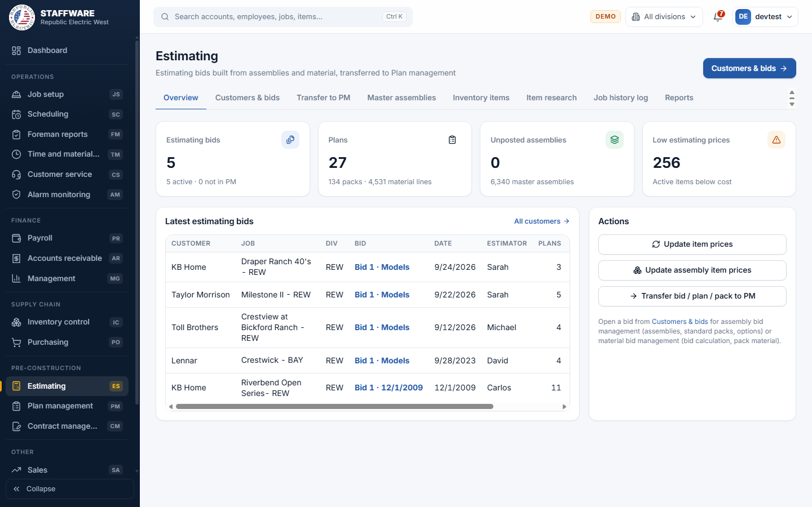
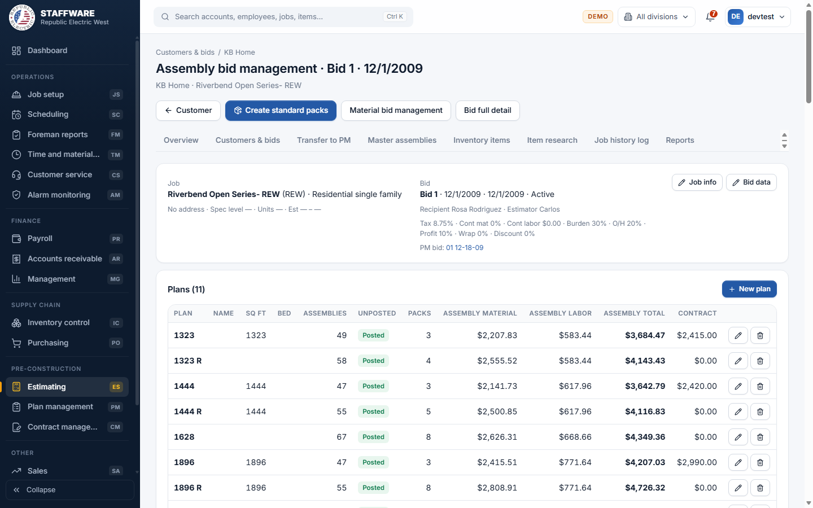
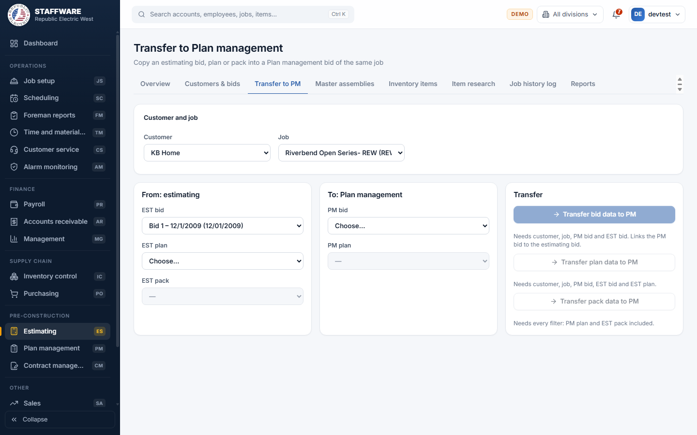

# Estimating (ES)
*Build and price estimating bids from standard assemblies and material, then hand them over to Plan management.*

## 1. What this module is for
Estimating is where the estimator prepares a bid for a builder. You pick a customer and a job, create an estimating bid, add the plans of the house, fill each plan from ready-made assemblies, and let the system create the standard packs and price them. When the bid is agreed, one click copies it into Plan management, where the production packs live. Estimating also keeps the master assemblies, the estimating prices of inventory items, and the dated notes of each job (the job history log).

Estimators and the contract department use it. Access is controlled per login: a user sees the Estimating module only when the login has the permission flag ES.

## 2. How it connects to other modules
### Needs data from
| Module | What it uses | Why |
|---|---|---|
| Inventory control | The item list: item names, descriptions, labor cost, average cost, last cost, default stage and work, vendors | Every material line in a pack is an inventory item, priced from the item. |
| Plan management | Customers, jobs, bids, plans and packs | Customers and jobs are shared with Plan management. The transfer needs a Plan management bid of the same job to receive the data. |
| Contract management | Job history entries (the dated notes of a job) | The job history log is the same list of entries that Contract management shows for the job. |
| Job setup | Whether a job is already linked to a scheduled job | A job that is linked to Job setup cannot be deleted from Estimating. |
| Database maintenance | The pick-lists: status, job type, division, jurisdiction, pack type, stage, work, cost code, contract type, update type | They fill the drop-down boxes on the forms. |

### Feeds data to
| Module | What it gives | When |
|---|---|---|
| Plan management | A copy of the estimating bid, plan or pack with all its material | When you press a Transfer button on the Transfer to PM tab. |
| Plan management | New customers and jobs | When you add a customer or a job in Estimating, it is a normal Plan management customer or job from then on. |
| Inventory control | New item prices (job cost, estimating, price book) | When you press Update item prices, or save an item on the Inventory items tab. |
| Contract management | Job history entries | When you add, change or delete a note on the Job history log tab. |
| Management | Bid, plan, pack and material figures are read by Management reports | Automatic; nothing to press. |

### Where it sits in the work flow
Before: Inventory control keeps the item prices up to date, and Database maintenance keeps the lists. Plan management already knows the customer and the job if the builder is an existing one.
During: the estimator builds the bid here: plans, assemblies, standard packs, option packs, material.
After: the bid is transferred to Plan management, the contract department sets contract values in Contract management, and the job is scheduled in Job setup and Scheduling.

## 3. Screens (tabs) in this module
| Screen / tab | What it is for | What you can do there |
|---|---|---|
| Overview | A quick view of the estimating work | See the counts (estimating bids, plans, unposted assemblies, low estimating prices), the latest bids, and press the price update buttons. |
| Customers & bids | The starting point: customer, then its jobs, then the estimating bids of the job | Search customers, add a customer, add or edit jobs and bids, open a bid for Assemblies or Material. |
| Assembly bid management (opened from a bid) | Plans of a bid and the assemblies of each plan | Add plans, select assemblies, change quantities, see cost by cost code, create standard packs, add option packs. |
| Material bid management (opened from a bid) | The price calculation of each plan and its packs | See the bid calculation, add or edit packs, open a pack to work on its material. |
| Pack (opened from a pack) | The material lines of one pack | Add items, add assembly material, change quantity, price, stage and work, delete lines. |
| Transfer to PM | Copying estimating data into Plan management | Choose the customer, job and the sending and receiving sides, then transfer a bid, a plan or a pack. |
| Master assemblies | The library of assemblies: groups, types, assemblies and their material | Add, rename and delete groups, types and assemblies; add material to an assembly; press Set default values. |
| Inventory items | Estimating prices and mark-ups of the inventory items | Search items, open one, change estimating price, mark-ups and update method. |
| Item research | Finding items by words and comparing them | Search item descriptions; pick items to compare cost and vendor. |
| Job history log | Dated notes for each job | Pick a job, add, change or delete your own notes, open the report. |
| Reports | Printable reports | Bid full detail, Job history log, Low estimating prices. |

## 4. How the data entry forms work
All forms save to the database only when you press Save (or the green save button of that form). Cancel closes the form and throws away what you typed. Fields marked with an asterisk are required. If something is missing or wrong, a red message appears at the top of the page and nothing is saved. A green message confirms a successful save.

### Customer (Customers & bids)
- When you use it: a builder is new, or you want to rename a customer or change its status.
- Fields: Customer name (required, up to 50 characters), Status (pick-list: Active, Inactive and so on), Notes.
- Step by step: type a name in "New customer name" and press New customer; the customer opens. Change the fields and press Save. The Delete button removes the customer.
- What gets saved: the customer, which is shared with Plan management and Contract management.
- Safeguards: two customers cannot have the same name. A customer that still has jobs cannot be deleted ("Delete the jobs first"). Delete asks for confirmation.

### Job
- When you use it: the builder has a new project, or you need to fix project details.
- Fields: required first: Job name, Division and Job type. Then Job number, Spec level, Jurisdiction, Address, City, State (two letters), Zip, Est start date, Est end date, Unit qty, Status, Template (tick box), Job notes. Division, Job type, Jurisdiction and Status are pick-lists from the maintained lists.
- Step by step: open the customer, press New job, fill in the form, press Save job. Use the pencil to change a job and the bin to delete it. You can also change job details from the top of a bid with the Job info button.
- What gets saved: the job, shared with Plan management and Contract management.
- Safeguards: the same customer cannot have two jobs with the same name in the same division. A job cannot be deleted while it has estimating bids, Plan management bids, a link to Job setup, or job history entries. Delete asks for confirmation.

### Estimating bid
- When you use it: you start a new estimate for a job, or a new version of one.
- Fields: required: Bid number (suggested as the next number). Then four tabs. Bid data: Bid date, Effective release, Effective date, Recipient, Estimator, Status, Tax %, Contingency material %, Contingency labor $, Burden %, Overhead %, Profit %, Wrap %, Discount %, Light fixture supplier, Gear supplier, Rough piece $, Trim piece $. Notes: Bid questions and private notes. Features 1 and Features 2: the list of house features (doorbell, phone wire, security alarm and so on).
- Step by step: open the customer, pick the job, press New bid, fill in the tabs, press Save bid. Change a bid with the pencil, or from inside the bid with the Bid data button.
- What gets saved: the bid with its percentages. The percentages are used in every price calculation of the bid.
- Safeguards: a job cannot have two bids with the same number. A bid cannot be deleted while it has plans ("Delete the plans first") or after it was transferred to Plan management.

### Plan (inside a bid)
- When you use it: each house model in the bid.
- Fields: required: Plan number. Then Plan info: Plan name, Sq ft, Bedrooms, AC units, Status, Contract value, Plan adjust, Universal. Plan details: gear size and type, riser location, island, floor plug, detached, TV and phone outlets, AC, oven, cooktop and dryer wiring, gear power.
- Step by step: in Assembly bid management or Material bid management press New plan, fill in the two tabs, press Save plan. The pencil changes a plan, the bin deletes it.
- What gets saved: the plan under the bid. It shows in both bid management screens and in the Bid full detail report.
- Safeguards: the plan number must be unique within the bid. A plan with packs cannot be deleted. Deleting asks for confirmation.

### Assemblies of a plan
- When you use it: to fill a plan quickly from the library of master assemblies.
- Fields: Assembly group (pick-list), Assembly type (pick-list, depends on the group), then a tick box and a Quantity per assembly.
- Step by step: select a plan, press Select assemblies for std packs, choose the group, then the type, tick the assemblies, type quantities, press Add assemblies. To change a quantity, type the new number in the table and press the Save button that appears. The bin removes an assembly from the plan.
- What gets saved: assembly lines on the plan, shown with value, and "Posted" or "No". The side panel Cost by cost code shows material, tax and labor.
- Safeguards: at least one assembly must be selected. Removing asks for confirmation.

### Pack (standard or option pack)
- When you use it: to add an option pack to a plan, or to fix a standard pack.
- Fields: required: Pack name and Pack type (Standard, Option and the other types of the list). Quantity, Builder code, Contract value, Status, Notes. The pack name box lets you type a name or pick one that is already used in Plan management. The button "Builder code used for this pack before" fills in the code last used for that pack name and customer.
- Step by step: select a plan, press New pack, fill in, press Save pack. Press Assemblies on an option pack to fill it from assemblies. Click the pack name to open its material.
- What gets saved: the pack under the plan.
- Safeguards: pack names are unique within a plan. Deleting a pack deletes its material too, and asks for confirmation. When adding assemblies to an option pack, every ticked assembly needs a quantity above zero.

### Material line (Pack screen)
- When you use it: to add or correct the items of one pack.
- Fields: required: Inventory item (type to search), Quantity, Stage, Work. Optional: Estimating price (leave blank to take the price from the item), Status, No change (tick box), Notes (the wording quoted to the builder).
- Step by step: press Add item, search and pick the item, fill in quantity, stage and work, press Save. Use the pencil to change a line and the bin to delete it. Add assembly material works like the plan assemblies selection.
- What gets saved: the line, with a price. Labor items are priced at the item's labor cost, all other items at the item's estimating price, unless you typed a price. The total at the bottom shows material and labor per pack.
- Safeguards: an inactive item can be used but is flagged with an "Inactive item" label and the message says so. Deleting a line asks for confirmation.

### Master assemblies
- When you use it: to maintain the standard library the estimators draw from.
- Fields: Group name; Type name; assembly Name, Description, Notes; material lines with Inventory item, Quantity, Estimating price, Stage, Work, Status, No change, Notes.
- Step by step: pick a group, then a type, then an assembly. Use the small box to add a new group or type, the pencil to rename, the bin to delete. Add an assembly with New, add material with Add item.
- What gets saved: the library. Assemblies already used on estimating plans show how many plan lines use them.
- Safeguards: group and type names must be unique. A group cannot be deleted while it has types, a type cannot be deleted while it has assemblies, and an assembly that is used on an estimating plan cannot be deleted. Deletes ask for confirmation.

### Inventory item (Inventory items tab)
- When you use it: to change what Estimating charges for an item.
- Fields: editable: Estimating price, Estimating update (how the price is kept up to date), Job cost update, mark-ups for Estimating, VIP, Resi-PO and Retail, Description, Private notes. Everything else (item name, class, cost code, vendor, last cost, average cost, labor cost and so on) is shown read-only because it is maintained in Inventory control.
- Step by step: search or filter by class and status, open an item, change the fields, press Save.
- What gets saved: the item's prices. Changing a mark-up recalculates the related prices from the job cost price (or from the typed estimating price when the update method is Manual).
- Safeguards: the estimating price cannot be negative.

### Job history log
- When you use it: to record a call, a change request or a signed document for a job.
- Fields: Type (pick-list of contract types), Title, Effective phase, Effective date, Notes. Either a title or notes is required.
- Step by step: pick the job in the list on the left, press New entry, fill in, press Save. The date and your user name are added automatically.
- What gets saved: the entry. It shows in Contract management for the same job.
- Safeguards: you can only change or delete your own entries; others show without buttons ("You cannot edit somebody else's notes. Please create your own."). Delete asks for confirmation.

### Transfer to PM (wizard-like)
- When you use it: when the estimate is accepted and the packs must exist in Plan management.
- Fields: Customer and Job; on the sending side EST bid, EST plan, EST pack; on the receiving side PM bid and PM plan. Each list depends on the one before it, so choose from the top down.
- Step by step: choose customer and job. To move a whole bid choose EST bid and PM bid and press Transfer bid data to PM. For one plan also choose the EST plan and press Transfer plan data to PM. For one pack choose the EST pack and the PM plan and press Transfer pack data to PM. Confirm the question. A green message tells how many plans, packs and material lines were copied, with a link to open the PM bid.
- What gets saved: new plans, packs and material lines in Plan management, copied from the estimate. The unit cost of each line is the item's current job cost price; the estimating price is copied.
- Safeguards: see section 6.

## 5. Reports
| Report | What it shows | Filters you choose first | Print / export |
|---|---|---|---|
| Bid full detail | Every plan, pack and item of an estimating bid with its total value, using the bid's tax, contingency, burden, overhead, profit, wrap and discount | Customer, Job, EST bid | Print and CSV buttons |
| Job history log | The job information and all its history entries | Customer, Job | Print and CSV buttons |
| Low estimating prices | Active items whose estimating price is below last cost, average cost or labor cost | None | Print and CSV buttons |

You can also open Bid full detail straight from a bid, and the Job history log report from the Job history log tab.

## 6. Action buttons
| Button | Where | What it does | What changes | Safeguards |
|---|---|---|---|---|
| Update item prices | Overview | Sets the job cost price of "automatic" and "update feature" items from average cost (labor cost for labor items), then estimating prices from job cost price plus mark-up, then the price book prices of every item | Prices on the inventory items, which Inventory control also sees | Confirmation question; shows how many items were changed and links to the Low estimating prices report |
| Update assembly item prices | Overview | Sets the price of every master assembly material line to the item's current estimating price (labor cost for labor items) | Prices in the master assemblies | Confirmation question; shows the number of lines updated |
| Create standard packs | Assembly bid management | For plans that have no pack yet, creates a standard pack for each stage's default pack name, adds the combined assembly material to the standard packs, and marks the assemblies "Posted" | New packs, material lines and the Posted flag | Confirmation question; all or nothing; refused if a plan has no assemblies (it names the plans) |
| Transfer bid data to PM | Transfer to PM | Copies every plan, pack and material line of the estimating bid into the chosen PM bid and links the two bids | New plans, packs and material in Plan management | Confirmation question; all or nothing; refused if the PM bid is locked, already linked to an estimating bid, belongs to another job, or already has a plan with the same number |
| Transfer plan data to PM | Transfer to PM | Copies one plan with its packs and material into the PM bid | Same, for one plan | Same checks; refused if the PM bid already has that plan number |
| Transfer pack data to PM | Transfer to PM | Copies one pack with its material into the PM plan | Same, for one pack | Refused if the PM bid is locked, belongs to another job, or the plan already has a pack of that name |
| Set default values | Master assemblies | Fills stage, work, status and estimating price on assembly material lines that have none, from the item's defaults | Blank fields in the master assemblies | Confirmation question; only blank lines are touched |

## 7. A typical day-to-day workflow
1. Open Estimating and look at the Overview: check Low estimating prices and press Update item prices if the costs changed.
2. Open Customers & bids, find the builder (or add a new customer), and add a job if needed.
3. Add an estimating bid for the job and fill in the Bid data tab (tax, overhead, profit and so on).
4. Open the bid (Assemblies). Add a New plan for each house model.
5. For each plan press Select assemblies for std packs and add the assemblies with quantities.
6. Press Create standard packs. Check the packs and add option packs where the builder asked for options.
7. Open Material bid management to review the bid calculation and open a pack to fine-tune the material lines.
8. Print Bid full detail for the builder.
9. When the bid is accepted, go to Transfer to PM, choose the estimating bid and the Plan management bid, and press Transfer bid data to PM.
10. Record calls and changes on the Job history log as the job moves on.

## 8. Screenshots

## 9. Good to know
- The sample database has few records in the job history log, so that screen and its report are mostly empty.
- A transfer copies the data; it does not keep the two sides in step. Later changes in Estimating do not change Plan management, and the other way round.
- The Plan management bid must be of the same job as the estimating bid, and must not be locked. Locking and unlocking is done in Plan management.
- Transferring a whole bid links the Plan management bid to the estimating bid. After that, the estimating bid cannot be deleted.
- Transferring a plan or pack also links the bid when it is not yet linked.
- The bid calculation counts standard packs only, multiplied by the pack quantity and the estimating price.
- Item master data (name, class, cost code, vendor) is changed in Inventory control, not here.
- The report layouts and the tab names follow the Access screens the estimators know. Where Access matched copied rows by name, the web version copies each row one for one, so a copy cannot double up.
- Reports can be printed with the Print button and exported with CSV; there is no separate PDF button, use Print and save as PDF.
