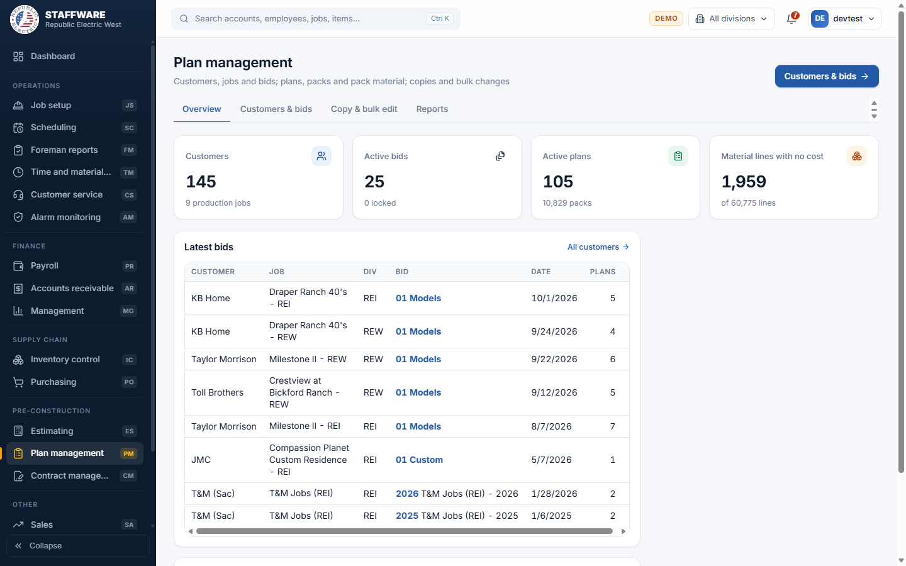
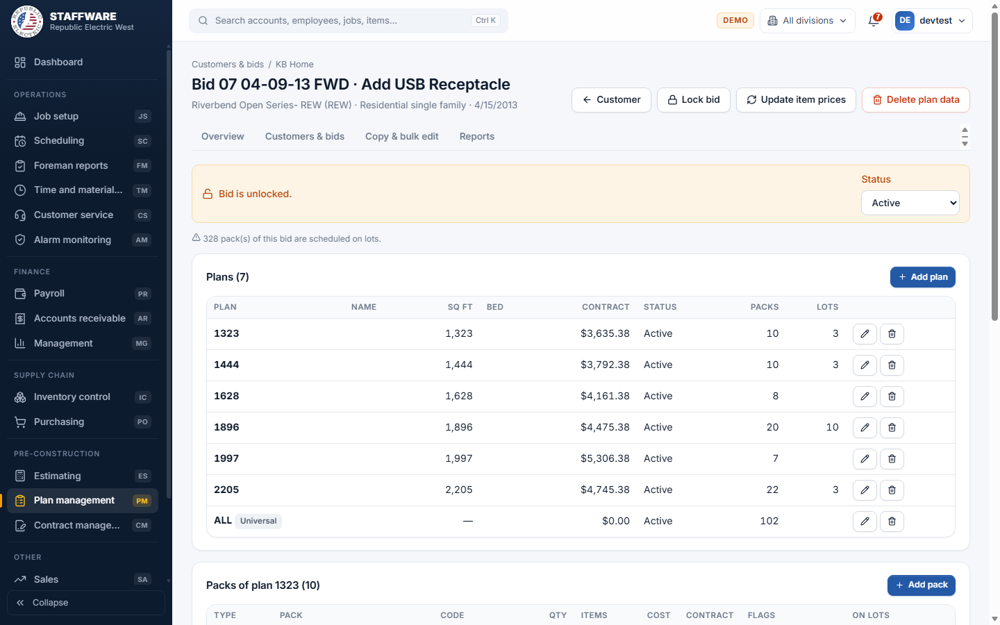
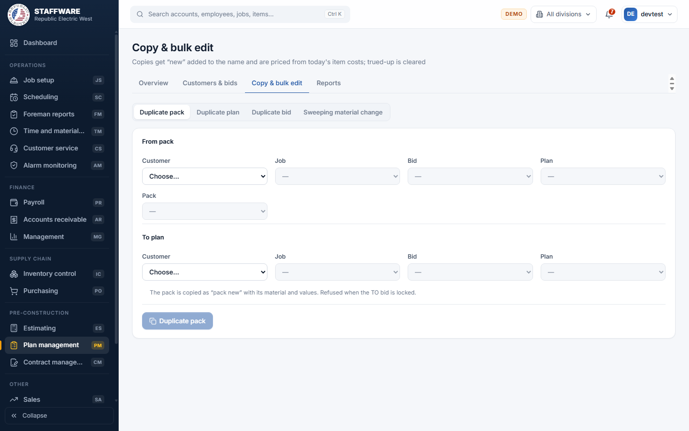

# Plan management (PM)
*The master record of every customer, job, bid, plan, pack and material list that production and billing are built on.*

## 1. What this module is for
Plan management holds the "standard data" of the company: for each builder and job, the bids, the house plans in each bid, the packs of each plan (the standard pack and the option packs) and the material lines of each pack, with their cost and estimating prices and their contract values by stage and work. Estimators, the contract department and the people who maintain prices use it. Many other modules read this data when they schedule lots, order material or bill.

Access is controlled per login: a user sees Plan management only when the login has the permission flag PM.

## 2. How it connects to other modules
### Needs data from
| Module | What it uses | Why |
|---|---|---|
| Inventory control | Inventory items with their cost and estimating prices | Every material line is an inventory item; its cost and price come from the item. |
| Job setup | Scheduled jobs, phases, lots and packs | To show which plans and packs are already scheduled on lots and to stop deletions that would break scheduled work. |
| Database maintenance | The pick-lists: status, division, job type, jurisdiction, pack type, stage, work, schedule stage, cost code, gear names | They fill the drop-down boxes. |

### Feeds data to
| Module | What it gives | When |
|---|---|---|
| Job setup and Scheduling | Plans, packs, material and stage/work values to schedule on lots | Whenever a lot is set up or a pack is scheduled. |
| Contract management | Bids, plans, packs and their contract values | Contract management sets the contract values on the same plans and packs. |
| Accounts receivable, Foreman reports, Customer service, Cox cable, Sales, Purchasing, Payroll, Inventory control, Management | Read the plans, packs and material for billing, work orders, ordering, reporting | Automatic; these modules read Plan management data when they need it. |
| Estimating | The customers, jobs and bids that estimating bids are tied to | Estimating shares customers and jobs, and sends its bids into a Plan management bid. |

### Where it sits in the work flow
Before: Estimating prepares the bid and transfers it here, or the contract department enters the bid directly. Inventory control keeps item prices current.
During: the bid is reviewed, packs and material are corrected, and the bid is locked once it is final.
After: Contract management sets contract values, Job setup and Scheduling schedule lots with these packs, Purchasing and Foreman reports use the material.

## 3. Screens (tabs) in this module
| Screen / tab | What it is for | What you can do there |
|---|---|---|
| Overview | A quick view of plan data | See customers, active bids, active plans and material lines with no cost; latest bids; press Update zero item cost. |
| Customers & bids | Customer, then its jobs, then the bids of a job | Search customers, add or edit customers, jobs and bids; open a bid. |
| Bid (opened from a bid) | The plans of a bid and the packs of the selected plan | Add or edit plans and packs, lock or unlock the bid, set the bid status, update item prices, delete all plan data. |
| Pack (opened from a pack) | Material lines of one pack and its value by stage and work | Add, change and delete material lines, add stage and work values, read the change log. |
| Copy & bulk edit | Copying and sweeping changes | Duplicate pack, Duplicate plan, Duplicate bid, Sweeping material change. |
| Reports | Twelve printable reports | Pick a report, choose its filters, print or export. |

## 4. How the data entry forms work
Forms save to the database when you press their Save button. Cancel closes the form without saving. Fields with an asterisk are required. A red message at the top explains a refused save; a green message confirms a good one.

### Customer
- When you use it: a new builder, or to rename or deactivate one.
- Fields: Name (required, up to 50 characters), Status (pick-list), Notes.
- Step by step: type a name next to Add customer and press the button; change the fields and press Save. Delete removes the customer.
- What gets saved: the customer, which also appears in Estimating and Contract management.
- Safeguards: duplicate names are refused. A customer with jobs cannot be deleted ("Delete or move the jobs first"). Delete asks for confirmation.

### Job
- When you use it: a new project for a builder.
- Fields: required: Job, Division, Job type. Optional: Job number, Jurisdiction, Status, Template (tick box), Spec level, Notes. Division, Job type, Jurisdiction and Status are pick-lists.
- Step by step: open the customer, press Add job, fill in, press Save job. The table shows a column "In Job setup" when the job already exists as a scheduled job.
- What gets saved: the job. It then appears in Contract management, Estimating and Job setup lists.
- Safeguards: the same customer cannot have two jobs with the same name in the same division. A job with bids or with a link to Job setup cannot be deleted. Delete asks for confirmation.

### Bid
- When you use it: a new price version for a job.
- Fields: required: Bid number. Release / phase, Name, Bid date (today if left empty), Status, Notes.
- Step by step: select the job in the Jobs table, press Add bid, fill in, press Save bid. Click the bid number to open it.
- What gets saved: the bid under the job.
- Safeguards: the same job cannot have two bids with the same number and release. A bid that still has plans cannot be deleted ("Use Delete plan data first"), and neither can a bid used by a phase in Job setup. Delete asks for confirmation.

### Plan
- When you use it: each house model in a bid.
- Fields: required: Plan number. Name, Sq ft, Bedrooms, TV outlets, Island, Floor plug, Detached, Gear (pick-list), Contract value, Status (pick-list), AC units and Universal (tick boxes), Notes.
- Step by step: open the bid, press Add plan, fill in, press Save plan. The pencil edits, the bin deletes. Click a plan row to see its packs below.
- What gets saved: the plan. The table shows the number of packs and how many lots use the plan.
- Safeguards: the plan number must be unique in the bid. A plan used by lots cannot be deleted, and neither can a plan that still has packs. Delete asks for confirmation.

### Pack
- When you use it: to add an option pack, or to change the standard pack's values.
- Fields: required: Pack name (up to 100 characters) and Type (Standard, Option, Permits, Non standard option, Option elev, Info Only, PO). Builder code, Quantity, Contract value $, Contract cost $, Build time (h), Status, Verified, Substitution, Trued up (tick boxes), Notes.
- Step by step: select a plan, press Add pack, fill in, press Save pack. Click the pack name to open its material.
- What gets saved: the pack under the plan; shown in the plan's pack list with items, cost, contract value and the number of lots it is on.
- Safeguards: pack names are unique within a plan. A trued-up pack is locked: only the Trued up tick box can be changed (untick it first to edit the pack), and it cannot be deleted. A pack scheduled on lots cannot be deleted. Delete asks for confirmation and removes the pack's material with it.

### Material line (Pack screen)
- When you use it: to add, correct or retire an item in a pack.
- Fields: required: Inventory item (type to search), Quantity, Stage, Work (pick-lists). When editing also: Unit cost, Estimating price, No change, Status, Notes.
- Step by step: in the last row of the table pick the item, type quantity, choose stage and work, press Add. A message shows the cost and estimating price taken from the item. The pencil edits the line in place and the disk button saves it. The bin deletes.
- What gets saved: the line. Every change and every delete is written to the Material change log at the bottom of the screen with date, user and action.
- Safeguards: if the item is inactive, a question asks "are you sure you want to use it?" and only continues on Yes. When you replace the item on a line, the cost and price fields switch to "from the item". Deleting asks for confirmation.

### Contract value by stage and work (Pack screen)
- When you use it: to split a pack's contract value into the stages and kinds of work used for billing.
- Fields: Stage (schedule stage), Work, Value $, all required.
- Step by step: choose stage, work, type the value, press Add. Use the pencil to change a value and the bin to delete it. The total is shown at the bottom, next to the pack's contract value.
- Safeguards: a pack can have only one value per stage and work combination.

### Copy and bulk edit forms
See section 6. They are processes with a "from" and a "to" side rather than ordinary data entry.

## 5. Reports
All reports are opened from the Reports tab: pick a report and only the filters it needs appear. Every report has Print and CSV buttons.

| Report | What it shows | Filters you choose first | Print / export |
|---|---|---|---|
| Plan standard data | Standard packs and material of one plan | Customer, Job, Bid, Plan | Print, CSV |
| Plan full data | Every active pack and material line of a bid | Customer, Job, Bid | Print, CSV |
| Bid cost per bid | Standard cost by plan, cost code and work against the contract value | Customer, Job, Bid | Print, CSV |
| Bid cost at current prices | The same, priced at today's job cost prices | Customer, Job, Bid | Print, CSV |
| Bid cost per customer | Every active plan of the customer's active jobs | Customer | Print, CSV |
| Bid cost per plan | Each standard material line of one plan | Customer, Job, Bid, Plan | Print, CSV |
| Customer standard prices | Plan contract value against standard pack cost | Customer | Print, CSV |
| Customer option prices | Option pack value against cost (latest bid) | Customer | Print, CSV |
| Job list by division | All production jobs with type, status and spec level | Division (optional: blank means all) | Print, CSV |
| Active plans | Active plans of active bids in a division | Division | Print, CSV |
| Pack search | Packs found by name, builder code or words | Division, then a pack name, a builder code or words | Print, CSV |
| Wire price check | Wire in the standard packs of the latest bids against the item prices | Division | Print, CSV |

## 6. Action buttons
| Button | Where | What it does | What changes | Safeguards |
|---|---|---|---|---|
| Update zero item cost | Overview | Fills the cost of every material line that has no cost, from the item's labor cost (labor items) or job cost price (others) | Cost on those material lines, in all bids | Confirmation shows how many lines; disabled when there are none; message shows the count updated |
| Lock bid / Unlock bid | Bid | Locks the bid so plans and packs cannot be copied into it, or unlocks it | The lock flag of the bid | Banner shows the state (locked or unlocked) at all times |
| Update item prices | Bid | Sets the cost of every non-labor material line of the bid to the item's current job cost price and estimating price | Cost and price on those lines | Confirmation question; message shows the number of lines |
| Delete plan data | Bid | Wipes all plans, packs, material and values of the bid | Everything below the bid is removed; the bid itself stays | Refused when packs are scheduled or used by lots; asks for confirmation; downloads a backup file of the data first; all or nothing |
| Duplicate pack | Copy & bulk edit | Copies a pack with its material and values into another plan, named "<name> new" | A new pack | Refused if the receiving bid is locked or already has a pack with that name; material is priced from today's item costs; trued up is cleared |
| Duplicate plan | Copy & bulk edit | Copies a plan with all its packs into another bid as "<plan> new" with contract value 0 | A new plan with packs, material and values | Refused if the receiving bid is locked or already has that plan name |
| Duplicate bid | Copy & bulk edit | Copies every plan of the FROM bid into the TO bid as "<plan> new", inactive, keeping the contract values | New plans with packs, material and values | The two bids must differ; a question appears if they belong to different jobs ("Let the contract department know"); all or nothing |
| Find lines, then Apply to n line(s) | Copy & bulk edit, Sweeping material change | Finds every line of one item in one pack type across all bids of a customer, then changes the ticked lines at once (item, quantity, stage, work, cost, estimating price; empty means keep) | Material lines in many packs | Red warning that the feature is risky; lines of locked bids are not ticked automatically; confirmation with the line count; every change is written to the change log; at least one change is required |

## 7. A typical day-to-day workflow
1. Open Plan management and check the Overview: look at "Material lines with no cost" and press Update zero item cost if needed.
2. Go to Customers & bids, find the builder and the job, and open the bid (or add a new bid).
3. In the bid, check the plans. Add a plan or pack when the builder adds a model or option.
4. Open a pack and correct its material lines: add items, change quantities, stage and work.
5. Add the stage and work values that billing will use.
6. If an option already exists elsewhere, use Copy & bulk edit to duplicate the pack, plan or bid, then rename the copy.
7. Press Update item prices on the bid when material prices changed.
8. Set the bid status and press Lock bid once it is final.
9. Run Bid cost per bid or Customer standard prices to compare cost with contract value.
10. Hand over to Contract management for contract values.

## 8. Screenshots

## 9. Good to know
- Locking only stops copies into the bid (duplicates and Estimating transfers). It does not stop editing plans, packs and material directly.
- A pack marked Trued up is protected: only material and labor lines can still be changed.
- Delete plan data is the only way to clear a bid; it refuses anything already scheduled.
- Copies are priced from today's item costs, not from the old pack's prices.
- Access matched copied rows by name, which could double up; the web version copies each row one for one.
- The Estimating transfer and the Time and material module also add data here; the exact rules for the Time and material additions are described in that module's guide.
