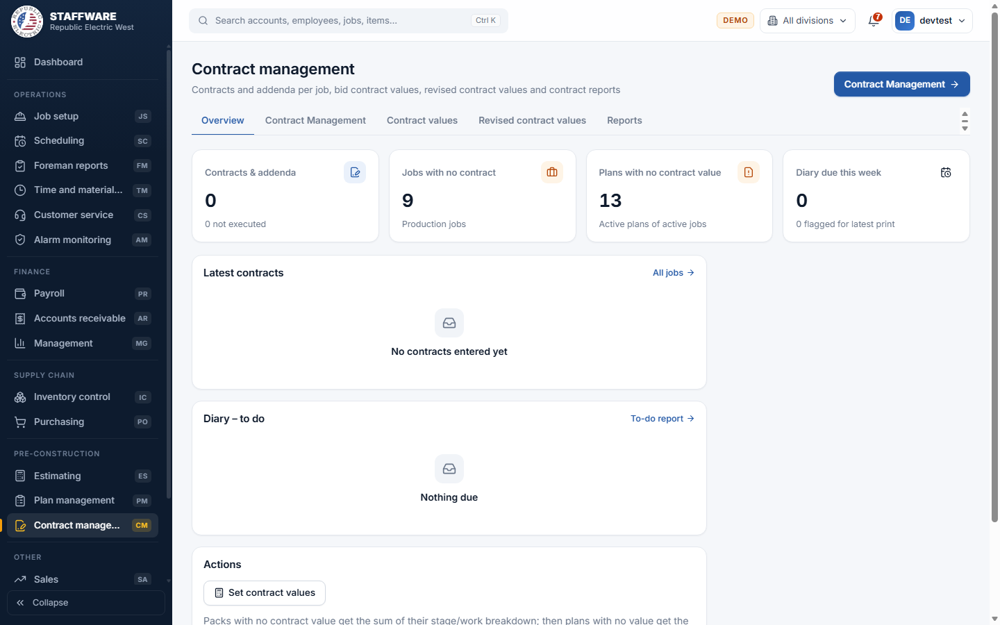
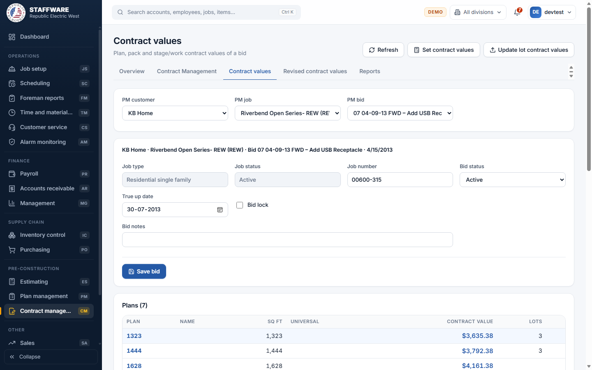
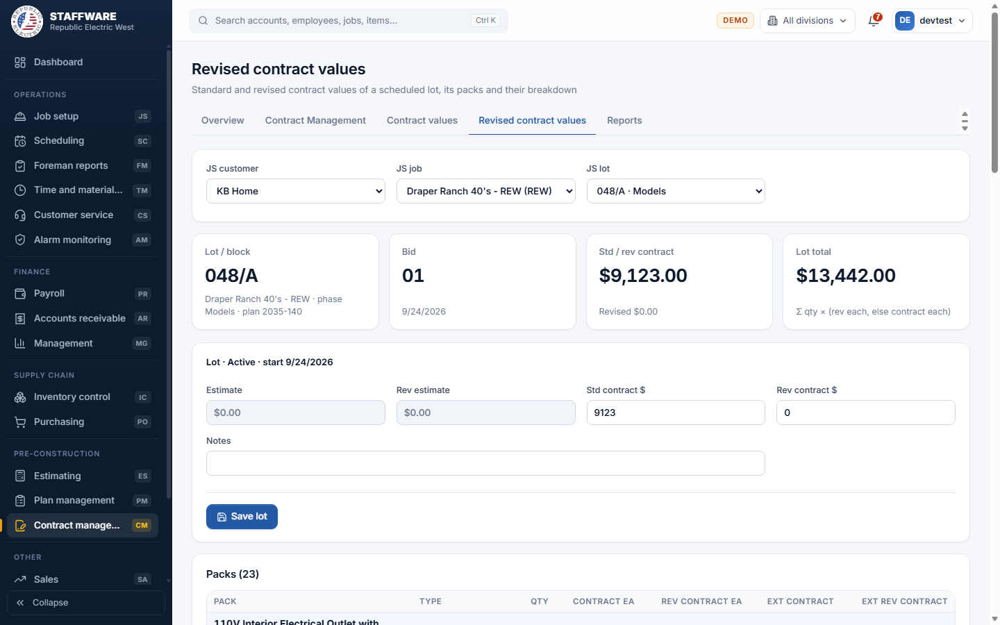
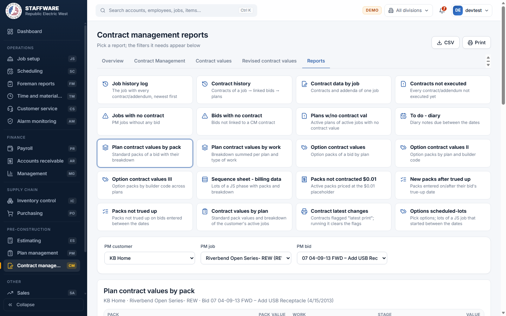

# Contract management (CM)
*Contracts and addenda per job, the contract values of every plan and pack, revised values of scheduled lots, and the contract reports.*

## 1. What this module is for
Contract management is the contract department's workplace. It keeps the signed contracts and addenda of each job with a diary of follow-ups, sets the agreed contract values on the plans and packs of a bid (and how each value splits by stage and work), pushes those values to the lots already scheduled, and lets you correct the standard and revised values of one scheduled lot. It also produces twenty reports that find missing contracts, missing values, unexecuted contracts and packs that still need to be trued up.

Access is controlled per login: a user sees Contract management only when the login has the permission flag CM.

## 2. How it connects to other modules
### Needs data from
| Module | What it uses | Why |
|---|---|---|
| Plan management | Customers, jobs, bids, plans, packs and their stage/work values | The contract values are stored on the Plan management plans and packs; every list starts with a Plan management customer, job and bid. |
| Job setup | Scheduled jobs, phases, lots, packs and their value breakdown | Revised contract values and the Update lot contract values button work on scheduled lots. |
| Database maintenance | Pick-lists: status, job type, division, jurisdiction, contract type, work, schedule stage, pack type | They fill the drop-down boxes. |

### Feeds data to
| Module | What it gives | When |
|---|---|---|
| Plan management | Contract values on plans and packs, builder codes, trued-up flags, bid status, bid lock, true-up date, job number and address details | When you edit a value on the Contract values tab or press Set contract values. |
| Job setup, Scheduling and Accounts receivable | Standard and revised contract values of lots, lot packs and their stage/work breakdown | When you press Update lot contract values, or edit a lot on the Revised contract values tab. Scheduling and billing read these values. |
| Estimating | The job history entries shown on the Estimating Job history log | Entries are the same list; each module can add to it. |

### Where it sits in the work flow
Before: Estimating or Plan management has created the bid, plans and packs. The builder's contract arrives.
During: the contract is entered here with its addenda, the contract values are set per plan and pack, and the stage/work breakdown is checked.
After: the values are pushed to the lots in Job setup, Scheduling uses them for stages, and Accounts receivable bills from them. Revised values are entered here when the price of one lot changes.

## 3. Screens (tabs) in this module
| Screen / tab | What it is for | What you can do there |
|---|---|---|
| Overview | A quick view of contract work | See contracts and addenda, jobs with no contract, plans with no contract value, diary due this week; latest contracts; the diary to-do list; press Set contract values; open Contract latest changes. |
| Contract Management | The job list and, per job, its contracts | Search and filter jobs by division; open a job to change its details, enter contracts and addenda, write diary notes and link bids. |
| Contract values | Contract values of one bid | Choose PM customer, job and bid; edit plan values, pack values, contract cost, builder code, trued-up flag and the stage/work breakdown; save bid header data. |
| Revised contract values | Values of one scheduled lot | Choose JS customer, job and lot; edit standard and revised contract values of the lot, its packs and breakdown rows. |
| Reports | Twenty reports | Pick a report, choose its filters, print or export. |

## 4. How the data entry forms work
Forms save to the database when you press their Save button. A red message at the top explains a refused save, a green one confirms success. Fields with an asterisk are required. Cells in the value tables (the amounts shown as links) are changed by clicking the amount, typing the new number and pressing Enter or leaving the box; the change is saved at once.

### Job (Contract Management tab, opened from the job list)
- When you use it: to correct the job details that the contract department owns.
- Fields: customer and job name are shown but locked. Editable: Job number, Job type, Division, Status (pick-lists for the last three), Address, City, State, Zip, Jurisdiction, Est start date, Est end date, Unit qty.
- Step by step: search for the job in the list (you can filter by division), click it, change the fields, press Save job.
- What gets saved: the job in Plan management, so the change shows in Estimating, Plan management and Job setup lists.
- Safeguards: the end date cannot be before the start date; unit quantity must be a whole number; job type, division and status cannot be emptied.

### Contract / addendum
- When you use it: every time a signed contract, work agreement or addendum arrives for the job.
- Fields: required: Contract type (pick-list: High voltage, Low voltage, Fixtures and so on). Contract number, Work agreement num, Addendum number, Description, Effective phase, Effective date, Notes, and two tick boxes: Executed (the document is signed) and Latest print (include it in the next Contract latest changes report).
- Step by step: open the job, press Add contract/addendum, fill in the form, press Save. Use the pencil to change an entry and the bin to delete it. Click a row to see its diary and bid links below.
- What gets saved: the contract entry, shown in the job's table with badges for Latest and Executed and the number of diary notes and bids. It also feeds the contract reports and the Estimating Job history log.
- Safeguards: the contract type is required; the effective date must be a real date. Deleting asks for confirmation and says how many diary notes and bid links will be deleted with it.

### Diary note
- When you use it: to record a call or promise on a contract and when it must be followed up.
- Fields: Date (today by default), Due date (one week ahead by default), Contact, Notes, File (a path or link). Contact or notes is required.
- Step by step: click the contract, press Add note, fill in, press Save note. The pencil edits and the bin deletes.
- What gets saved: the note. Notes whose due date falls in the week show on the Overview and in the To do - diary report.
- Safeguards: deleting asks for confirmation.

### Link to bids
- When you use it: to say which Plan management bids belong to a contract.
- Fields: a pick-list of the bids of the same job.
- Step by step: click the contract, choose a bid in "Choose a bid of this job...", press Link. Change the bid in an existing row with its drop-down, or remove it with the bin.
- What gets saved: the link, which the Contract history and "Bids with no contract" reports use.
- Safeguards: only bids of the same job are offered; the same bid cannot be linked twice to a contract; removing asks for confirmation.

### Contract values of a bid
- When you use it: to put the agreed prices on the plans and packs of a bid.
- Fields: header: Job number, Bid status (pick-list), True up date, Bid lock (tick box), Bid notes. Plans table: Contract value per plan. Packs table (click a plan): Builder code, Contract value, Contract cost, and a T-up (trued up) tick box per pack. Breakdown (click a pack): Work and Schedule stage (pick-lists) and Value.
- Step by step: choose PM customer, then PM job, then PM bid (each list depends on the one before). Change the header and press Save bid. Click a plan, then a pack, and click the amounts to change them. Add a breakdown row by choosing work and stage, typing a value and pressing Add.
- What gets saved: the values on the Plan management plans and packs. They show at once in Plan management and in the reports.
- Safeguards: "check your math". After every change, if a plan value is not the sum of its standard packs, or a pack value is not the sum of its breakdown, an amber message says "The values you entered don't match, please check your math!" and lists the plans and packs. The plan or pack also carries a badge ("Packs don't add up", "Breakdown doesn't add up"). The footer of the breakdown turns red when its sum differs from the pack value. A pack can have only one value per work and stage. Deleting a breakdown row asks for confirmation.

### Revised contract values of a lot
- When you use it: when the price of one scheduled lot changes after contract.
- Fields: header: Std contract $ and Rev contract $, Notes (Estimate and Rev estimate are shown for information). Pack rows: Contract ea and Rev contract ea. Breakdown rows under each pack: Work, Schedule stage, Contract and Revised amounts.
- Step by step: choose JS customer, JS job and JS lot. Change the header and press Save lot. Click an amount in the pack table to change it; add a breakdown row under a pack with Add breakdown.
- What gets saved: the values on the scheduled lot, its packs and their breakdown. The Lot total at the top is the sum of quantity times revised price (or the standard price when there is no revised price).
- Safeguards: a closed lot (with an end date) is read-only and the screen says "You need to open it before you can modify it." Deleting a breakdown row asks for confirmation.

## 5. Reports
Open the Reports tab, click a report, then choose the filters that appear. Every report has CSV and Print buttons once it shows data.

| Report | What it shows | Filters you choose first | Print / export |
|---|---|---|---|
| Job history log | The job with every contract and addendum, newest first | PM customer, PM job | Print, CSV |
| Contract history | Contracts of a job, their linked bids and the plans | PM customer, PM job | Print, CSV |
| Contract data by job | Contracts and addenda of one job | PM customer, PM job | Print, CSV |
| Contracts not executed | Every contract or addendum not executed yet | None | Print, CSV |
| Jobs with no contract | Plan management jobs that have no bid | None | Print, CSV |
| Bids with no contract | Bids not linked to a contract | None | Print, CSV |
| Plans w/no contract val | Active plans of active jobs with no contract value | Division | Print, CSV |
| To do - diary | Diary notes due between two dates | From, To | Print, CSV |
| Plan contract values by pack | Standard packs of a bid with their breakdown | PM customer, PM job, PM bid | Print, CSV |
| Plan contract values by work | The breakdown summed per plan and kind of work | PM customer, PM job, PM bid | Print, CSV |
| Option contract values | Option packs of a bid by plan | PM customer, PM job, PM bid | Print, CSV |
| Option contract values II | Option packs by plan and builder code | PM customer, PM job, PM bid | Print, CSV |
| Option contract values III | Option packs by builder code across plans | PM customer, PM job, PM bid | Print, CSV |
| Sequence sheet - billing data | Lots of a Job setup phase with packs and breakdown | JS customer, JS job, JS phase | Print, CSV |
| Packs not contracted $0.01 | Active packs still priced at the $0.01 placeholder | PM customer | Print, CSV |
| New packs after trued up | Packs entered on or after their bid's true-up date | Division | Print, CSV |
| Packs not trued up | Packs not trued up on bids entered between the dates | Division, From, To | Print, CSV |
| Contract values by plan | Standard pack values and breakdown of the customer's active jobs | PM customer, Division | Print, CSV |
| Contract latest changes | Contracts flagged "Latest print" in a division | Division, then press Run report | Print, CSV |
| Options scheduled-lots | Lots of a Job setup job, started between the dates, that carry the options you tick | JS customer, JS job, From, To, then tick options and press Display report | Print, CSV |

## 6. Action buttons
| Button | Where | What it does | What changes | Safeguards |
|---|---|---|---|---|
| Set contract values | Overview, and the Contract values tab | Gives every pack with no contract value the sum of its stage/work breakdown, then every plan with no value the sum of its standard packs. Works on all bids | Contract values on packs and plans that were empty | Shows a count first and asks for confirmation; says "Nothing to set" when there is nothing to do; only empty values are changed |
| Update lot contract values | Contract values tab (needs a bid chosen) | For the chosen bid, copies the plan value to the open lots, the pack values to their packs and the breakdown to the lot breakdown; adds missing breakdown rows and removes rows that no longer exist in the bid | Standard contract values on scheduled lots, lot packs and breakdown rows in Job setup | Preview with counts (lots, packs, rows updated, added, removed) and a confirmation; all or nothing; only lots without an end date are updated and revised values are left alone |
| Refresh | Contract values tab | Reloads the bid from the database | Nothing | None needed |
| Run report (Contract latest changes) | Reports | Lists the contracts flagged "Latest print" in the division, then clears those flags | The Latest print tick box of the listed contracts | Warning question; advises saving the report as a PDF and sending it to the contract coordinator if run by mistake; message shows how many flags were cleared |
| Display report (Options scheduled-lots) | Reports | Runs the report for the ticked options | Nothing | At least one option must be ticked |

## 7. A typical day-to-day workflow
1. Open the Overview: check Plans with no contract value, Jobs with no contract and the diary due this week.
2. Open Contract Management, find the job, and press Add contract/addendum for each new document. Tick Executed once it is signed.
3. Add diary notes for follow-ups with their due dates, and link the bids that the contract covers.
4. Open Contract values, choose the PM customer, job and bid, and enter the plan and pack values. Watch for the "check your math" message.
5. Add the stage and work breakdown to each pack so billing can follow the stages.
6. Save the bid header: status, true-up date, and lock the bid when it is final.
7. Press Set contract values for empty values, then Update lot contract values for the bid so scheduled lots follow the contract.
8. For a lot whose price changed, open Revised contract values and enter the revised amounts.
9. Run the checks: Plans w/no contract val, Packs not contracted $0.01, Packs not trued up, Contracts not executed.
10. Run Contract latest changes for the division to send out what changed, which also clears the flags.

## 8. Screenshots

## 9. Good to know
- The sample database has no contracts entered yet, so the Contract Management job screen, the contract reports and the diary lists show empty results in the demonstration. The contract values, lots and plan reports have data.
- The report and tab names follow the Access screens. The Job history log report is an Estimating report in Access; the web app also offers it here.
- Contract latest changes clears the "Latest print" flags when it runs, as in Access. The web app asks first.
- A closed lot (one with an end date) cannot be edited on the Revised contract values tab; it must be opened again before it can be changed.
- Update lot contract values only touches lots that are still open. Breakdown rows that no longer exist in the bid are removed from every lot of the bid, including closed ones, so check the preview counts.
- The button under a contract that links bids is called Link to estimating bids on screen, but the list offers the Plan management bids of the job.
- The Overview and the Contract values tab both have a Set contract values button; they do exactly the same thing on all bids.
- Some reports show little data until real data is loaded; the layouts were checked against the Access queries.
