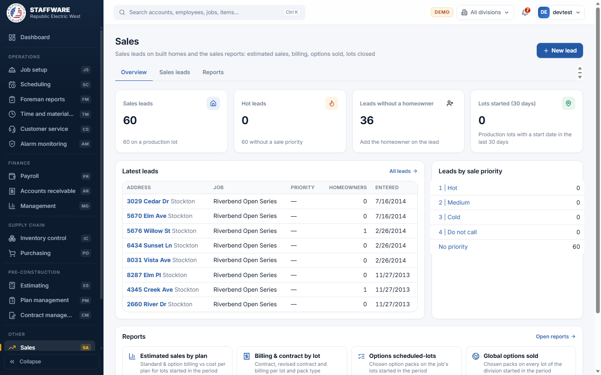
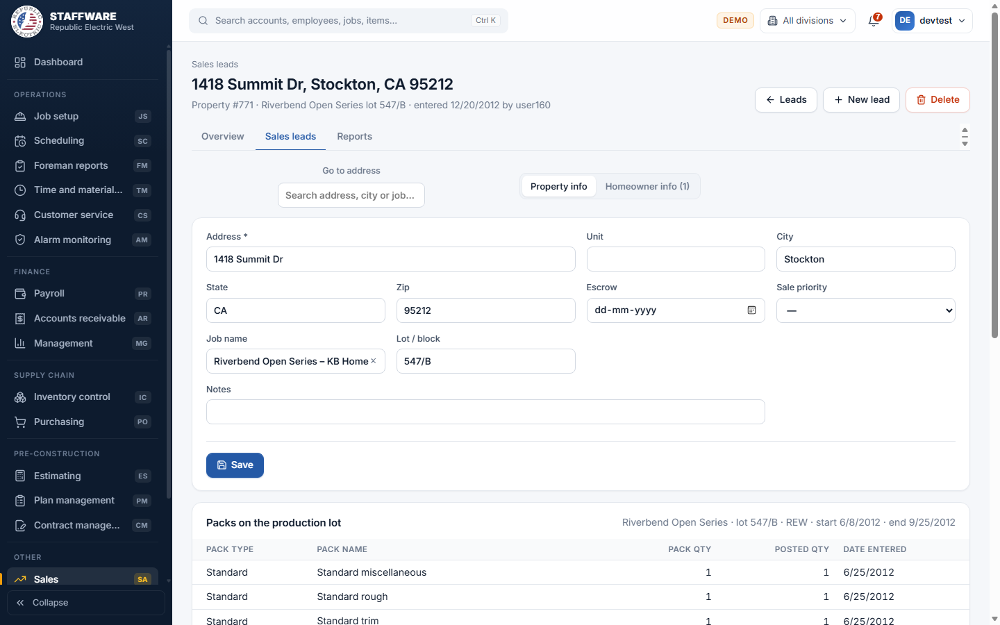
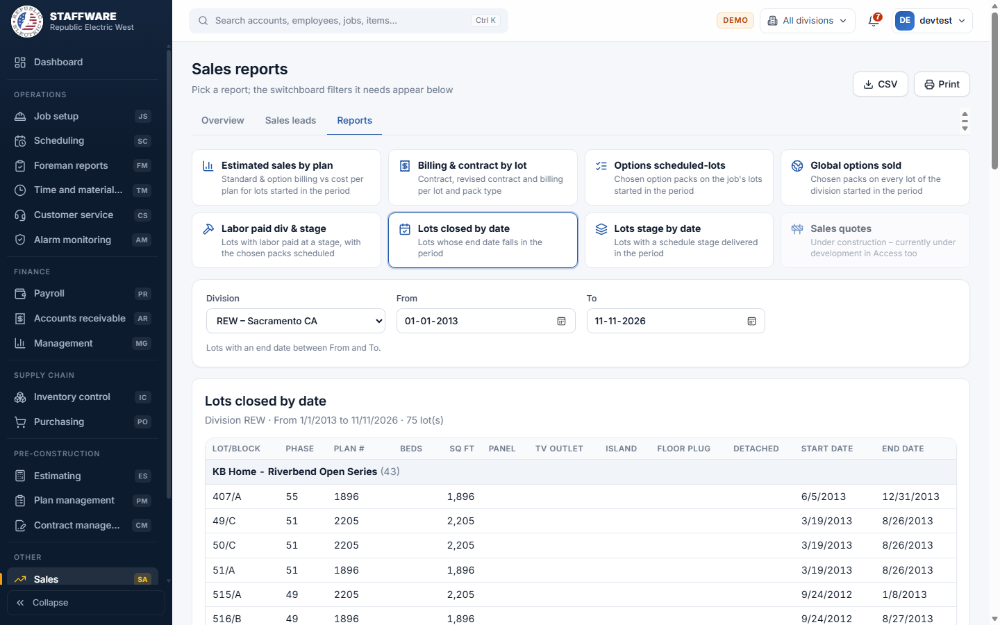

# Sales (SA)
*Sales leads on built homes, and sales reports on estimated sales, billing, options sold and lots closed.*

## 1. What this module is for
Sales has two jobs. First, it keeps a list of sales leads: houses (properties) that may be sold or serviced, with their homeowners, phone numbers, a sale priority and the packs installed on the production lot. Second, it gives sales and management a set of reports built from production, billing and payroll data: estimated sales by plan, billing and contract by lot, options sold, labor paid by stage, lots closed and lots at a stage. Access is controlled per login: only users with the SA permission flag see the module.

## 2. How it connects to other modules
### Needs data from
| Module | What it uses | Why |
|---|---|---|
| Job Setup (JS) | Customers, jobs, lots, packs, phases and stages | The packs on a lead's production lot, and the lots, packs and stage dates behind most reports |
| Plan Management (PM) | Plans, packs, contracts, plan material | Plan numbers and names, contract and billing amounts per pack, and the material cost used in Estimated sales by plan |
| Accounts Receivable (AR) | Billing items | Billing figures in the sales reports |
| Payroll (PR) | Labor paid | The Labor paid div & stage report |
| Inventory Control (IC) | Items | Material cost in Estimated sales by plan |
| Customer Service (CS) | Properties, homeowners, phones, call notes, tickets and quotes | Leads are stored as the same properties and homeowners that Customer Service uses; the module checks them before a lead is deleted |
| Database Maintenance (DM) | Divisions, schedule stages, pack types, phone types and sale priorities | Pick-lists on the forms and reports |

### Feeds data to
| Module | What it gives | When |
|---|---|---|
| Customer Service (CS) | New leads (properties), their homeowners and phone numbers | When a lead, homeowner or phone is saved here, it is immediately a property, homeowner or phone in Customer Service |

### Where it sits in the work flow
Production lots come from Job Setup and are built, billed and paid through Scheduling, Payroll and Receivables. Sales looks at that finished data: it lists the houses as leads and reports on what was sold and billed. A lead that becomes a service customer carries over to Customer Service with no re-entry.

## 3. Screens (tabs) in this module
| Screen / tab | What it is for | What you can do there |
|---|---|---|
| Overview | Quick summary | See Sales leads, Hot leads, Leads without a homeowner, Lots started (30 days), latest leads, leads by sale priority, and shortcuts to the reports. Button: New lead |
| Sales leads | List of leads | Search by address, city, zip, job, builder, lot or homeowner; filter by sale priority (including "No priority"); sort by Address, City, Sale priority, Newest first or Escrow date; page through; New lead; open a lead |
| Lead (opened from the list) | One lead, two sub-tabs: Property info and Homeowner info | Edit the property, see packs on the production lot, add and change homeowners and their phones; "Go to address" jumps to another lead |
| Reports | Seven reports | Pick a report, choose its filters, run, print or export |

## 4. How the data entry forms work
### Lead (Property info)
- When you use it: to add a house as a sales lead or correct its details.
- Fields:
  - Required: Address.
  - Optional: Unit, City, State (two letters), Zip (five digits), Escrow date, Lot / block, Notes.
  - Pick-lists: Sale priority (1 Hot, 2 Medium, 3 Cold, 4 Do not call, from the sale priority list); Job name is a finder that searches jobs and builders.
- Step by step: Sales leads, New lead (or the New lead button on the Overview). Enter the address and details and click Create lead. To change a lead, open it from the list, edit, and click Save; "Lead saved" appears. Under the form, the "Packs on the production lot" table lists pack type, pack name, quantity, posted quantity and date entered for the lot the lead is tied to; if the lead has no production lot it says so.
- What gets saved: the property record. It shows in Sales leads and Overview, and in Customer Service under Properties.
- Safeguards: if another property already has the same address (and city and unit) you are asked whether to save a second one anyway. State must be two letters and zip five digits. Delete asks for confirmation and removes the homeowner links but keeps the homeowners themselves. A lead cannot be deleted if it is tied to a production lot, or has Customer Service tickets, call notes or quotes.

### Homeowner info (on a lead)
- When you use it: to record who owns or is buying the house and how to reach them.
- Fields:
  - Required: First name, Last name, Customer type (pick-list shared with Customer Service).
  - Optional: Middle name, Email, Notes, Phone number and Phone type (pick-list; defaults to the first type).
- Step by step: open the lead and click the "Homeowner info" tab. Existing homeowners show as panels; change a field and click "Save homeowner". Use "Remove from lead" to unlink them (the homeowner record is kept, after confirmation). Under each homeowner, change a phone number or type and click the save icon, delete one with the bin (confirmation), or type a new number and click Add. To add another person use the "Add homeowner" form at the bottom and click Add homeowner.
- What gets saved: the homeowner, the link to the property, and phones. They appear at once in Customer Service under Homeowners and on the scheduling form.
- Safeguards: email must look like an email, phone numbers must have 10 digits, and the same number and type cannot be added twice to one homeowner. If a homeowner with the same first and last name already exists you are asked whether to add a new one anyway. Adding the homeowner and its link and phone is all-or-nothing.

## 5. Reports
Click a report button; the filters it needs appear below. Some reports run as soon as the filters are complete. Three reports (Options scheduled-lots, Global options sold, Labor paid div & stage) first list the pack names found and you tick the ones to show, then click Display report; "Change pack selection" returns to the list. Dates default to 1 January of this year to today.

| Report | What it shows | Filters you choose first | Print / export |
|---|---|---|---|
| Estimated sales by plan | Standard and option billing against cost for each plan, for lots started in the period | Customer (or all), Division, From, To, Labor burden % (starts at 25) | Print, CSV |
| Billing & contract by lot | Contract, revised contract and billing per lot and pack type, for lots started in the period | Customer, Job, From, To | Print, CSV |
| Options scheduled-lots | Chosen option packs on the job's lots started in the period | Customer, Job, From, To, then tick packs | Print, CSV |
| Global options sold | Chosen packs on every lot of the division started in the period | Division, From, To, then tick packs | Print, CSV |
| Labor paid div & stage | Lots with labor paid at a stage (payroll date in the period), with the chosen packs scheduled | Division, Schedule stage, From, To, then tick packs | Print, CSV |
| Lots closed by date | Lots whose end date falls in the period | Division, From, To | Print, CSV |
| Lots stage by date | Lots with a schedule stage delivered in the period | Division, Schedule stage, From, To | Print, CSV |

A grey "Sales quotes" button is shown but disabled. It is marked "under construction", as in Access.

## 6. Action buttons
Sales has no processes that post or change many records at once. The buttons that save are the ordinary form buttons described above (Create lead, Save, Save homeowner, Add homeowner, Add phone). Display report only reads data.

| Button | Where | What it does | What changes | Safeguards |
|---|---|---|---|---|
| Display report | Reports (the three pick reports) | Runs the report for the ticked packs | Nothing is changed | At least one pack must be ticked |
| Delete | Lead page | Deletes the lead | Property and homeowner links removed | Confirmation; refused for lots, tickets, notes or quotes |

## 7. A typical day-to-day workflow
1. Open Overview and check hot leads and leads without a homeowner.
2. Open Sales leads, filter by priority or search by address.
3. Open a lead and check the packs installed on its production lot.
4. Set the Sale priority and Escrow date, and click Save.
5. On the Homeowner info tab add the homeowner and phone numbers.
6. Use "Go to address" to jump to the next lead.
7. At month end open Reports, Lots closed by date and Lots stage by date for production status.
8. Run Estimated sales by plan and Billing & contract by lot for the sales and billing review.
9. Run Options scheduled-lots or Global options sold, tick the packs of interest, and print the result.

## 8. Screenshots

## 9. Good to know
- Leads are not a separate list: they are Customer Service properties and homeowners. This avoids double entry but means a change in one module shows in the other.
- Leads are tied to production lots by Customer Service ("Add production jobs / lots"), not created from the Sales screen; a lead made here has no lot until it is linked there.
- "Sales quotes" is not built. It was also unfinished in Access.
- Sale priority is empty on all test leads, so Hot leads shows zero in the screenshots.
- Estimated sales by plan only includes lots whose plan, bid and contract are set up; lots missing that data do not appear.
- Reports only show data that exists in the database; the figures in the screenshots are test data.
