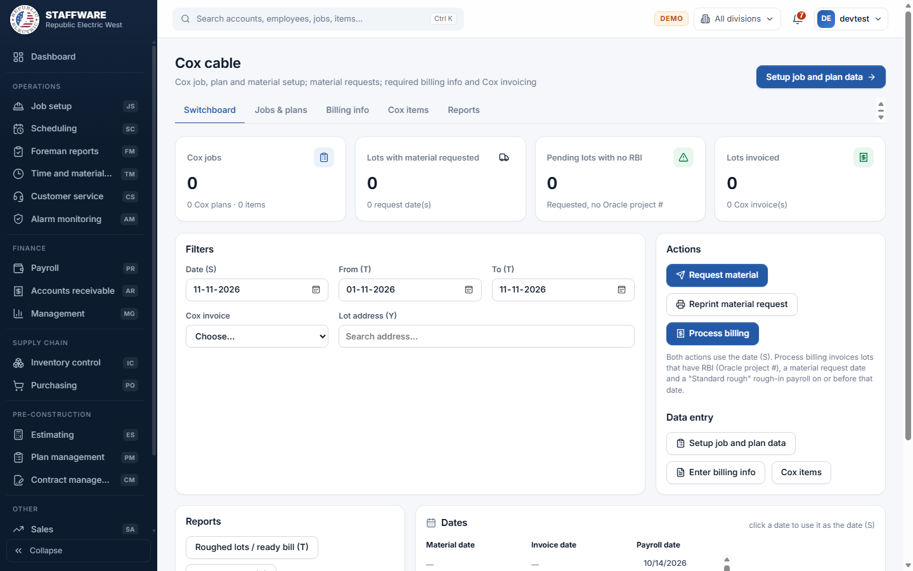
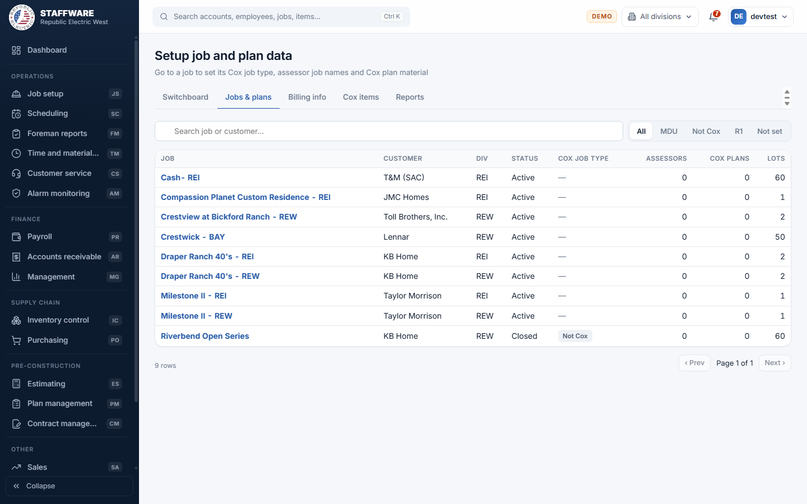
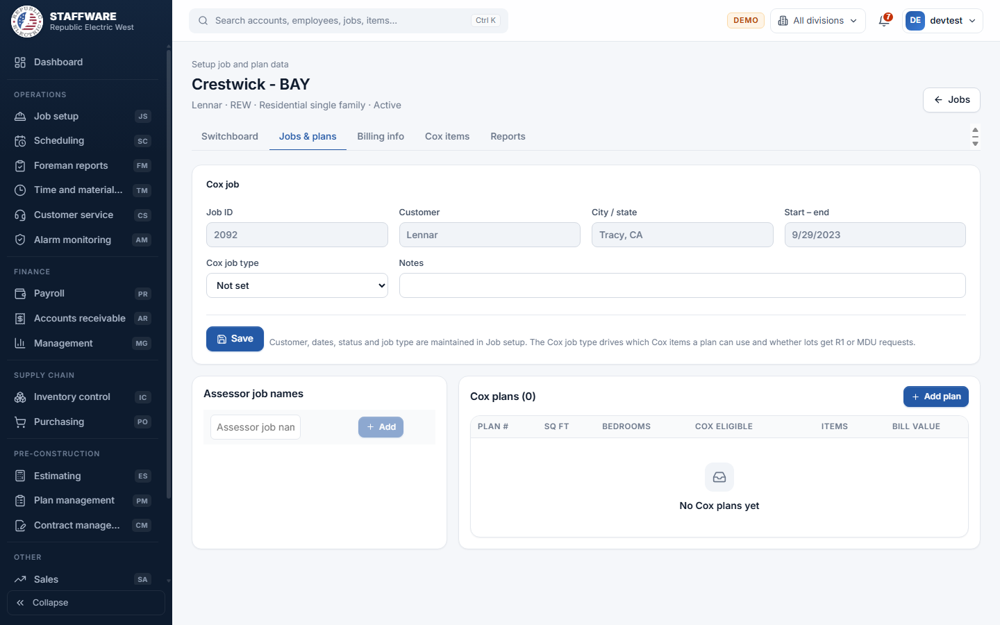

# Cox cable (CX)
*Sets up Cox cable jobs and their material, requests the material, and bills Cox for the lots once the rough-in is paid.*

## 1. What this module is for
Some builders' homes include Cox cable wiring that Cox pays for. This module holds the Cox side of those jobs: which jobs are Cox jobs, which "assessor job names" Cox knows them by, which plans carry Cox wiring, and what material (and what billing price) goes with each plan. From that setup it produces the material request for the supplier and, later, the invoices sent to Cox.

It is used by the people who handle Cox paperwork and billing. Access is controlled per login (permission flag CX); a login without it does not see the module.

## 2. How it connects to other modules
### Needs data from
| Module | What it uses | Why |
|---|---|---|
| Job setup | Jobs, customers, phases, lots (address, lot and block, permit) and the rough-in stage schedule of each lot | The Cox job list is the job list; a lot is only requested once it has an address and its rough-in stage is scheduled |
| Plan management | The plans, bids and packs of the job | Cox plans are picked from the job's plan numbers; each lot's plan decides its Cox material |
| Payroll | Labor paid records (the "Standard rough" rough-in payment and its payroll date) | A lot can only be invoiced after its rough-in has been paid |
| Database maintenance | The pick-lists: Cox job types, Cox admin specialists, Cox project planners, job status, schedule stages, superintendents | These fill the drop-downs on the Cox screens |

### Feeds data to
| Module | What it gives | When |
|---|---|---|
| Job setup | The Cox job type and notes on the job, and on each lot: Cox job type, assessor job name, material request date, requisition number, PO number, Oracle project number, admin specialist, project planner and Cox invoice number | When you save the Cox job, save a lot on Billing info, run Request material, or run Process billing |
| Receivables, Purchasing, Inventory | Nothing. Cox invoices are kept inside this module and are not posted to Receivables | Not applicable |

### Where it sits in the work flow
Plan management defines the plans and Job setup creates the lots and schedules the stages. Cox cable then needs its own setup for the job (Cox job type, assessor job name, Cox plans and material). When a lot's rough-in is scheduled, Request material sends the lot to the supplier request. When the rough-in is paid in Payroll and the Oracle project number has been entered, Process billing creates the Cox invoice. Reports then show what is waiting or already billed.

## 3. Screens (tabs) in this module
| Screen / tab | What it is for | What you can do there |
|---|---|---|
| Switchboard | Run date, action buttons, report buttons and the date lists | See four totals (Cox jobs, Lots with material requested, Pending lots with no RBI, Lots invoiced); run Request material, Reprint material request and Process billing; open reports |
| Jobs & plans | List of all jobs (title "Setup job and plan data") | Search by job or customer, filter by Cox job type (All, MDU, Not Cox, R1, Not set), open a job |
| Job page (opened from Jobs & plans) | Cox setup of one job | Set Cox job type and notes; add, rename and delete assessor job names; add, change and delete Cox plans; add, change and delete the material of a plan |
| Billing info | Required billing information (RBI) per lot | Pick a job, then edit each lot's Cox details |
| Cox items | The items billed to Cox, by Cox job type | Add, change and delete items and bill prices |
| Reports | Nine Cox reports | Pick a report, choose its filters, view, print, or save as CSV |

## 4. How the data entry forms work
All Cox forms follow the usual pattern: a green message confirms a save, a red message explains a problem, and nothing is saved until you press the save button or the tick icon on a row.

### Cox job (on the job page)
- When you use it: when a job becomes a Cox job, or to change its Cox type.
- Fields: Cox job type (pick-list of Cox job types, or "Not set") and Notes (up to 255 characters). Job ID, Customer, City / state and Start - end are shown greyed out because they belong to Job setup.
- Step by step: open Jobs & plans, click the job, change the Cox job type or notes, press Save. The message "Job saved" appears.
- What gets saved: the job's Cox job type and notes. The Cox job type decides which items a plan can use, and whether lots get a single-home (R1) or multi-family (MDU) request. "Not Cox" jobs are skipped by requests and billing.
- Safeguards: the type must be a real Cox job type.

### Assessor job names
- When you use it: Cox knows each job by a project name on the assessor's page; enter it here.
- Fields: Assessor job name (required, up to 255 characters).
- Step by step: type the name in the empty row at the bottom and press Add. Use the pencil to rename and the bin to delete (a confirmation asks first).
- What gets saved: the name on that job. It is then offered on Billing info and used on requests and invoices.
- Safeguards: the same name cannot be added twice to one job. A name that is already on lots cannot be deleted; the message tells you how many lots use it.

### Cox plans
- When you use it: once per plan (and bedroom count) that has Cox wiring.
- Fields: Plan # (required; type or pick from the plan numbers of the job's plans in Plan management), Sq ft, Bedrooms, Cox eligible (ticked by default).
- Step by step: press Add plan, fill in, press Save plan. Choosing a plan number fills in square feet and bedrooms from Plan management when they are empty. Click a plan row to see its material below. Pencil edits, bin deletes.
- What gets saved: the Cox plan for that job. Plans that are not Cox eligible make their lots "Not Cox" at the next material request.
- Safeguards: the same plan and bedrooms cannot be entered twice for a job. A plan with material lines cannot be deleted until the lines are removed.

### Plan material
- When you use it: to say which Cox items, and how many, a plan uses.
- Fields: Item (pick-list of the items of the job's Cox job type), Cox pay qty and True qty (numbers, zero or more).
- Step by step: select the plan, choose the item and quantities in the bottom row, press add. The table shows the bill price and the extended bill amount for each line.
- What gets saved: the material line on the plan. It feeds the material request and the invoice amounts.
- Safeguards: an item can appear only once per plan; delete asks for confirmation.

### Cox items
- When you use it: when Cox adds or reprices a billable item.
- Fields: Item (required), Description, Job type (required, pick-list of Cox job types), Bill price (number, zero or more).
- Step by step: use the empty row at the bottom and press Add; pencil to change; bin to delete. The type buttons at the top filter the list.
- What gets saved: the item. "Used on plans" shows how many plan lines use it.
- Safeguards: the same item name cannot exist twice within a job type. An item used on a plan, or already invoiced, cannot be deleted. The material request reads the items named Home runs, Lockbox prewire, Outlet prewire and Riser prewire (MDU) and Outlet prewire (R1), so do not rename them.

### Required billing information (Billing info tab)
- When you use it: to enter what Cox needs before a lot can be billed.
- Fields: Go to job (pick-list of jobs that have an assessor job name; shows how many lots lack an Oracle project number). Per lot: Cox job, Job assessor (only this job's assessor names), Date material, Requisition #, PO #, Oracle proj #, Admin (Cox admin specialist), Planner (project planner), Invoice.
- Step by step: pick the job, optionally filter by address or lot, press the pencil on a lot, edit, press the save icon. "Lot saved" appears.
- What gets saved: the lot's Cox fields in Job setup's lot record. Lots with a material date but no Oracle project number show an amber "No RBI" tag and appear in the Pending lots no RBI report.
- Safeguards: the assessor must belong to the lot's job; the admin specialist, planner and Cox job type must be on their pick-lists; whole numbers for requisition and invoice; an invoice number must exist among the Cox invoices.

## 5. Reports
| Report | What it shows | Filters you choose first | Print / export |
|---|---|---|---|
| Roughed lots / ready bill | Lots roughed in, with a material request, not yet invoiced, grouped by job, showing whether RBI is entered | From and To dates (first rough payroll date) | Print, CSV |
| Billing by date | Cox invoices created on a date, as the invoice sent to Cox | Date | Print, CSV |
| Billing by date summary | Summary of the invoice run of a date, with the Cox job type | Date | Print, CSV |
| Billing by invoice # | One Cox invoice reprinted | Cox invoice | Print, CSV |
| Pending lots no RBI | Lots with a material request that are not invoiced and have no Oracle project number, grouped by request date | None | Print, CSV |
| Address lot search | Everything about one lot, with its packs and Cox invoice | Lot address | Print, CSV |
| Reprint material request | The R1 and MDU request forms and the summary for a request date | Date | Print |
| Material request summary | Items requested on a date and the estimated billing | Date | Print, CSV |
| Jobs without Cox data | Active jobs whose unrequested lots are on plans with no Cox plan data | None | Print, CSV |

The Switchboard has buttons for the first six reports and for Reprint material request; the Reports tab lists all nine.

## 6. Action buttons
| Button | Where | What it does | What changes | Safeguards |
|---|---|---|---|---|
| Request material | Switchboard | Creates the material requests for every eligible lot not yet requested, dated with the run date | First, lots without a Cox type get the job's type; lots on non-Cox plans become "Not Cox"; lots without an assessor get the job's first assessor name. Then each requested lot gets the request date. Single homes (R1) and multi-family (MDU) forms and a summary appear for printing | Needs a date. A confirmation first. The run stops before any request is made when an active job has lots on plans without Cox plan data; it then shows the list to fix (the Cox type and assessor clean-up done first is kept, but no request dates are set). If any other error occurs, nothing is saved. Only lots with an address and a scheduled rough-in stage are included |
| Reprint material request | Switchboard | Shows the saved request of the chosen date again | Nothing | Needs a date |
| Process billing | Switchboard | Creates Cox invoices for the run date | One invoice per assessor job and requisition number; the lots get their invoice number; their Cox plan material is copied to the invoice at the bill price | Needs a date. Lots must have an Oracle project number, a material request date and a paid "Standard rough" rough-in on or before the date. A preview lists the job and assessor combinations and you confirm first. "Nothing to invoice" means no invoice is created. All or nothing |

## 7. A typical day-to-day workflow
1. In Job setup and Plan management, make sure the job, lots and plans exist.
2. Open Cox cable, Jobs & plans, and open the job. Set the Cox job type and add the assessor job name.
3. Add a Cox plan for each plan with Cox wiring and add its material lines. Keep Cox items up to date on the Cox items tab.
4. On the Switchboard, check the report "Jobs without Cox data" so nothing blocks the request.
5. Choose the date and press Request material. Print the forms and send them.
6. As Cox issues numbers, open Billing info and enter the requisition, PO and Oracle project number for each lot.
7. Check Pending lots no RBI each week and chase the missing numbers.
8. After rough-in payroll is posted, open Roughed lots / ready bill to see what can be billed.
9. Press Process billing with the invoice date, confirm the preview, and print Billing by date.
10. Use Billing by invoice # to reprint one invoice and Address lot search to answer questions about a lot.

## 8. Screenshots

## 9. Good to know
- The sample database used for these screenshots has no Cox data yet, so the totals show zero and the plan list is empty. Your live data will fill them.
- Invoices created here are Cox invoices kept in this module; they are not sent to Accounts Receivable.
- Billing and requests follow the Access rules: R1 = single home, MDU = multi-family, Not Cox = skipped.
- The invoice report carries a fixed contact address and department code taken over from the Access report. Changing them would need a system change.
- The invoice by date and by number reports show only lots with a Cox admin specialist, as in Access; the summary report does not need one.
- Some switchboard buttons carry a small letter tag on screen showing which filter they use. The Reports tab does not need them.
- Customer, dates and status of a job cannot be changed here; they belong to Job setup.
