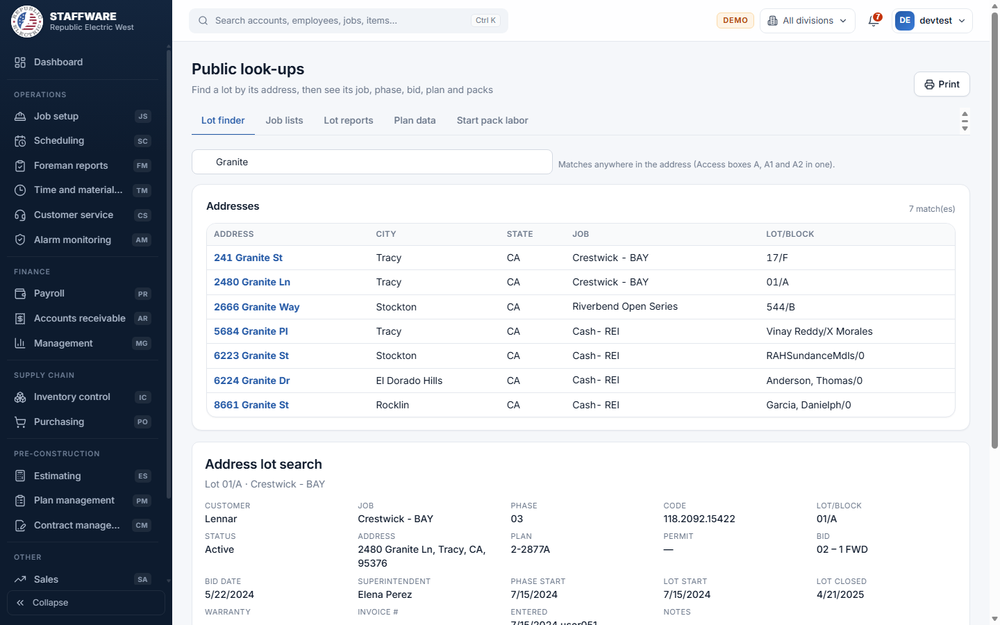
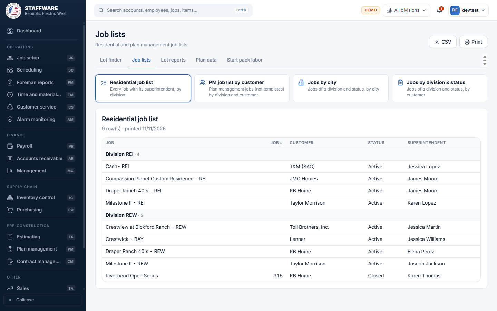

# Public (PU)
*Read-only look-ups and reports that every user can open: find a lot, list jobs, see plan material and start-pack labor.*

## 1. What this module is for
Public is the shared "quick answers" area. Anyone in the company can find a lot by its address, see which job, phase, bid, plan and packs it belongs to, print job lists, look at the standard and option material of a plan, and print the labor of a start pack. Nothing here is entered or changed: it only reads data kept by other modules.

Public is open to every user. It does not need a permission flag and no login is blocked from it.

## 2. How it connects to other modules
### Needs data from
| Module | What it uses | Why |
|---|---|---|
| Job setup | Customers, jobs, phases, lots, packs on lots, schedule stages of lots | Every lot and job look-up and list comes from here |
| Plan management | PM customers, jobs, bids (contracts), plans, packs and material | Plan data and start-pack labor are read from the plans |
| Inventory | Item descriptions and codes | Shows the material and labor item on plan and start-pack reports |
| Database maintenance (lists) | Status, division, schedule stage, superintendent, job type, pack type, stage, work type and phase type lists | Fill the drop-downs and the names on the reports |

### Feeds data to
None. Public only reads data and does not write anything to the database.

### Where it sits in the work flow
Public is used at any point, usually before or while working in another module: to confirm a lot's address and plan, to check which jobs are active, or to print the labor a crew will be paid for a lot. The data comes from Plan management (plans and packs) and Job setup (jobs and lots), so a look-up is only as complete as those modules.

## 3. Screens (tabs) in this module
| Screen / tab | What it is for | What you can do there |
|---|---|---|
| Lot finder (page title "Public look-ups") | Find a lot by address | Type part of an address or house number, click a match, see the "Address lot search" sheet, print it |
| Job lists | Four job lists | Residential job list, PM job list by customer, Jobs by city, Jobs by division & status |
| Lot reports | Two lot reports | Lot info search, Status search |
| Plan data | Plan material of a PM plan | Plan standard data, Plan option data |
| Start pack labor | Labor items of a start pack | Start pack labor - lot, Start pack labor - phase |

## 4. How the data entry forms work
There are no data entry forms in this module. Every screen only has filters (drop-downs and a search box) that decide what a report shows. The filters work like this:
- Pick-lists depend on each other. In the lot reports you pick a Job first, and only then does the Lot list fill with that job's lots (closed lots show their close date). Phase works the same way after Job.
- For plan data you pick PM customer, then PM job, then PM bid, then PM plan; each list stays empty until the one before it is chosen, and changing an earlier choice clears the later ones.
- A report only appears once all of its filters are chosen. Until then the page says "Complete the filters above".
- Nothing is saved when you use these screens, so there is nothing to cancel or confirm.

## 5. Reports
| Report | What it shows | Filters you choose first | Print / export |
|---|---|---|---|
| Address lot search (on Lot finder) | One lot: customer, job, phase, bid, superintendent, plan, permit, status, dates, warranty, invoice number, notes, and its packs | Type part of the address, then click the address | Print |
| Residential job list | Every job with customer, status and superintendent, grouped by division | None | Print, CSV |
| PM job list by customer | Plan management jobs (templates left out) by division and customer, with job type, spec level and status | None | Print, CSV |
| Jobs by city | Jobs of a division and status, grouped by city | Division, Status (can be "1-All status") | Print, CSV |
| Jobs by division & status | Jobs of a division and status, grouped by customer | Division, Status (can be "1-All status") | Print, CSV |
| Lot info search | Same lot sheet as the address search, chosen by job and lot | Job, Lot | Print, CSV |
| Status search | Lots of a division that have one status, grouped by customer, job and phase | Division, Status (one status, not "All") | Print, CSV |
| Plan standard data | Standard packs and their material for one PM plan | PM customer, PM job, PM bid, PM plan | Print, CSV |
| Plan option data | Option packs and their material for one PM plan | PM customer, PM job, PM bid, PM plan | Print, CSV |
| Start pack labor - lot | Labor items, quantities and prices of one lot at a schedule stage, with subtotal and total | Job, Lot, Schedule stage | Print, CSV |
| Start pack labor - phase | The same for every lot of a phase | Job, Phase, Schedule stage | Print, CSV |

## 6. Action buttons
None. The only buttons are Print and CSV (save the report as a spreadsheet file) on the reports, which do not change any data.

## 7. A typical day-to-day workflow
1. Open Public and type part of an address on Lot finder.
2. Click the right address to see the lot sheet: job, plan, bid, superintendent and packs. Print it if needed.
3. Open Job lists and choose the Residential job list to see active and closed jobs by division, or Jobs by city for one division.
4. Open Lot reports. Use Lot info search when you know the job and lot, or Status search to list every lot of a division with a given status.
5. Open Plan data, choose the PM customer, job, bid and plan, and view the standard or option material.
6. Open Start pack labor, choose the job and lot (or phase) and the schedule stage, and print the labor to hand to a foreman.
7. Use CSV to open any list in Excel.

## 8. Screenshots

## 9. Good to know
- Public never changes data. To correct a lot, plan or job, use Job setup or Plan management.
- The job lists leave out customers whose name starts with "Test", and the city and division lists also leave out jobs with "Test" in the name.
- "1-All status" means every real job status. The Status search needs one specific status.
- The address search needs the lot's phase to have a superintendent and a bid; if it does not, the sheet says nothing is found and you can use Lot info search instead, which does not require them.
- Lot status in the address search is the lot's own status; in Lot info search it is the job's status. This follows the two Access reports.
- Start pack labor shows only labor items (cost code L), only active material, and only packs whose total quantity on the lot is not zero. Stages hidden from start-pack labor in Plan management do not appear.
- If a job has more than one superintendent on its phases, the job lists show one of them.
