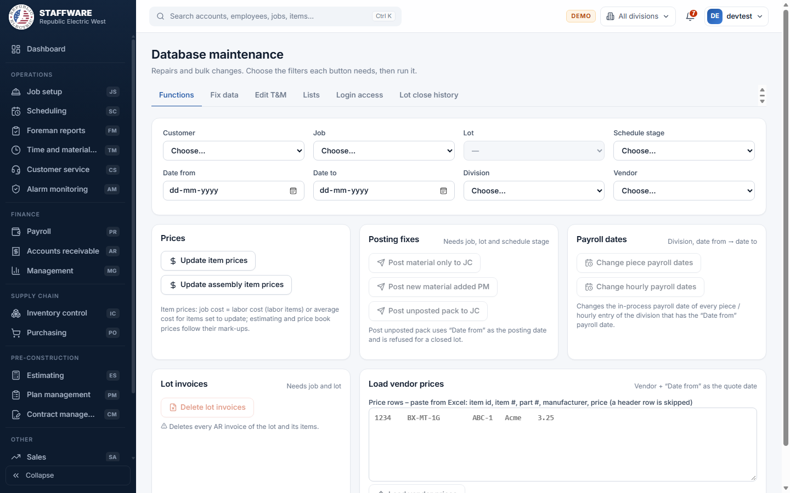
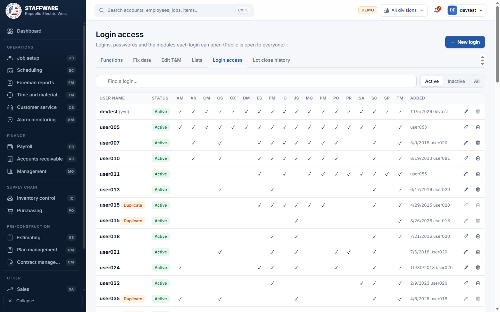
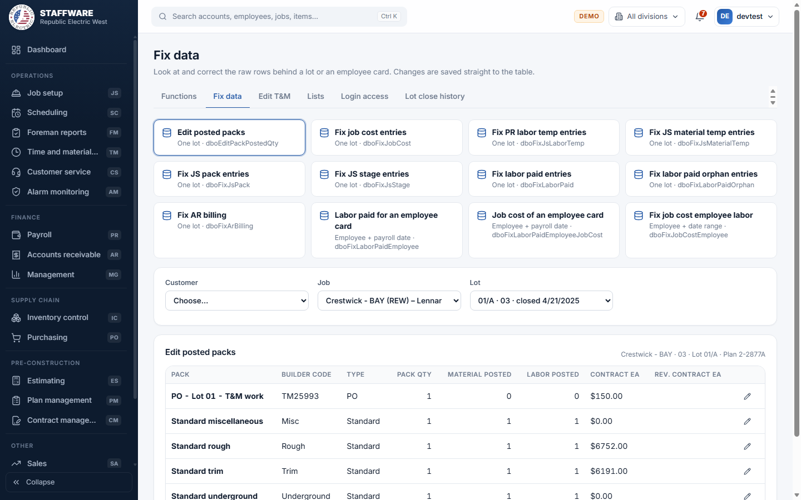
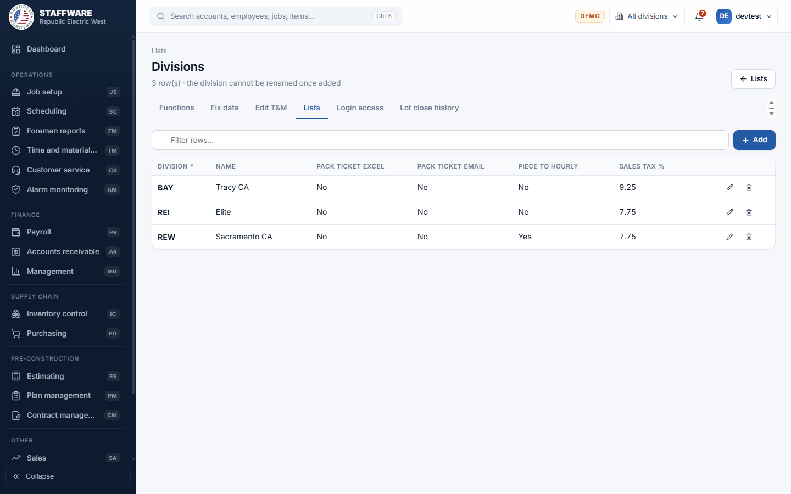

# Database maintenance (DM)
*Administrator tools: who can log in and what they can open, the pick-lists used everywhere, and repair and bulk-change functions.*

## 1. What this module is for
Database maintenance is where an administrator keeps the system tidy. It controls the logins and which modules each login may open, edits the lookup lists that fill the drop-downs in every other module (divisions, statuses, cost codes, vendors and more), and offers repair tools: update prices, post material to job cost, change payroll dates, load vendor prices, fix individual database rows, and edit a few fields that are normally locked.

Much of this module changes many records at once or changes records that other modules treat as final, so it is meant for a very small number of trusted people. Access is controlled per login (permission flag DM). A person cannot remove DM from their own login, deactivate it or delete it, so the last administrator cannot lock themselves out.

## 2. How it connects to other modules
### Needs data from
| Module | What it uses | Why |
|---|---|---|
| Job setup | Customers, jobs, lots, phases, packs, stages, contract values | To pick the lot and schedule stage that a repair works on, and to read what is already posted |
| Plan management | Packs, material, plans and values | Posting fixes compare a lot with the material defined in Plan management |
| Inventory | Items, vendors, vendor items | Price updates and vendor price loads work on these |
| Payroll | Employees and labor paid | To pick an employee card to repair |
| Time and material | T&M tickets | Edit T&M works on one ticket |
| Receivables | Invoices and invoice items | Delete lot invoices and Fix AR billing work on them |
| Cox cable | Cox items | The Cox items list is edited here too |

### Feeds data to
| Module | What it gives | When |
|---|---|---|
| Every module | The pick-lists (see the Lists screen) and the list of who may log in to which module | When a list or login is saved. Login changes apply within 30 seconds |
| Inventory | Re-calculated item prices; vendor prices and quote dates | When Update item prices or Load vendor prices is run |
| Estimating | Re-priced assembly material lines | When Update assembly item prices is run |
| Job setup and Job cost | Material posted to job cost for a lot and stage; stage and pack posted marks; material list lines added or cleared | When the posting fix buttons are run |
| Payroll | Changed payroll dates of in-process entries; corrected labor paid rows | When Change payroll dates or Fix data is used |
| Receivables | Deleted invoices of a lot; corrected invoice item rows | When Delete lot invoices or Fix AR billing is used |
| Time and material | Corrected type, approval and paid date of a T&M ticket | When Edit T&M is saved |

### Where it sits in the work flow
Database maintenance is not part of the daily flow. Lists are set up before a new division, vendor or cost code is used elsewhere. Logins are set up when a person joins or leaves. The repair functions are used after something went wrong in another module, for example a lot was not posted to job cost, an invoice was created on the wrong lot, or a payroll date has to move. Afterwards users go back to the module concerned to confirm the result.

## 3. Screens (tabs) in this module
| Screen / tab | What it is for | What you can do there |
|---|---|---|
| Functions | Bulk changes and posting fixes, with filters at the top | Update item prices, update assembly item prices, three posting fixes, change piece or hourly payroll dates, delete lot invoices, load vendor prices |
| Fix data | Raw rows behind a lot or an employee card | Choose a data set, then correct or delete single rows |
| Edit T&M | One T&M ticket | Change its type, approval and paid date |
| Lists | All lookup lists, grouped (Alarm monitoring, Billing, Cox cable, Customer service, General, Inventory, Jobs, Payroll, Time & material) | Open a list and add, change or delete rows |
| Login access | Logins and module permissions | Add a login, change its modules or password, mark it inactive, delete it |
| Lot close history | Every change of a lot's close (end) date | Filter, print, save as CSV |

## 4. How the data entry forms work
### Login access
- When you use it: when someone joins, changes role, forgets a password or leaves.
- Fields: User name (new logins only, no spaces, up to 50 characters), Password (new logins required; for existing logins "New password", left blank to keep the current one; 4 to 50 characters), Active (can log in), and one tick box for each module: Alarm monitoring, Billing (AR), Contracts, Customer service, Cox cable, Database maintenance, Estimating, Foreman, Inventory, Job setup, Management, Plan management, Purchasing, Payroll, Sales, Scheduling, Scheduling panel, Time & material. Public is open to everyone and has no box.
- Step by step: press New login, or the pencil on a row. Fill in, tick the modules, press Save. A message confirms the save and says changes apply within 30 seconds. The bin deletes after a confirmation. The list can be searched and filtered to Active, Inactive or All.
- What gets saved: the login and its permissions. They decide which modules appear in the left menu at the person's next sign-in.
- Safeguards: passwords are never shown anywhere, only typed in; the screen shows user names and tick marks only. A user name that already exists is refused. You cannot deactivate or delete your own login, or remove Database maintenance from it. If two logins share a name in the database they are tagged "Duplicate" and cannot be edited here until fixed. A login with no password is tagged "no password".

### List editor (Lists, then a list)
- When you use it: to add a division, status, vendor, cost code, Cox job type, and so on.
- Fields: shown as columns of the list. A column marked with a star is required. Some columns are pick-lists taken from another list (for example a company's division). Yes/No columns are tick boxes. Some lists (such as Divisions, Cost codes, Units of measure, Billing terms) use a code that you type yourself; it cannot be renamed once added.
- Step by step: open the list from the Lists screen, press Add, fill in the new row at the top and press Add; the pencil edits a row and the bin deletes it. The filter box narrows the rows. The three Customer service error lists (errors, categories, details) are linked: categories belong to an error and details to a category, and a filter above the table picks the parent.
- What gets saved: the row in that list. It appears at once in the drop-downs of the modules that use it.
- Safeguards: required fields are checked; a duplicate name (or name combination, such as city and state) is refused; a row that is still used by records elsewhere cannot be deleted, and the message says how many records use it and suggests marking it inactive instead.

### Edit T&M
- When you use it: to correct a T&M ticket after approval, for example a wrong type or a missing paid date.
- Fields: T&M # (pick-list of tickets). Shown but locked: date, customer number, name, customer, job, lot, who entered it, notes. Editable: T&M type (pick-list of T&M types), Approved by, Approved date, Paid date.
- Step by step: choose the T&M #, change the fields, press Save. "T&M saved" appears.
- What gets saved: those four fields on the ticket; they then show in Time and material.
- Safeguards: only those four fields can change; dates must be valid.

### Fix data
- When you use it: when a record is wrong and cannot be corrected in its own module.
- Fields: first choose a data set, then its filters. For lot data sets: Customer, Job and Lot (each list depends on the one before). For employee data sets: Employee and a payroll date (and, for the job cost employee data set, a date entered from and to).
- Data sets: Edit posted packs, Fix job cost entries, Fix PR labor temp entries, Fix JS material temp entries, Fix JS pack entries, Fix JS stage entries, Fix labor paid entries, Fix labor paid orphan entries, Fix AR billing, Labor paid for an employee card, Job cost of an employee card, Fix job cost employee labor.
- Step by step: pick the data set, choose the filters, press the pencil on a row, change the allowed columns, press Save ("Row saved"). The bin deletes a row after a confirmation. Edit posted packs shows each pack of the lot and only allows its posted material and labor quantities to change.
- What gets saved: the row is changed in the table itself, straight away. Only columns marked as editable (the others are greyed in the heading) can be changed, and at most the first 2,000 rows are shown.
- Safeguards: values are checked against the column type (whole numbers, dates). Deleting a row says it cannot be undone. There is no preview or undo, so use with care.

### Load vendor prices (Functions tab)
- When you use it: when a vendor sends a new price sheet.
- Fields: Vendor (pick-list), Date from (used as the quote date), and a box where you paste price rows from Excel: item id, item #, part #, manufacturer, price. A header row is skipped. A counter shows how many rows were read.
- Step by step: choose the vendor and quote date, paste the rows, press Load vendor prices.
- What gets saved: the vendor's existing price lines are updated and new items are added to the vendor, with the quote date.
- Safeguards: if any pasted item id and item number do not match the inventory item list, nothing is loaded and the mismatched rows are listed with the message that the price import was stopped. An item id listed twice is refused, and at most 5,000 rows are accepted. All or nothing.

## 5. Reports
| Report | What it shows | Filters you choose first | Print / export |
|---|---|---|---|
| Lot close history | For every lot, each change of its close date: action, previous and new close date, who changed it and when, grouped by customer, job and lot | A text filter for customer, job, lot or user | Print, CSV |
| Low estimating prices | After Update item prices: active items whose estimating price is below last, average or labor cost | None (shown on the Functions tab after the run) | On screen |

## 6. Action buttons
| Button | Where | What it does | What changes | Safeguards |
|---|---|---|---|---|
| Update item prices | Functions | Recalculates prices of all inventory items from cost and mark-ups | Job cost price (labor cost for labor items, otherwise average cost, for items set to update); estimating price from the job cost price and mark-up; the price book prices (VIP, residential PO, retail) from their mark-ups | Confirmation. All or nothing. Afterwards lists items priced below cost |
| Update assembly item prices | Functions | Re-prices every assembly material line from its item | Estimating price of assembly material lines (labor items use labor cost) | Confirmation |
| Post material only to JC | Functions | Posts the material of a lot at a schedule stage to job cost | Job cost lines "Production pack" added; the stage marked posted; every pack's posted quantity set to its pack quantity; contract values refreshed from Plan management | Needs job, lot and schedule stage. Confirmation. All or nothing |
| Post new material added PM | Functions | Adds material that was added in Plan management after the lot was posted | Material list lines "Material pack added late to PM" added for that lot and stage | Needs job, lot and schedule stage. Confirmation |
| Post unposted pack to JC | Functions | Posts the scheduled material list of a lot and stage to job cost | Job cost lines added using "Date from" as the posting date; the material list lines cleared | Needs lot, stage and date. Refused for a closed lot. Confirmation |
| Change piece payroll dates / Change hourly payroll dates | Functions | Moves in-process payroll entries from one date to another for a division | Payroll date of every in-process entry of that division having the "Date from" date | Needs division, Date from and Date to. Confirmation that names the division and dates |
| Delete lot invoices | Functions | Deletes every invoice of the chosen lot | All receivable invoices of the lot and their items are removed | Needs job and lot. The button is red and a confirmation warns it cannot be undone. All or nothing |
| Load vendor prices | Functions | See "Load vendor prices" above | Vendor prices | Match check, all or nothing |

## 7. A typical day-to-day workflow
1. New employee needing access: open Login access, press New login, enter user name and a password, tick the modules, Save.
2. When someone leaves, open Login access, find the login and either set it inactive or delete it.
3. A new vendor or cost code is needed: open Lists, open the list, press Add and fill the row.
4. A vendor sends a price sheet: on Functions choose the vendor and date, paste the rows and press Load vendor prices.
5. After prices change, press Update item prices and review the Low estimating prices list.
6. A lot was not posted to job cost: choose the job, lot and schedule stage on Functions and use the fitting Post button.
7. A payroll date must move: choose the division and the two dates and press Change piece payroll dates or Change hourly payroll dates.
8. A single wrong row: open Fix data, choose the data set and lot or employee, correct the row, Save.
9. Check Lot close history when someone asks who reopened or closed a lot.

## 8. Screenshots

## 9. Good to know
- Passwords are never displayed and can only be typed in. They are stored the way the old Access front end expects, because both programs read the same login table.
- The Fix data screens change database rows directly with no undo and no history other than the user and date columns shown on some rows. They replace the Access datasheets used for repairs.
- Lot close history is only as complete as the records the database keeps; it lists changes that have been recorded.
- "Transfer lot data" was never finished in Access (it only showed "This feature is not finished yet") and is not offered here.
- The Access price load used a temporary import table; the web version replaces it with pasting rows from Excel.
- In Access, "Post unposted pack to JC" read a date box that did not exist on the switchboard; here "Date from" is used.
- Lists: the web app shows only the lists on its approved list (more than 40) plus Login access. Other tables must still be changed in the database.
- Some lists (for example Divisions or Status) are used by many records, so deleting a used row is blocked. Mark rows inactive instead when the list has a status.
